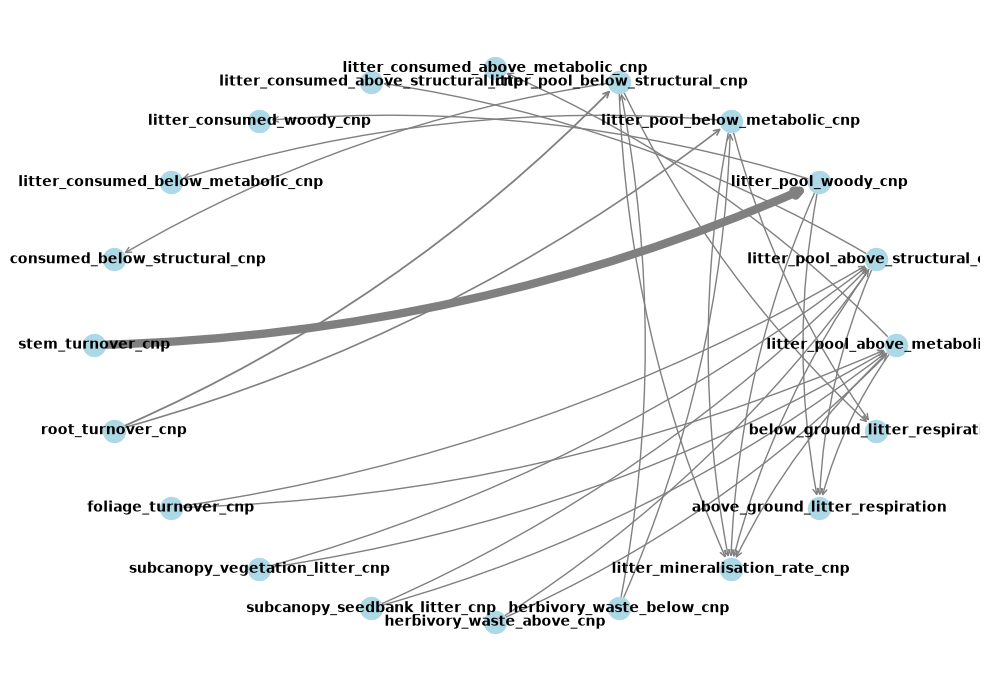
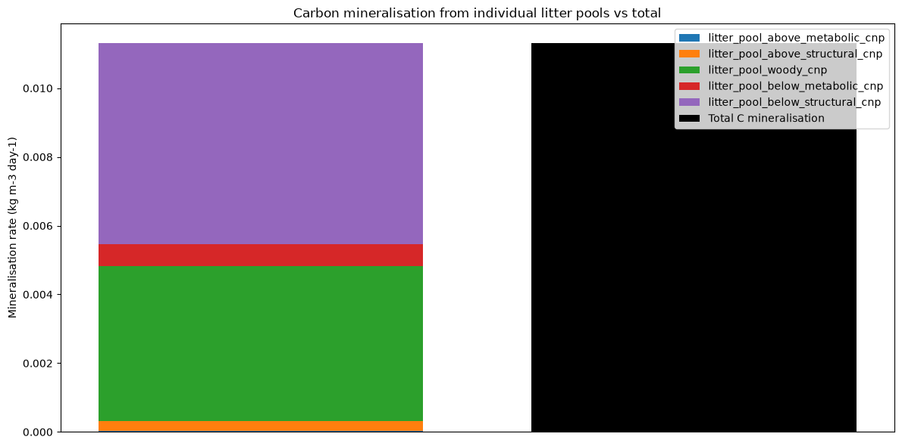

# Macronutrient cycling analysis

## Setup

First setup everything by doing the necessary imports and loading in the
simulation data and configuration.


```python
from pathlib import Path

import matplotlib.pyplot as plt
import numpy as np
from litter_analysis import generate_litter_network
from virtual_ecosystem.core.config_builder import (
    ConfigurationLoader,
    generate_configuration,
)
from virtual_ecosystem.core.core_components import CoreComponents
from virtual_ecosystem.core.model_config import CoreConfiguration
from virtual_ecosystem.models.litter.model_config import LitterConfiguration

# With the imports load in the simulation data/configuration. (As this report is
# an example of usage I'm just providing a local path)
data_dir = Path("/Users/jc2017/Desktop/litter_nutrient_cycling/maliau_2/out")

model_data_path = data_dir / "model_data.nc"

simulation_configuration = data_dir / "compiled_configuration.toml"

config_data = ConfigurationLoader(cfg_paths=simulation_configuration)
full_config = generate_configuration(config_data.data)
litter_config = full_config.get_subconfiguration("litter", LitterConfiguration)
core_config = full_config.get_subconfiguration("core", CoreConfiguration)
core_components = CoreComponents(config=core_config)
```

    [INFO] - config_builder - _collect_config_paths(427) - Config paths resolve to 1 files
    [INFO] - config_builder - _load_config_toml(450) - Config TOML loaded from /Users/jc2017/Desktop/litter_nutrient_cycling/maliau_2/out/compiled_configuration.toml
    [INFO] - config_builder - _compile_data(374) - Configuration data compiled.
    [INFO] - registry - _register_module(163) - Registering module: virtual_ecosystem.core
    [INFO] - registry - _register_module(176) - Configuration class registered for virtual_ecosystem.core
    [INFO] - registry - _register_module(163) - Registering module: virtual_ecosystem.models.abiotic_simple
    [INFO] - registry - _get_model(237) - Registering model class for virtual_ecosystem.models.abiotic_simple: AbioticSimpleModel
    [INFO] - registry - _register_module(176) - Configuration class registered for virtual_ecosystem.models.abiotic_simple
    [INFO] - registry - _register_module(163) - Registering module: virtual_ecosystem.models.hydrology
    [INFO] - registry - _get_model(237) - Registering model class for virtual_ecosystem.models.hydrology: HydrologyModel
    [INFO] - registry - _register_module(176) - Configuration class registered for virtual_ecosystem.models.hydrology
    [INFO] - registry - _register_module(163) - Registering module: virtual_ecosystem.models.animal
    [INFO] - registry - _get_model(237) - Registering model class for virtual_ecosystem.models.animal: AnimalModel
    [INFO] - registry - _register_module(176) - Configuration class registered for virtual_ecosystem.models.animal
    [INFO] - registry - _register_module(163) - Registering module: virtual_ecosystem.models.plants
    [INFO] - registry - _get_model(237) - Registering model class for virtual_ecosystem.models.plants: PlantsModel
    [INFO] - registry - _register_module(176) - Configuration class registered for virtual_ecosystem.models.plants
    [INFO] - registry - _register_module(163) - Registering module: virtual_ecosystem.models.soil
    [INFO] - registry - _get_model(237) - Registering model class for virtual_ecosystem.models.soil: SoilModel
    [INFO] - registry - _register_module(176) - Configuration class registered for virtual_ecosystem.models.soil
    [INFO] - registry - _register_module(163) - Registering module: virtual_ecosystem.models.litter
    [INFO] - registry - _get_model(237) - Registering model class for virtual_ecosystem.models.litter: LitterModel
    [INFO] - registry - _register_module(176) - Configuration class registered for virtual_ecosystem.models.litter
    [INFO] - config_builder - generate_configuration(629) - Configuration model built.
    [INFO] - config_builder - generate_configuration(642) - Configuration validated.
    [INFO] - grid - from_config(330) - Grid created from configuration.
    [INFO] - core_components - __post_init__(331) - Layer structure built from model configuration
    [INFO] - core_components - __post_init__(147) - Timing details built from model configuration: start - 2010-01-01, end - 2020-12-31T18:00:00, run length - 347133600 seconds


## Generate litter macronutrient cycles

Then call the function that generates the full litter model macronutrient cycles.


```python
litter_cycles = generate_litter_network(
    model_data_path=model_data_path,
    litter_config=litter_config,
    core_config=core_config,
)
```

    /Users/jc2017/Repositories/ve_data_science/analysis/macronutrient_cycling/litter_analysis.py:171: FutureWarning: In a future version of xarray the default value for compat will change from compat='no_conflicts' to compat='override'. This is likely to lead to different results when combining overlapping variables with the same name. To opt in to new defaults and get rid of these warnings now use `set_options(use_new_combine_kwarg_defaults=True) or set compat explicitly.
      initial_nodes = xr.merge([inputs[INPUT_POOLS], initial[FLOW_GENERATED_ON_INIT]])
    /Users/jc2017/Repositories/ve_data_science/analysis/macronutrient_cycling/litter_analysis.py:171: FutureWarning: In a future version of xarray the default value for compat will change from compat='no_conflicts' to compat='override'. This is likely to lead to different results when combining overlapping variables with the same name. To opt in to new defaults and get rid of these warnings now use `set_options(use_new_combine_kwarg_defaults=True) or set compat explicitly.
      initial_nodes = xr.merge([inputs[INPUT_POOLS], initial[FLOW_GENERATED_ON_INIT]])
    /Users/jc2017/Repositories/ve_data_science/.venv/lib/python3.14/site-packages/virtual_ecosystem/models/litter/inputs.py:402: RuntimeWarning: invalid value encountered in multiply
      lignin_proportion
    /Users/jc2017/Repositories/ve_data_science/.venv/lib/python3.14/site-packages/virtual_ecosystem/models/litter/inputs.py:402: RuntimeWarning: invalid value encountered in multiply
      lignin_proportion


## Visualise the macronutrient network

The plot shows carbon flows at the first simulated time step for grid index
`(y=1, x=1)`, using zero-based indices. The line width is proportional to flow
magnitude, with a minimum line size of 1. Arrows indicate the direction of the flow.
The overall plot isn't amazing, but you can see the expected links.


```python
import networkx as nx

# Create directed graph
G = nx.DiGraph()

# Select time and cell indices for which I want to plot the network
time_index = 1
x_index = 1
y_index = 1

# Extract nodes
nodes = [
    name for name, var in litter_cycles.data_vars.items()
    if var.attrs.get("category") == "node"
]

# Extract links
links = [
    name for name, var in litter_cycles.data_vars.items()
    if var.attrs.get("category") == "link"
]

# Add nodes
for node in nodes:
    G.add_node(node)

# Add links and their flow values
for link in links:
    source, target = link.split("_→_")

    if "element" in litter_cycles[link].dims:
        flow = litter_cycles[link].sel(time_index=time_index, element="C").isel(
            x=x_index,
            y=y_index
        ).values
    else:
        flow = litter_cycles[link].sel(time_index=time_index).isel(
            x=x_index,
            y=y_index
        ).values

    

    G.add_edge(source, target, flow=flow)

# Generate node positions
pos = nx.circular_layout(G)

# Draw network
fig, ax = plt.subplots(figsize=(10, 7))

# Nodes
nx.draw_networkx_nodes(
    G, pos,
    node_size=250,
    node_color="lightblue",
    ax=ax
)

# Node labels
nx.draw_networkx_labels(
    G, pos,
    font_size=10,
    font_weight="bold",
    ax=ax
)

# Get flow values
flows = [
    abs(d["flow"])
    for u, v, d in G.edges(data=True)
]

# Scale line widths (e.g. between 1 and 6)
max_flow = max(flows) if flows else 1

edge_widths = [
    1 + (5 * flow / max_flow)
    for flow in flows
]

# Draw edges
nx.draw_networkx_edges(
    G, pos,
    width=edge_widths,
    arrowstyle="->",
    arrowsize=10,
    edge_color="grey",
    connectionstyle="arc3,rad=0.1",
    ax=ax
)

ax.set_axis_off()
plt.tight_layout()
plt.show()
```


    

    


## Check litter-pool flow balance

While we could check a lot of different nodes the easiest thing to check is
whether the individual flows to the mineralisation correctly sum to the total
mineralisation flux.


```python
mineralisation_variables = [
    "litter_pool_above_metabolic_cnp_→_litter_mineralisation_rate_cnp",
    "litter_pool_above_structural_cnp_→_litter_mineralisation_rate_cnp",
    "litter_pool_woody_cnp_→_litter_mineralisation_rate_cnp",
    "litter_pool_below_metabolic_cnp_→_litter_mineralisation_rate_cnp", 
    "litter_pool_below_structural_cnp_→_litter_mineralisation_rate_cnp"
]

# Setup stacked bar chart for comparison
fig, ax = plt.subplots(figsize=(12, 6))

# Setup positioning of the bars
width = 0.75
x_0 = 1.0
x_1 = 2.0

bottom = 0

# Extract depth and update interval (in days), which are both needed for unit
# conversions
depth = core_config.constants.microbial_simulation_depth
update_time_days = core_components.model_timing.update_interval_quantity.to("days").magnitude

# extract a specific time and location for the snapshot
litter_snapshot = litter_cycles.sel(time_index=10).isel(y=0, x=0)

# Stack the five mineralisation variables (for corner plot and time step 10)
for var in mineralisation_variables:
    # Convert from kg m-2 units to kg m-3 day-1 units
    C_value = litter_snapshot[var].sel(element="C").values/(depth * update_time_days)

    ax.bar(
        x_0,
        C_value,
        width,
        bottom=bottom,
        label=var.split("_→_")[0]
    )

    bottom += C_value

# Add comparison bar
ax.bar(
    x_1,
    litter_snapshot["litter_mineralisation_rate_cnp"].sel(element="C").values,
    width,
    color='black',
    label="Total C mineralisation"
)

# Turn off x-ticks
ax.tick_params(
    axis="x",
    which='both',
    bottom=False,
    top=False,
    labelbottom=False
)

ax.set_ylabel('Mineralisation rate (kg m-3 day-1)')
ax.set_title('Carbon mineralisation from individual litter pools vs total')
ax.legend()

plt.tight_layout()
plt.show()
```


    

    


To test this isn't a fluke, I then check the litter mineralisation components for each element, for each time index and grid cell. (300 NaN values are expected as this sum is not defined for the first timestep).


```python
# Convert mineralisation components from kg m-2 units to kg m-3 day-1 units and sum
mineralisation_components = sum(
    litter_cycles[var]/(depth * update_time_days) for var in mineralisation_variables
)
reported_mineralisation = litter_cycles["litter_mineralisation_rate_cnp"]

# Find difference between the reported total and the components
residual = mineralisation_components - reported_mineralisation

atol = 1e-15

count = ((residual > atol) & np.isfinite(residual)).sum().item()
print("Total values:", residual.size)
print("Finite values:", np.isfinite(residual).sum().item())
print("NaNs:", np.isnan(residual).sum().item())
print("Infinite values:", np.isinf(residual).sum().item())
print("Bad finite values", count)
```

    Total values: 39900
    Finite values: 39600
    NaNs: 300
    Infinite values: 0
    Bad finite values 0

