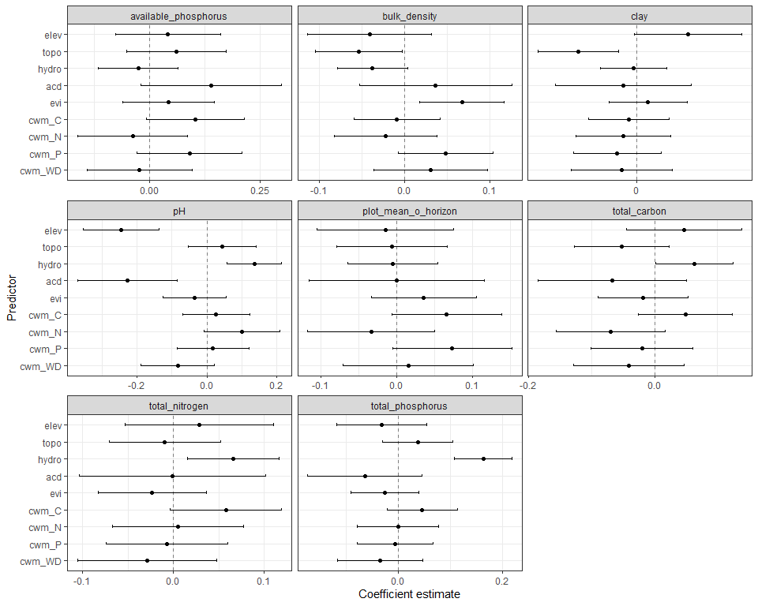

# Summarised findings from the SAFE soil spatial model

Lai, Hao Ran

This short report visualises two outputs from the spatial soil model
used to generate input data for the Maliau scenarios:

1. Effect size plots: the effect of each predictor on each response
   variable
2. Variance partitioning plot

## Fit the spatial model

    here::i_am("analysis/soil/initialisation/model_safe_varpart.qmd")

    here() starts at C:/Users/User/Documents/ve_data_science

    knitr::opts_knit$set(root.dir = here::here())

    library(tidyverse)

    Warning: package 'tidyverse' was built under R version 4.6.1

    Warning: package 'ggplot2' was built under R version 4.6.2

    Warning: package 'tibble' was built under R version 4.6.1

    Warning: package 'tidyr' was built under R version 4.6.1

    Warning: package 'readr' was built under R version 4.6.1

    Warning: package 'dplyr' was built under R version 4.6.1

    Warning: package 'stringr' was built under R version 4.6.1

    Warning: package 'forcats' was built under R version 4.6.1

    Warning: package 'lubridate' was built under R version 4.6.1

    ── Attaching core tidyverse packages ──────────────────────── tidyverse 2.0.0 ──
    ✔ dplyr     1.2.1     ✔ readr     2.2.0
    ✔ forcats   1.0.1     ✔ stringr   1.6.0
    ✔ ggplot2   4.0.4     ✔ tibble    3.3.1
    ✔ lubridate 1.9.5     ✔ tidyr     1.3.2
    ✔ purrr     1.2.2     
    ── Conflicts ────────────────────────────────────────── tidyverse_conflicts() ──
    ✖ dplyr::filter() masks stats::filter()
    ✖ dplyr::lag()    masks stats::lag()
    ℹ Use the conflicted package (<http://conflicted.r-lib.org/>) to force all conflicts to become errors

    library(viridis)

    Warning: package 'viridis' was built under R version 4.6.2

    Loading required package: viridisLite

    Warning: package 'viridisLite' was built under R version 4.6.1

    library(CBFM)

    Loading required package: TMB

    Warning: package 'TMB' was built under R version 4.6.2

    Attaching package: 'CBFM'

    The following objects are masked from 'package:stats':

        influence, nobs, simulate

    source("analysis/soil/initialisation/model_safe.R")

    Warning: package 'readxl' was built under R version 4.6.1

    Warning: package 'sf' was built under R version 4.6.1

    Linking to GEOS 3.14.1, GDAL 3.12.1, PROJ 9.7.1; sf_use_s2() is TRUE

    Warning: package 'terra' was built under R version 4.6.1

    terra 1.9.34

    Attaching package: 'terra'

    The following object is masked from 'package:tidyr':

        extract

    Warning: package 'autoFRK' was built under R version 4.6.1

    Loading required package: spam

    Warning: package 'spam' was built under R version 4.6.1

    Spam version 2.11-4 (2026-05-28) is loaded.
    Type 'help( Spam)' or 'demo( spam)' for a short introduction 
    and overview of this package.
    Help for individual functions is also obtained by adding the
    suffix '.spam' to the function name, e.g. 'help( chol.spam)'.

    Attaching package: 'spam'

    The following objects are masked from 'package:base':

        backsolve, forwardsolve

    Warning: package 'modelr' was built under R version 4.6.1

    Attaching package: 'modelr'

    The following object is masked from 'package:terra':

        resample

    Warning: [merge] 3 raster(s) that did not share the base geometry of the first
    raster were resampled

    |---------|---------|---------|---------|
    =========================================
                                              
    Reading layer `gazetteer' from data source 
      `C:\Users\User\Documents\ve_data_science\data\primary\site\gazetteer.geojson' 
      using driver `GeoJSON'
    Simple feature collection with 5171 features and 15 fields
    Geometry type: GEOMETRY
    Dimension:     XY
    Bounding box:  xmin: 116.9471 ymin: 4.41215 xmax: 117.9959 ymax: 4.961828
    Geodetic CRS:  WGS 84

    Warning: st_centroid assumes attributes are constant over geometries

    Compiling TMB C++ file...
    using C++ compiler: 'G__~1.EXE (GCC) 14.3.0'
    Calculating starting values...
    Commencing model fitting...
    Updating all coefficients and dispersion/power parameters (this includes running an inner EM algorithm if appropriate).
    Updating between response correlation (covariance) matrices, G.
    Updating covariance matrices for basis functions, Sigma, if required.
    Iteration: 0     Difference in parameter estimates (mean squared error): 0.20427
    Updating all coefficients and dispersion/power parameters (this includes running an inner EM algorithm if appropriate).
    Updating between response correlation (covariance) matrices, G.
    Updating covariance matrices for basis functions, Sigma, if required.
    Iteration: 1     Difference in parameter estimates (mean squared error): 3e-05
    Calculating (components of) the covariance (standard error) matrix...

## Model coefficients

    coef_df <-
      summary(fitcbfm, coverage = 0.95, digits = 15, ncores = 1)$summary_tables |>
      imap_dfr(
        ~ .x$parametric_coefs |>
          rownames_to_column("predictor") |>
          mutate(response = .y)
      ) |>
      mutate(predictor = factor(predictor, levels = rev(colnames(fitcbfm$betas))))

    coef_df |>
      filter(predictor != "(Intercept)") |>
      ggplot(aes(x = Estimate, y = predictor)) +
      geom_vline(xintercept = 0, linetype = "dashed", colour = "grey50") +
      geom_errorbar(aes(xmin = `Lower CI`, xmax = `Upper CI`), width = 0.15) +
      geom_point() +
      facet_wrap(~response, scales = "free_x", labeller = label_wrap_gen(20)) +
      scale_x_continuous(n.breaks = 3) +
      theme_bw() +
      labs(
        x = "Coefficient estimate",
        y = "Predictor"
      )

## Variance partitioning

For clarity, the model terms are grouped as intercept, topographic
predictors, LiDAR predictors, and canopy traits. Spatial basis terms are
included as a separate spatial residual component.

    var_part <- varpart(
      fitcbfm,
      groupX = c(1, rep(2, 3), rep(3, 2), rep(4, 4))
    )

    var_part_df <-
      with(var_part, rbind(varpart_X, varpart_B_space)) |>
      as.data.frame() |>
      rownames_to_column("predictor") |>
      mutate(
        predictor = recode_values(
          predictor,
          "Group1" ~ "Intercept",
          "Group2" ~ "Topographic",
          "Group3" ~ "LiDAR",
          "Group4" ~ "Canopy traits",
          "varpart_B_space" ~ "spatial_residual"
        )
      ) |>
      pivot_longer(
        cols = -predictor,
        names_to = "response",
        values_to = "p_variance"
      ) |>
      filter(predictor != "Intercept")

    predictor_order <-
      var_part_df |>
      group_by(predictor) |>
      summarise(median_variance = median(p_variance), .groups = "drop") |>
      arrange(median_variance) |>
      pull(predictor)

    var_part_df <-
      var_part_df |>
      mutate(predictor = factor(predictor, levels = predictor_order))

    ggplot(var_part_df, aes(y = response, x = p_variance, fill = predictor)) +
      geom_col(position = "stack") +
      scale_fill_viridis_d(option = "turbo") +
      theme_bw() +
      coord_cartesian(expand = FALSE) +
      labs(
        title = "Variance partitioning across soil response variables",
        x = "Proportion of variance explained",
        y = "Response variable",
        fill = "Predictor"
      ) +
      theme(legend.position = "bottom")

