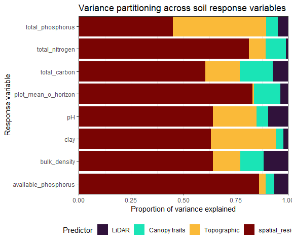

# Summarised findings from the SAFE soil spatial model

Lai, Hao Ran
2026-11-24

This short report visualises two outputs from the spatial soil model
used to generate input data for the Maliau scenarios:

1. Effect size plots: the effect of each predictor on each response
   variable
2. Variance partitioning plot

## Fit the spatial model

``` r
here::i_am("analysis/soil/initialisation/model_safe_varpart.qmd")
knitr::opts_knit$set(root.dir = here::here())
```

``` r
library(tidyverse)
library(viridis)
library(CBFM)

source("analysis/soil/initialisation/model_safe.R", echo = FALSE)
```

## Model coefficients

``` r
coef_df <-
  summary(fitcbfm, coverage = 0.95, digits = 15, ncores = 1)$summary_tables |>
  imap_dfr(
    ~ .x$parametric_coefs |>
      rownames_to_column("predictor") |>
      mutate(response = .y)
  ) |>
  mutate(predictor = factor(predictor, levels = rev(colnames(fitcbfm$betas))))

coef_df |>
  filter(predictor != "(Intercept)") |>
  ggplot(aes(x = Estimate, y = predictor)) +
  geom_vline(xintercept = 0, linetype = "dashed", colour = "grey50") +
  geom_errorbar(aes(xmin = `Lower CI`, xmax = `Upper CI`), width = 0.15) +
  geom_point() +
  facet_wrap(~response, scales = "free_x", labeller = label_wrap_gen(20)) +
  scale_x_continuous(n.breaks = 3) +
  theme_bw() +
  labs(
    x = "Coefficient estimate",
    y = "Predictor"
  )
```


## Variance partitioning

For clarity, the model terms are grouped as intercept, topographic
predictors, LiDAR predictors, and canopy traits. Spatial basis terms are
included as a separate spatial residual component.

``` r
var_part <- varpart(
  fitcbfm,
  groupX = c(1, rep(2, 3), rep(3, 2), rep(4, 4))
)

var_part_df <-
  with(var_part, rbind(varpart_X, varpart_B_space)) |>
  as.data.frame() |>
  rownames_to_column("predictor") |>
  mutate(
    predictor = recode_values(
      predictor,
      "Group1" ~ "Intercept",
      "Group2" ~ "Topographic",
      "Group3" ~ "LiDAR",
      "Group4" ~ "Canopy traits",
      "varpart_B_space" ~ "spatial_residual"
    )
  ) |>
  pivot_longer(
    cols = -predictor,
    names_to = "response",
    values_to = "p_variance"
  ) |>
  filter(predictor != "Intercept")

predictor_order <-
  var_part_df |>
  group_by(predictor) |>
  summarise(median_variance = median(p_variance), .groups = "drop") |>
  arrange(median_variance) |>
  pull(predictor)

var_part_df <-
  var_part_df |>
  mutate(predictor = factor(predictor, levels = predictor_order))

ggplot(var_part_df, aes(y = response, x = p_variance, fill = predictor)) +
  geom_col(position = "stack") +
  scale_fill_viridis_d(option = "turbo") +
  theme_bw() +
  coord_cartesian(expand = FALSE) +
  labs(
    title = "Variance partitioning across soil response variables",
    x = "Proportion of variance explained",
    y = "Response variable",
    fill = "Predictor"
  ) +
  theme(legend.position = "bottom")
```


