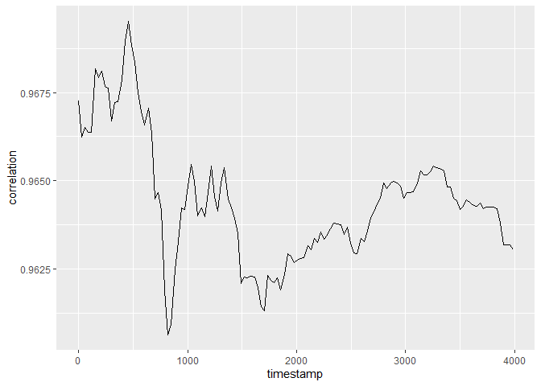

# Correlations between VE data variables over simulation time steps

Lai, Hao Ran
2026-11-10

## Is between-variable correlations stationary?

``` r
library(tidyverse)

here::i_am("analysis/soil/validation/reports/correlation_emergent.qmd")

correlations_path <- here::here(
  "data/derived/soil/validation/emergent/correlations.parquet"
)
```

Generate correlations only when the saved Parquet file is missing.
Delete the file before running this chunk to regenerate correlations.

``` r
if (!file.exists(correlations_path)) {
  source(here::here("tools/R/R/valdb_build.R"))
  source(here::here("tools/R/R/get_ve_variables.R"))
  source(here::here("tools/R/R/tidy_continuous_data.R"))

  data_vars <- names(build_data_variables_table(variables_derived = NULL))

  states <-
    tidy_continuous_data(
      here::here("data/scenarios/maliau/maliau_2/out/model_data.zarr"),
      variables = NULL,
      initial = TRUE
    ) |>
    filter(variable %in% data_vars) |>
    mutate(value = as.numeric(value)) |>
    unite(
      "full_name",
      variable,
      layers,
      pft,
      element,
      community_id,
      functional_group_id,
      groundwater_layers,
      na.rm = TRUE
    )

  correlations <-
    states |>
    group_by(timestamp) |>
    group_modify(\(.x, .y) {
      values <-
        .x |>
        select(cell_id, full_name, value) |>
        pivot_wider(names_from = full_name, values_from = value) |>
        select(-cell_id) |>
        as.matrix()

      correlation <- cor(
        values,
        method = "spearman",
        use = "pairwise.complete.obs"
      )
      pairwise_n <- crossprod(!is.na(values))

      as.data.frame(as.table(correlation)) |>
        as_tibble() |>
        rename(
          full_name_1 = Var1,
          full_name_2 = Var2,
          correlation = Freq
        ) |>
        mutate(n_cells = as.vector(pairwise_n)) |>
        # Keep one alphabetically ordered row per pair; drop self-correlations.
        filter(as.character(full_name_1) < as.character(full_name_2))
    }) |>
    ungroup()

  correlations |>
    filter(!is.na(correlation)) |>
    arrow::write_parquet(correlations_path)
}
```

Load saved correlations for plotting without repeating the calculation.

``` r
correlations <- arrow::read_parquet(correlations_path)

correlations |>
  filter(
    full_name_1 == "soil_cnp_pool_maom_C",
    full_name_2 == "soil_cnp_pool_maom_N"
  ) |>
  ggplot() +
  geom_line(aes(timestamp, correlation))
```


