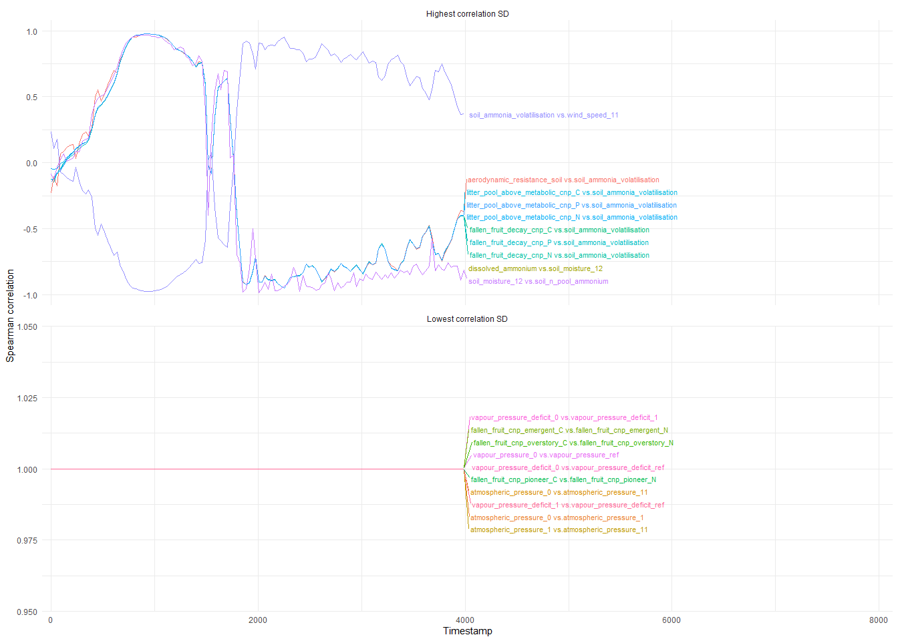
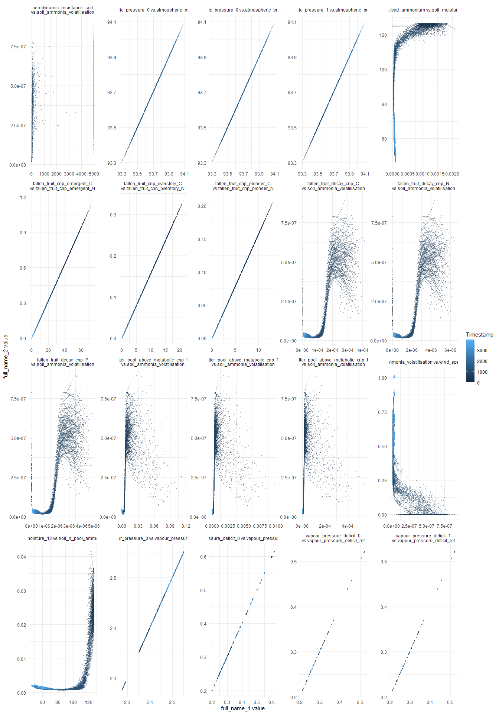

# Correlations between VE data variables over simulation time steps

Lai, Hao Ran
2026-11-11

``` r
library(tidyverse)
library(here)
library(arrow)
library(ggrepel)
```

I explored this topic to investigate the feasibility of pairwise
correlation between state variables as an emergent validation target
(inspired by Dietze’s *Ecological Forecasting*). Variable correlation
tells us about process coupling, joint responses and dimensionality of
ecosystem. The dimensionality aspect is something that I’ve been
pursuing for a while.

However, this quickly turned into an ugly exercise, mainly because a lot
of the state variables in VE are deterministic, placeholder or have
unresolved code. These led to quirky correlations due to near-static
variables and distinct spinup vs. post-spinup correlations. It’ll become
clearer if you read the figures below.

So I don’t think any of these will make it into the near-term validation
deliveries, but some findings may benefit long-term thinking.

NB: I will be printing VE settings and version at the *bottom* of
reports from now on.

## Is between-variable correlations stationary?

``` r
i_am("analysis/soil/validation/reports/correlation_emergent.qmd")
source(here("tools/R/R/summarise_ve_config.R"))
out_dir <- here("data/scenarios/maliau/maliau_2/out")
config_path <- file.path(out_dir, "compiled_configuration.toml")
log_path <- file.path(out_dir, "logfile.log")
if (!all(file.exists(c(config_path, log_path)))) {
  stop("The selected output directory must contain both run files.")
}
correlations_path <- here(
  "data/derived/soil/validation/emergent/correlations.parquet"
)
states_path <- here(
  "data/derived/soil/validation/emergent/states.parquet"
)
```

``` r
if (!file.exists(states_path)) {
  source(here("tools/R/R/valdb_build.R"))
  source(here("tools/R/R/get_ve_variables.R"))
  source(here("tools/R/R/tidy_continuous_data.R"))

  data_vars <- names(build_data_variables_table(variables_derived = NULL))

  states <-
    tidy_continuous_data(
      here("data/scenarios/maliau/maliau_2/out/model_data.zarr"),
      variables = NULL,
      initial = TRUE
    ) |>
    filter(variable %in% data_vars) |>
    mutate(value = as.numeric(value)) |>
    unite(
      "full_name",
      variable,
      layers,
      pft,
      element,
      community_id,
      functional_group_id,
      groundwater_layers,
      na.rm = TRUE
    )

  write_parquet(states, states_path)
}

states <- read_parquet(states_path)

if (!file.exists(correlations_path)) {
  # Calculate each time step separately to track changing correlations.
  correlations <-
    states |>
    group_by(timestamp) |>
    group_modify(\(.x, .y) {
      values <-
        .x |>
        select(cell_id, full_name, value) |>
        pivot_wider(names_from = full_name, values_from = value) |>
        select(-cell_id) |>
        as.matrix()

      correlation <- cor(
        values,
        method = "spearman",
        use = "pairwise.complete.obs"
      )
      # Pairwise sample sizes vary when different variables have missing cells.
      pairwise_n <- crossprod(!is.na(values))

      as.data.frame(as.table(correlation)) |>
        as_tibble() |>
        rename(
          full_name_1 = Var1,
          full_name_2 = Var2,
          correlation = Freq
        ) |>
        mutate(n_cells = as.vector(pairwise_n)) |>
        # Keep one alphabetically ordered row per pair; drop self-correlations.
        filter(as.character(full_name_1) < as.character(full_name_2))
    }) |>
    ungroup()

  correlations |>
    filter(!is.na(correlation)) |>
    write_parquet(correlations_path)
}

correlations <- read_parquet(correlations_path)
```

``` r
corr_sd <-
  correlations |>
  summarise(corr_sd = sd(correlation), .by = c(full_name_1, full_name_2))

corr_sd_top_bottom <-
  bind_rows(
    slice_max(corr_sd, order_by = corr_sd, n = 10, with_ties = FALSE) |>
      mutate(panel = "Highest correlation SD"),
    slice_min(corr_sd, order_by = corr_sd, n = 10, with_ties = FALSE) |>
      mutate(panel = "Lowest correlation SD")
  )
```

``` r
correlation_series <-
  correlations |>
  inner_join(
    corr_sd_top_bottom |> select(full_name_1, full_name_2, panel),
    by = c("full_name_1", "full_name_2")
  ) |>
  mutate(pair = paste(full_name_1, full_name_2, sep = " vs."))

correlation_labels <-
  correlation_series |>
  slice_max(timestamp, n = 1, with_ties = FALSE, by = c(panel, pair))

correlation_series |>
  ggplot(aes(timestamp, correlation, colour = pair)) +
  geom_line() +
  geom_text_repel(
    data = correlation_labels,
    aes(label = pair),
    direction = "y",
    hjust = 0,
    nudge_x = diff(range(correlation_series$timestamp)) * 0.02,
    max.overlaps = Inf,
    seed = 1,
    size = 3
  ) +
  facet_wrap(~panel, ncol = 1, scales = "free_y") +
  scale_x_continuous(expand = expansion(mult = c(0.02, 1))) +
  labs(x = "Timestamp", y = "Spearman correlation") +
  theme_minimal() +
  theme(legend.position = "none")
```



``` r
phase_data <-
  correlation_series |>
  distinct(full_name_1, full_name_2, pair) |>
  inner_join(
    states |>
      select(timestamp, cell_id, full_name, value) |>
      rename(full_name_1 = full_name, value_1 = value),
    by = "full_name_1"
  ) |>
  inner_join(
    states |>
      select(timestamp, cell_id, full_name, value) |>
      rename(full_name_2 = full_name, value_2 = value),
    by = c("full_name_2", "timestamp", "cell_id")
  )

phase_data |>
  ggplot(aes(value_1, value_2, colour = timestamp)) +
  geom_point(alpha = 0.3, size = 0.5) +
  facet_wrap(
    ~pair,
    ncol = 5,
    scales = "free",
    labeller = label_wrap_gen(width = 55)
  ) +
  labs(x = "full_name_1 value", y = "full_name_2 value", colour = "Timestamp") +
  theme_minimal()
```



## Virtual Ecosystem configuration

- **VE version**: v0.2.3
- **Models**: AbioticSimple, Hydrology, Animal, Plants, Soil, Litter
- **Grid**: 10 x 10 cells
- **Resolution**: 100 m
- **Extent (bbox)**: xmin: 495559.3 ymin: 524298.8 xmax: 496559.3 ymax:
  525298.8
- **Time period**: start 2010-01-01, length 11 years, update interval 1
  month
- **Input files**:
  - `era5_maliau_10x10_2010_2020.nc`
  - `elevation_maliau_10x10.nc`
  - `plant_input_data_maliau_2.nc`
  - `soil_maliau.nc`
  - `litter_maliau.nc`
  - `animal_functional_groups_Maliau_level3.csv`
  - `plant_pft_definitions_maliau_2.csv`
  - `cohort_data_1_cm_maliau_2.csv`
