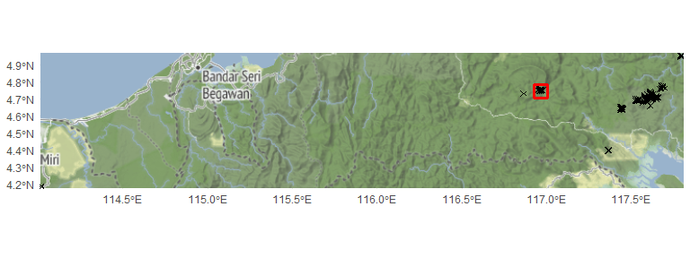
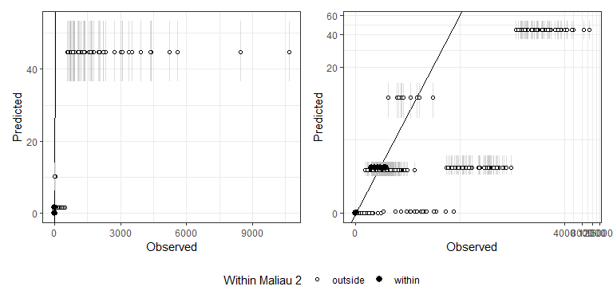

# Soil–Litter validation progress report

Lai, Hao Ran
2026-10-16

## Progress over the past few months

- Built a validation database pipeline, see docs
  [here](https://github.com/ImperialCollegeLondon/ve_data_science/blob/main/docs/validation_database.md).
- Screened, add and harmonise datasets using the database functions.
- I did not limit datasets to only Maliau or old growth. I included SAFE
  and disturbed forests since we are going to need them in future
  scenarios. The database has spatial coordinates to filter what we need
  (can be combined with all sorts of GIS layer, including SAFE layers).
- Most effort went into harmonisation, including units and derived
  variables.

``` r
library(knitr)
library(tidyverse)
library(patchwork)
library(arrow)
library(sf)
library(toml)
library(here)
library(yardstick)
source(here("tools/R/R/valdb.R"))
source(here("tools/R/R/summarise_ve_config.R"))

# Read the validation database
val_db_combined <-
  open_dataset(here("data/derived/soil/validation/database_combined")) |>
  collect()
```

## Simulation settings

``` r
out_dir <- here("data/scenarios/maliau/maliau_2/out")
invisible(summarise_ve_config(
  file.path(out_dir, "compiled_configuration.toml"),
  file.path(out_dir, "logfile.log")
))
```

- **VE version**: v0.2.3
- **Models**: AbioticSimple, Hydrology, Animal, Plants, Soil, Litter
- **Grid**: 10 x 10 cells
- **Resolution**: 100 m
- **Extent (bbox)**: xmin: 495559.3 ymin: 524298.8 xmax: 496559.3 ymax:
  525298.8
- **Time period**: start 2010-01-01, length 11 years, update interval 1
  month
- **Input files**:
  - `era5_maliau_10x10_2010_2020.nc`
  - `elevation_maliau_10x10.nc`
  - `plant_input_data_maliau_2.nc`
  - `soil_maliau.nc`
  - `litter_maliau.nc`
  - `animal_functional_groups_Maliau_level3.csv`
  - `plant_pft_definitions_maliau_2.csv`
  - `cohort_data_1_cm_maliau_2.csv`

## Datasets included

``` r
screened <- list_screening_records(here("data/derived/soil/validation/sources"))
n_screened <- length(screened)
n_excluded <- sum(map_lgl(screened, ~ .x$screening$decision == "exclude"))
n_deferred <- sum(map_lgl(screened, ~ .x$screening$decision == "defer"))
n_datasets <- length(unique(val_db_combined$dataset))
n_data <- nrow(val_db_combined)
screened_summary <- screened |>
  map_dfr(
    \(x) {
      tibble(
        decision = x$screening$decision,
        reason = x$screening$reason,
        notes = x$screening$notes %||% ""
      )
    }
  )

n_excluded_no_relevant_variables <- sum(
  screened_summary$decision == "exclude" &
    screened_summary$reason == "no_relevant_variables"
)
n_excluded_insufficient_metadata <- sum(
  screened_summary$decision == "exclude" &
    screened_summary$reason == "insufficient_metadata"
)
n_excluded_duplicate_source <- sum(
  screened_summary$decision == "exclude" &
    screened_summary$reason == "duplicate_source"
)
n_excluded_not_relevant <- sum(
  screened_summary$decision == "exclude" &
    screened_summary$reason == "other"
)

n_deferred_outside_module_scope <- sum(
  screened_summary$decision == "defer" &
    screened_summary$reason == "outside_module_scope"
)
n_deferred_needs_second_opinion <- sum(
  screened_summary$decision == "defer" &
    screened_summary$reason == "needs_second_opinion"
)

n_screened_not_in_db <- n_screened - n_datasets
p_within_temporal <- val_db_combined$temporal_join_class |>
  table() |>
  proportions() |>
  pluck("within")
p_within_spatial <- val_db_combined$spatial_join_class |>
  table() |>
  proportions() |>
  pluck("within")
```

I screened a total of 103 datasets or literature, and obtained 10 that
can be included into the validation database. The included datasets
contained a total of 3750 data points. 100% of data points fall within
the simulation’s temporal range, but only 0.3% fall within the spatial
extent of Maliau 2.

## Where datasets come from

``` r
# draw the map
unique_locations <-
  val_db_combined |>
  distinct(longitude, latitude) |>
  filter(!is.na(longitude), !is.na(latitude)) |>
  st_as_sf(coords = c("longitude", "latitude"), crs = 4326)

maliau_2_bbox <- toml::read_toml(here(
  "data/derived/site/maliau/maliau_grid_definition.toml"
)) |>
  purrr::pluck("Scenario", "maliau_2", "wgs84_bounds") |>
  unlist() |>
  (\(x) c(xmin = x[1], ymin = x[2], xmax = x[3], ymax = x[4]))()

maliau_2_polygon <-
  st_as_sfc(st_bbox(maliau_2_bbox, crs = st_crs(4326))) |>
  st_as_sf() |>
  mutate(name = "Maliau 2")

# Use the full data extent to set the map boundaries, while keeping the site
# marker visible as a point-like symbol rather than a real-scale box.
raw_bbox <- st_bbox(
  st_union(
    st_geometry(unique_locations),
    st_geometry(maliau_2_polygon)
  )
)

all_map_bbox <- raw_bbox |>
  st_as_sfc() |>
  st_buffer(
    dist = 0.1 *
      max(
        diff(unname(raw_bbox[c("xmin", "xmax")])),
        diff(unname(raw_bbox[c("ymin", "ymax")]))
      )
  ) |>
  st_bbox(crs = st_crs(4326))

maliau_2_point <- st_point(c(
  mean(c(maliau_2_bbox["xmin"], maliau_2_bbox["xmax"])),
  mean(c(maliau_2_bbox["ymin"], maliau_2_bbox["ymax"]))
)) |>
  st_sfc(crs = 4326) |>
  st_as_sf()

ggmap::register_stadiamaps(key = Sys.getenv("STADIA_API_KEY"), write = FALSE)
basemap <- ggmap::get_stadiamap(
  as.numeric(all_map_bbox),
  zoom = 8,
  maptype = "stamen_terrain"
)

ggmap::ggmap(basemap) +
  geom_sf(
    data = unique_locations,
    pch = 4,
    size = 2,
    inherit.aes = FALSE
  ) +
  geom_sf(
    data = maliau_2_point,
    color = "red",
    size = 4,
    shape = 0,
    stroke = 2,
    fill = NA,
    inherit.aes = FALSE
  ) +
  theme_minimal() +
  theme(axis.title = element_blank())
```



Validation data locations relative to the Maliau 2 scenario site. The
Maliau 2 indicator is shown as a square marker greatly exaggerated and
is not to scale.

## Why many screened datasets are excluded / deferred

The remaining 93 are split into **57 excluded** and **35 deferred** due
to technical or scope reasons documented in the YAML `notes` field.

| Group | Reason | No. datasets | Descriptions |
| ---- | ---- | ---: | ---- |
| Excluded | No relevant variables | 45 | No soil or litter measurements match validation targets. Examples include taxonomic records without quantitative data, compositional data without C/N values, and measurements that cannot be converted to the needed pool or mass terms. |
| Excluded | Insufficient metadata | 2 | e.g., Litter biomass is present, but the record lacks enough context to derive a carbon pool. |
| Excluded | Duplicate source | 10 | The same data already used for input data. |
| Deferred | Outside module scope | 31 | Useful in principle, but the currently VE does not yet output them; or they belong to other modules, not soil / litter. Examples include soil temperature and moisture (abiotic), microbial diversity, and plant tissue nutrient data that need mass-per-area conversion. |
| Deferred | Needs second opinion | 4 | Needs a scope call or curation choice before inclusion; some belong to other modules. Examples include termite functional groups, deadwood conversion, litter biomass-to-carbon conversion, plant tissue nutrient upscaling, and system-level variables such as NPP or carbon balance. |

## Validation variables summary

In the final database, the empirical data that map to VE outputs are:

``` r
val_db_combined |>
  group_by(var_canonical, unit_canonical) |>
  summarise(
    n_obs = n(),
    min_val = min(value_canonical, na.rm = TRUE),
    max_val = max(value_canonical, na.rm = TRUE),
    # Span uses positive values only, since zeros have no log
    oom_span = log10(max_val / min(value_canonical[value_canonical > 0])),
    .groups = "drop"
  ) |>
  arrange(desc(n_obs)) |>
  mutate(oom_span = round(oom_span, 1)) |>
  select(
    Variable = var_canonical,
    N = n_obs,
    Unit = unit_canonical,
    Min = min_val,
    Max = max_val,
    `Orders of magnitude` = oom_span
  ) |>
  kable()
```

| Variable | N | Unit | Min | Max | Orders of magnitude |
| :--- | ---: | :--- | ---: | ---: | ---: |
| soil_respiration_CO2_mass | 974 | kg m-2 day-1 | -0.0097649 | 1.805760e-02 | 2.7 |
| soil_nitrous_oxide_emission_N2O_mass | 973 | kg m-2 day-1 | -0.0000038 | 4.300000e-05 | 4.3 |
| total_soil_n_per_volume | 353 | kg m^-3 | 0.4771187 | 4.819000e+02 | 3.0 |
| soil_n_pool_ammonium_per_mass | 302 | kg kg^-1 | 0.0000000 | 4.584000e-04 | 5.1 |
| soil_n_pool_nitrate_per_mass | 302 | kg kg^-1 | 0.0000000 | 2.480000e-05 | 3.9 |
| soil_p_pool_labile_per_mass | 300 | kg kg^-1 | 0.0000017 | 3.290000e-05 | 1.3 |
| dissolved_phosphorus | 297 | kg m^-3 | 0.0009088 | 4.888383e-01 | 2.7 |
| total_soil_c_per_mass | 67 | kg kg^-1 | 0.0034059 | 4.764000e+01 | 4.1 |
| total_soil_n_per_mass | 67 | kg kg^-1 | 0.0002437 | 1.770000e+00 | 3.9 |
| total_soil_c_per_volume | 56 | kg m^-3 | 584.2000000 | 1.065060e+04 | 1.3 |
| total_soil_p_per_mass | 20 | kg kg^-1 | 0.0000064 | 8.912000e-04 | 2.1 |
| soil_respiration_CO2_molar | 14 | mol m-2 day-1 | 0.2090970 | 5.262030e-01 | 0.4 |
| soil_respiration | 11 | kg m-2 day-1 | 0.0028283 | 4.085000e-03 | 0.2 |
| total_soil_c_per_area | 11 | kg m^-2 | 2.6540000 | 2.052900e+01 | 0.9 |
| soil_n_pool_inorganic_per_area | 3 | kg m^-2 | 0.0003300 | 1.930000e-03 | 0.8 |

\*Orders of magnitude = $\log_{10}$(max / smallest positive value);
zeros are ignored.

## Model performance

### Visual comparison

Now the actual validation itself.

Plotting the predicted vs. observed: original scale and log–log scale.
(Actually it’s `log1p` or $\log(1+x)$ for accommodate for zeros.)

``` r
# Factor order sets draw order after arrange(): "within" plotted last (on top)
val_db_plot <-
  val_db_combined |>
  mutate(
    spatial_join_class = factor(spatial_join_class, c("outside", "within"))
  ) |>
  arrange(spatial_join_class)

p1 <- ggplot(val_db_plot) +
  geom_abline(slope = 1) +
  # geom_function(fun = \(x) x) +
  # geom_function(fun = \(x) 10 * x, linetype = "dashed") +
  # geom_function(fun = \(x) x / 10, linetype = "dashed") +
  geom_errorbar(
    aes(
      x = value_canonical,
      ymin = value_VE_q05,
      ymax = value_VE_q95
    ),
    colour = "grey",
    alpha = 0.5
  ) +
  geom_point(
    aes(
      value_canonical,
      value_VE_q50,
      fill = spatial_join_class,
      size = spatial_join_class
    ),
    shape = 21,
    colour = "black"
  ) +
  scale_fill_manual(values = c(within = "black", outside = "white")) +
  scale_size_manual(values = c(within = 2.5, outside = 1.5)) +
  labs(
    x = "Observed",
    y = "Predicted",
    fill = "Within Maliau 2",
    size = "Within Maliau 2"
  ) +
  theme_bw()

p2 <- p1 +
  scale_x_continuous(trans = scales::log1p_trans()) +
  scale_y_continuous(trans = scales::log1p_trans())

patchwork::wrap_plots(p1, p2, guides = "collect") &
  theme(legend.position = "bottom")
```



### Performance metrics

Most raw-scale metrics are not good for cross-variable comparison
because units and scales are not comparable. Our variables rarely
conform to a Normal distribution:

- Contains zeros
- Right skewed due to positive boundedness
- Vary widely in scale and unit of measurement
- *Rare but it happens*: some variable’s values are always the same (due
  to limited spatiotemporal range or the way they aggregate/marginalise
  outputs to match empirical data); these constant data cannot use some
  variance-based metrics such as $R^2$

`rmse_relative()` is the main cross-variable metric here because it is
unitless (with its own caveats). As a skew-robust sensitivity check, we
also compute `mae()`, `rmse()` and `ccc()` after a `log1p()` transform.

``` r
raw_scale_metrics <- metric_set(rmse_relative)
log_scale_metrics <- metric_set(mae, rmse, ccc)

raw_results <- val_db_combined |>
  group_by(var_canonical) |>
  raw_scale_metrics(truth = value_canonical, estimate = value_VE_q50) |>
  mutate(scale = "raw")

log_results <- val_db_combined |>
  mutate(
    value_canonical = log1p(value_canonical),
    value_VE_q50 = log1p(value_VE_q50)
  ) |>
  group_by(var_canonical) |>
  log_scale_metrics(truth = value_canonical, estimate = value_VE_q50) |>
  mutate(scale = "log1p")

metrics_table <- bind_rows(raw_results, log_results) |>
  select(-`.estimator`, -scale) |>
  pivot_wider(
    names_from = `.metric`,
    values_from = `.estimate`
  )

metrics_table |>
  mutate(
    rmse_relative = sprintf("%.2f%%", rmse_relative * 100),
    mae = sprintf("%.3g", mae),
    rmse = sprintf("%.3g", rmse),
    ccc = sprintf("%.3g", ccc)
  ) |>
  kable()
```

| var_canonical | rmse_relative | mae | rmse | ccc |
| :--- | :--- | :--- | :--- | :--- |
| dissolved_phosphorus | 7.57% | 0.0119 | 0.0321 | -2.71e-08 |
| soil_n_pool_ammonium_per_mass | 8.56% | 8.33e-06 | 3.92e-05 | 8.72e-05 |
| soil_n_pool_inorganic_per_area | 64.36% | 0.00079 | 0.00103 | 0 |
| soil_n_pool_nitrate_per_mass | 13.92% | 2.13e-06 | 3.45e-06 | -0.0204 |
| soil_nitrous_oxide_emission_N2O_mass | 8.56% | 2.51e-06 | 4e-06 | -4.38e-05 |
| soil_p_pool_labile_per_mass | 13.01% | 2.88e-06 | 4.06e-06 | 0 |
| soil_respiration | 293.88% | 0.00367 | 0.00369 | 0 |
| soil_respiration_CO2_mass | 13.95% | 0.00316 | 0.00387 | -3.16e-05 |
| soil_respiration_CO2_molar | 136.51% | 0.345 | 0.355 | -2.35e-37 |
| total_soil_c_per_area | 30.70% | 0.534 | 0.611 | 0 |
| total_soil_c_per_mass | 19.84% | 0.747 | 1.37 | -0.00138 |
| total_soil_c_per_volume | 27.81% | 3.55 | 3.62 | 0 |
| total_soil_n_per_mass | 24.65% | 0.153 | 0.301 | -3.23e-05 |
| total_soil_n_per_volume | 14.99% | 0.908 | 1.62 | 0.0169 |
| total_soil_p_per_mass | 23.17% | 0.000152 | 0.000205 | 0 |

Metrics split by `spatial_join_class`, for variables with both “within”
and “outside” observations only:

``` r
vars_with_both <- val_db_combined |>
  distinct(var_canonical, spatial_join_class) |>
  count(var_canonical) |>
  filter(n == 2) |>
  pull(var_canonical)

val_db_both <- val_db_combined |>
  filter(var_canonical %in% vars_with_both)

raw_results_class <- val_db_both |>
  group_by(var_canonical, spatial_join_class) |>
  raw_scale_metrics(truth = value_canonical, estimate = value_VE_q50)

log_results_class <- val_db_both |>
  mutate(
    value_canonical = log1p(value_canonical),
    value_VE_q50 = log1p(value_VE_q50)
  ) |>
  group_by(var_canonical, spatial_join_class) |>
  log_scale_metrics(truth = value_canonical, estimate = value_VE_q50)

bind_rows(raw_results_class, log_results_class) |>
  select(-`.estimator`) |>
  pivot_wider(names_from = `.metric`, values_from = `.estimate`) |>
  mutate(
    rmse_relative = sprintf("%.2f%%", rmse_relative * 100),
    mae = sprintf("%.3g", mae),
    rmse = sprintf("%.3g", rmse),
    ccc = sprintf("%.3g", ccc)
  ) |>
  kable()
```

| var_canonical | spatial_join_class | rmse_relative | mae | rmse | ccc |
| :--- | :--- | :--- | :--- | :--- | :--- |
| dissolved_phosphorus | outside | 7.64% | 0.0121 | 0.0325 | 0 |
| dissolved_phosphorus | within | 149.64% | 0.00443 | 0.00456 | 0 |
| total_soil_n_per_volume | outside | 15.12% | 0.92 | 1.63 | 0.0174 |
| total_soil_n_per_volume | within | 35.74% | 0.176 | 0.203 | 5.73e-31 |

**Summary by metric:**

| Metric | Best | Worst |
| :--- | :--- | :--- |
| rmse_relative | dissolved_phosphorus (0.0757) | soil_respiration (2.94) |
| mae | soil_n_pool_nitrate_per_mass (2.13e-06) | total_soil_c_per_volume (3.55) |
| rmse | soil_n_pool_nitrate_per_mass (3.45e-06) | total_soil_c_per_volume (3.62) |
| ccc | total_soil_n_per_volume (0.0169) | soil_n_pool_nitrate_per_mass (-0.0204) |

Best and worst performers by metric

## Thoughts

- If we need more validation data, we could split the datasets used for
  input data into training and testing sets (reminder from Jacob).
- ph
