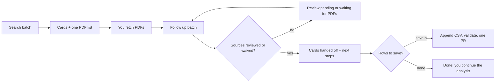

# AI-assisted parameterisation

The `ve-constant-search` skill narrows the literature for Virtual Ecosystem (VE)
configuration constants to a short, verified reading set per constant, then
hands the next steps to you. It produces **proposals for human review**, not
validated parameters or automatic changes to VE. A model default or an abstract
alone is not evidence for a new value. Analyses that need your time, such as
re-fitting, digitising, pooling or deciding on proxies, are handed off rather
than done by the agent.

## How a batch works

Work in batches of a few issues so each step needs your attention only once:

1. **Search.** Ask, for example, "Use ve-constant-search on #309 and #308".
   The agent searches, reads open-access papers and updates one card per
   issue. It ends with one list of paywalled PDFs for the whole batch, posted
   on the umbrella issue (for soil microbes, #215).
2. **Fetch.** Download those PDFs in one sitting into a private folder outside
   Git (or upload them to the session). No renaming or hand-written manifest is
   needed.
3. **Follow up.** Tell the agent "PDFs ready in `<folder>`". It reads them,
   updates the cards and umbrella readiness index, and gives you the next
   steps per issue. If any values are reported directly, it lists them as
   numbered rows; reply "save 1, 3" or "save none".

Each issue card is a single comment, edited in place. Its status matrix shows
every constant and group as `value`, `analysis` (you need to judge or analyse
something), `review pending`, `waiting PDF`, `gap`, `gap (no access)` or
`n/a`. `review pending` means a PDF was received but not yet assessed, not
that it supports a value. A later session must recheck access to private
files. Missing PDFs remain on the shared list until supplied or you choose to
finish without them. Read the card, not the comment history; reply under it
to give decisions or extra sources for the next phase.



## Before you start

1. Open a workspace containing this repository and a sibling
   `virtual_ecosystem` repository. Use the VE version whose constants you want
   to assess; record its commit and any relevant uncommitted changes. If the
   sibling checkout is missing or unverifiable, restore it before grounding;
   an installed package alone does not establish the checkout commit.
2. For the microbial pilot, run `uv sync --locked --group dev-pinned` from the
   repository root. This installs the reviewed post-VE-PR-1958 source, not the
   0.2.3 release with the older configuration schema. For other workflows,
   `uv sync` installs the default released environment. Both install dependencies
   declared in `pyproject.toml`, including `jedi`, `tomli-w` and `requests`.
   See [Python with uv](uv_setup.md). For the optional R documentation lookup,
   run `renv::restore()` from the repository root to install the packages in
   `renv.lock`, including `ragnar` and `DBI`. Rebuilding the documentation store
   also needs `tidyverse` from that lockfile. Local renv use is otherwise
   optional; see [R with renv](renv.md).
3. Optionally configure OpenAlex access. See the commands below. Without
   credentials, the helper still searches with OpenAlex's smaller keyless
   budget.

### Configure OpenAlex

The helper chooses the first available approach and reports it (`api_key`,
`email` or `keyless`) on stderr. It never prints the key or address.

1. `OPENALEX_API_KEY`: your free OpenAlex API key, from
   [Settings → API key](https://openalex.org/settings/api-key). It gives a
   larger daily budget. Treat it as a secret.
2. `OPENALEX_EMAIL`: your own contact address, used only when no key is set.
3. Keyless: used when neither is set.

For repo-local setup, create `.github/skills/ve-constant-search/.env` with
either or both lines:

```dotenv
OPENALEX_API_KEY=your-key
OPENALEX_EMAIL=you@example.org
```

Replace the placeholders with your own values. The file is ignored by Git. The
helper reads it relative to its own location, regardless of the working
directory. No Positron restart is needed. It does not read R `.Renviron` files.

An existing variable in the process environment takes precedence over the same
name in the `.env` file. To use the repo-local value instead, remove the
user-level variable and restart Positron, or unset it in the terminal running
the helper:

```powershell
Remove-Item Env:OPENALEX_API_KEY
```

On macOS or Linux, use `unset OPENALEX_API_KEY` instead.

Do not switch to OpenAlex MCP tools or another search integration. An API key
configured for an OpenAlex MCP server is not passed to the helper; set it as
`OPENALEX_API_KEY` as well.

### GitHub Actions-based Copilot cloud sessions

The microbial pilot's `.github/workflows/copilot-setup-steps.yml` installs the
locked `dev-pinned` VE and checks out the exact `dev-pinned` revision from
`pyproject.toml` as a sibling `virtual_ecosystem` repository. It
checks that its Python source is identical to the installed package before the
agent starts. It uses the repository's `.python-version` and does not install
the optional R tools.

**Pilot-only limitation:** GitHub's automatic agent setup uses the default
branch workflow, not an unmerged pilot workflow. Until promotion is explicitly
authorised, start from `constant-search-microbial-pilot` and run its setup
locally/in the session, or manually dispatch the workflow at the pilot ref.
A manual dispatch tests setup but does not prepare another agent's environment.
Do not assume that a session on a pilot feature branch has the pinned VE.
Verify the actual environment and clone in every session. Do not merge into
`main` to work around this limitation.

In repository **Settings → Secrets and variables → Agents**, add
`OPENALEX_API_KEY` as a secret, or `OPENALEX_EMAIL` as a variable. Values
previously configured in the Actions `copilot` environment are migrated to
Agents settings by GitHub. See
[GitHub's agent variables guide](https://docs.github.com/en/copilot/how-tos/copilot-on-github/customize-copilot/customize-cloud-agent/configure-secrets-and-variables).
The setup workflow does not test OpenAlex access.
Copilot's network policy must permit the OpenAlex API and any authorised
full-text hosts needed by a search.

The current pilot pin is VE `6c3132f46e06fa83b9133aa2c4d2adbd60cf21ad`.
To change the reviewed revision, update the existing `dev-pinned` source in
`pyproject.toml`, run `uv lock` and `uv sync --locked --group dev-pinned`,
and prepare a matching clean clone. Commit the manifest, lockfile and reviewed
inventory together. Do not replace the pin with floating VE `main`.
Use `uv run --no-sync`
for skill commands so they retain the prepared environment. As with local
work, compare the inventory's recorded VE commit and refresh it when needed;
the setup does not refresh it or perform a literature search. Setup-step
failures are shown in the session log, but GitHub may still start the agent.
The workflow applies to GitHub Actions sessions, not cloud sandboxes.

In an assistant that supports repository skills, ask it to use
[`ve-constant-search`](https://github.com/ImperialCollegeLondon/ve_data_science/blob/main/.github/skills/ve-constant-search/SKILL.md)
on a few issues or qualified names (`module.Class.attribute`), as in
[How a batch works](#how-a-batch-works). If you name a module, class or family,
agree on a small subset before searching.

## Review the evidence

The search does not change VE configuration. A failed search cannot support a
`no_evidence` result.

The assistant uses
[`ve_constant_usage.toml`](../.github/skills/ve-constant-search/assets/ve_constant_usage.toml)
to match selected constants to declarations, reference sites, functions and
VE commit. This generated inventory covers declared configuration attributes
across VE modules, including shared model and disturbance settings. It excludes
hardcoded numeric literals and other external trait tables, but includes the
validated soil microbial/enzyme CSV input schemas. Reference resolution is
best-effort. Review the VE declaration and reference sites directly for each
selected constant. Resolve ambiguous units or functional forms before accepting
an interpretation.

VE PR 1958 moved microbial parameters to
`virtual_ecosystem.models.soil.microbial_groups.SoilMicrobe`. Its 22 CSV
fields comprise two identifiers and 20 numeric inputs; internal/computed
fields are not inputs. `enzyme_production_pom` and `enzyme_production_maom`
replace the old dictionary input. Required inputs have no class default:
group-specific example CSV values are model context only. The inventory
retains required/default status, example hashes and units separately.
Aliases help locate old names; historical research rows retain their original
names and model commit. No historical estimate is automatically revalidated.
When reference discovery is empty, inspect the field's runtime consumer.

When the local VE commit changes, run the inventory dry run from this repository
root with a clean VE package source tree:

```bash
uv run --no-sync python .github/skills/ve-constant-search/scripts/refresh_constant_metadata.py
```

Review listed added, removed and changed qualified names. Only then rerun with
`--apply` to replace the TOML. The script skips a matching commit and rejects
uncommitted VE package source changes. It uses the sibling VE clone by default;
use `--ve-root` to point to another clone. Match the tool's Python environment
to the selected local VE clone before regenerating: the generator imports VE
configuration classes. Do not apply an inventory built from a different VE
installation. Check changes outside the package
that might affect imports separately. The TOML is generated model grounding,
not empirical evidence. Updating it does not rerun literature searches or
update historical reports. Do not assume a local full-text library exists.

Use only the Python helper for OpenAlex discovery and citation lookup. Do not
use `webfetch` or general web search for literature discovery or screening.
`search "DOI"` is a fuzzy search, so verify returned DOIs and do not treat a
missing match as proof that the paper is absent. `snowball --doi "DOI"` resolves
the seed for citation searches, but returns its ID and citations rather than
its full metadata. A dedicated exact DOI metadata lookup would help seed
searches; the helper does not yet provide one.
For screened candidates, `webfetch` is permitted only to open a specific
full-text article or PDF URL identified by the helper or supplied by the user;
do not use it to search for additional papers. For a PDF URL, check access and
retention rights before optionally downloading it with:

```bash
uv run --no-sync python \
  .github/skills/ve-constant-search/scripts/download_authorized_pdf.py \
  "PDF_URL" "OUTPUT.pdf" --doi "DOI"
```

Use a specific HTTPS PDF URL returned by the OpenAlex helper or supplied by the
user. Create the output directory first. Keep PDFs outside the repository unless
retention there is permitted. The tool rejects redirects and non-PDF responses,
never overwrites files, and saves a `.pdf.json` provenance record beside the
PDF. A saved PDF still needs manual full-text review. If full text is
inaccessible, the paper goes on the batch PDF list instead of being searched
for elsewhere. Verify access and retention rights for supplied PDFs.

### Supply private PDFs

You can use your existing filenames; no renaming or hand-written manifest is
required. Keep the PDF folder private and outside Git. When working locally,
give the agent its path as the optional `PDF_DIR`. In a cloud session, upload
the PDFs or grant folder access using the host's supported controls. The agent
must verify that it can read the supplied files: granting a local app folder
access does not automatically make that folder readable in a cloud workspace.
If necessary, upload the files into private cloud storage accessible to that
session. A new environment or Git checkout does not restore private PDF access.

The agent leaves PDFs unchanged and matches each one to the batch PDF list
using the paper's front matter, not DOIs in its reference list. Unmatched or
uncertain files are reported for your review. When matched PDFs are not yet in
the manifest, the agent asks once whether to add them to the Git-tracked
`.github/skills/ve-constant-search/sources/manifest.csv`. It records original
filenames, hashes, citation metadata and page counts. This choice is separate
from saving result rows.

PDFs, extracted full text and private absolute paths must
not be staged, committed, pushed or published in issue/PR comments. Research
outputs can retain permissible citation metadata, findings, source locations
and brief evidence quotations after review of retention rights. Supplied PDFs
can be read without publisher connectivity, but still require full scientific
verification. Unreadable/scanned PDFs trigger a request for a readable copy or
approval for OCR, not an invented value or a claim that evidence is absent.

### Verify candidate evidence

For each candidate, expect a recorded search query and date, screened and
excluded sources, and a traceable full-text quotation with a page or table
location. Compare the original measurement's units, conditions, organism or
enzyme source, and response function with the model. Check every conversion to
model units. If a value requires re-fitting, digitising, pooling, a proxy or
other reanalysis, the card marks it `analysis` and the hand-off describes the
task for you; the agent does not perform it. Only use full text you are
allowed to access and
retain; an inaccessible paper, search failure or abstract-only result cannot
verify a value. Citation counts do not establish measurement quality.

For soil microbial groups, seek separate evidence for bacteria, saprotrophic
fungi, arbuscular mycorrhiza and ectomycorrhiza; soil enzymes need separate
bacterial/fungal and POM/MAOM evidence. For other modules, check their applicable
categories and measurement conditions. Missing groups remain gaps; do not
fill them with pooled measurements. A `no_evidence` result describes the
limits of this search, not proof that no literature exists.

## Approve and retain results

Discuss proposed values, exclusions and gaps before authorising changes. The
assistant never uses proxies or changes inclusion criteria itself; those become
`analysis` cells for you. After your
approval, it writes results under `data/derived/llm/`, with one CSV per VE
module: `<module>_constant_literature_values.csv`. This is the default output
directory; a user may specify another project-relative directory for results
and search logs. Reusable prompts stay under `analysis/soil/llm/`. For soil,
create this CSV from the blank template for new searches. An older soil CSV exists at
[`data/derived/soil/llm/soil_constant_literature_values.csv`](../data/derived/soil/llm/soil_constant_literature_values.csv).
That file contains historical results and is not the output path for new
searches. Do not copy its rows into a new CSV without approval. Rows for other
constants must remain unchanged. The skill's
[CSV template](https://github.com/ImperialCollegeLondon/ve_data_science/blob/main/.github/skills/ve-constant-search/assets/soil_constant_literature_values.csv)
is blank; the
[field guide](../.github/skills/ve-constant-search/assets/README.md) defines its
fields. The historical soil CSV uses a different column order, so match columns
by name if you review its rows. Keep each module's new results in its own CSV.
Put each per-parameter log beside the corresponding module CSV.

Each supported value should identify its source, quotation, original units,
conversion, measurement conditions and confidence. If only a range is
supported, retain the range without inventing a point estimate. For gaps,
record why the evidence is insufficient. Keep the search and screening log
beside the resulting CSV so another reviewer can trace what was considered.
Start a new per-parameter log from the
[blank log template](../.github/skills/ve-constant-search/assets/constant_search_log.csv).
Record failed requests separately from successful zero-result searches. The
OpenAlex helper supports `search "QUERY"` and `snowball --id W...` via
`uv run --no-sync python
.github/skills/ve-constant-search/scripts/openalex_search.py` from the
repository root. It only returns candidates; it does not verify full text.
Before using any proposal in VE, verify it against the cited source and the
recorded VE commit. This workflow does not update VE configuration or
historical parameterisation reports automatically.

### Check approved pilot records

New trait evidence uses the explicit `group` and `source_location` columns.
With approval, add those columns to an older active CSV, leaving them blank
on historical rows and preserving every original field value. Required
trait inputs have no `model_default`. Use the inventory's `model_unit`
spelling. A matching source in the log must have `search_status=success` and
`full_text_status=verified`; retain its DOI, or a matching source URL/checksum
in the rationale for no-DOI sources.

After approval and writing the new rows, run from the repository root:

```bash
uv run --no-sync python \
  .github/skills/ve-constant-search/scripts/validate_constant_results.py \
  --values data/derived/llm/soil_constant_literature_values.csv \
  --log data/derived/llm/soil_constant_search_log.csv \
  --qualified-name virtual_ecosystem.models.soil.microbial_groups.SoilMicrobe.turnover_rate
```

For a new iteration, also pass `--baseline-values` and `--baseline-log`
copies from the explicitly fetched pilot, stored outside Git. Baseline rows
remain unchanged even if their names or commits predate the current schema.
The validator checks new rows and explicit approved replacements, not old
rows retained in the baseline. Append by default; `--replace-approved` is
only for qualified names whose replacement the user explicitly approved.
The search log remains append-only.

Passing this check means the records are structurally traceable, not that the
scientific interpretation is correct or the user has approved the parameters.
Reviewed evidence gaps can be PR-ready; failed infrastructure is blocked work.
All iteration PRs target `constant-search-microbial-pilot`, never `main`.
