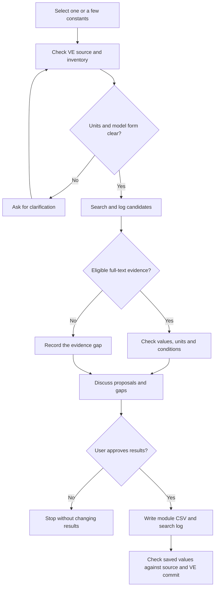

# AI-assisted parameterisation

The `ve-constant-search` skill helps find published values for Virtual Ecosystem
(VE) configuration constants in any module, one or a few at a time. It produces
**proposals for human review**, not validated parameters or automatic changes to
VE. A model default or an abstract alone is not evidence for a new value.

## Before you start

1. Open a workspace containing this repository and a sibling
   `virtual_ecosystem` repository. Use the VE version whose constants you want
   to assess; record its commit and any relevant uncommitted changes.
2. Run `uv sync` from the repository root to install the Python dependencies
   declared in `pyproject.toml`, including `jedi`, `tomli-w` and `requests`.
   See [Python with uv](uv_setup.md). For the optional R documentation lookup,
   run `renv::restore()` from the repository root to install the packages in
   `renv.lock`, including `ragnar` and `DBI`. Rebuilding the documentation store
   also needs `tidyverse` from that lockfile. Local renv use is otherwise
   optional; see [R with renv](renv.md).
3. Configure `OPENALEX_EMAIL` with your own contact address. See the commands
   below. The address identifies API traffic to OpenAlex; it is not a password
   or API key.

### Configure OpenAlex

For repo-local setup, create `.github/skills/ve-constant-search/.env` with:

```dotenv
OPENALEX_EMAIL=you@example.org
```

Replace `you@example.org` with your address. The file is ignored by Git. The
helper reads it relative to its own location, regardless of the working
directory. No Positron restart is needed. It does not read R `.Renviron` files.

An existing `OPENALEX_EMAIL` in the process environment takes precedence over
the `.env` file. To use the repo-local address instead, remove the user-level
variable and restart Positron, or unset it in the terminal running the helper:

```powershell
Remove-Item Env:OPENALEX_EMAIL
```

On macOS or Linux, use `unset OPENALEX_EMAIL` instead.

If you cannot provide an address, stop before searching. Do not switch to
OpenAlex MCP tools or another search integration.

In an assistant that supports repository skills, ask it to use
[`ve-constant-search`](https://github.com/ImperialCollegeLondon/ve_data_science/blob/main/.github/skills/ve-constant-search/SKILL.md).
Name the constants or parameter families you want reviewed. For example:

> Use ve-constant-search to review published values for the soil microbial
> turnover constants in this workspace. Show the search and source evidence,
> units, conversions and gaps before proposing any CSV changes.

Select one or a few qualified names (`module.Class.attribute`). If you name a
module, class or family, agree on a small subset before searching. The example
above is a soil-specific request, not the default scope.

## Review the evidence

The workflow has a review step before it saves results:



The search does not change VE configuration. A failed search cannot support a
`no_evidence` result.

The assistant uses
[`ve_constant_usage.toml`](../.github/skills/ve-constant-search/assets/ve_constant_usage.toml)
to match selected constants to declarations, reference sites, functions and
VE commit. This generated inventory covers declared configuration attributes
across VE modules, including shared model and disturbance settings. It excludes
hardcoded numeric literals and external trait tables. Reference resolution is
best-effort. Review the VE declaration and reference sites directly for each
selected constant. Resolve ambiguous units or functional forms before accepting
an interpretation.

When the local VE commit changes, run the inventory dry run from this repository
root with a clean VE package source tree:

```bash
uv run --no-sync python .github/skills/ve-constant-search/scripts/refresh_constant_metadata.py
```

Review listed added, removed and changed qualified names. Only then rerun with
`--apply` to replace the TOML. The script skips a matching commit and rejects
uncommitted VE package source changes. It uses the sibling VE clone by default;
use `--ve-root` to point to another clone. Match the tool's Python environment
to the selected local VE clone before regenerating: the generator imports VE
configuration classes. Do not apply an inventory built from a different VE
installation. Check changes outside the package
that might affect imports separately. The TOML is generated model grounding,
not empirical evidence. Updating it does not rerun literature searches or
update historical reports. Do not assume a local full-text library exists.

Use only the Python helper for OpenAlex discovery and citation lookup. Do not
use `webfetch` or general web search for literature discovery or screening.
For screened candidates, `webfetch` is permitted only to open a specific
full-text article or PDF URL identified by the helper or supplied by the user;
do not use it to search for additional papers. If full text is inaccessible,
record that gap instead of searching elsewhere.

For each candidate, expect a recorded search query and date, screened and
excluded sources, and a traceable full-text quotation with a page or table
location. Compare the original measurement's units, conditions, organism or
enzyme source, and response function with the model. Check every conversion to
model units. Only use full text you are allowed to access and retain; an
inaccessible paper, search failure or abstract-only result cannot verify a
value. Citation counts do not establish measurement quality.

For soil microbial groups, seek separate evidence for bacteria, saprotrophic
fungi, arbuscular mycorrhiza and ectomycorrhiza; soil enzymes need separate
bacterial and fungal evidence. For other modules, check their applicable
categories and measurement conditions. Missing groups remain gaps; do not
fill them with pooled measurements. A `no_evidence` result describes the
limits of this search, not proof that no literature exists.

## Approve and retain results

Discuss proposed values, exclusions and gaps before authorising changes. The
assistant must ask before it uses proxies or changes inclusion criteria. It must
also ask before it makes a consequential scientific judgment. After your
approval, it writes results under `data/derived/llm/`, with one CSV per VE
module: `<module>_constant_literature_values.csv`. For soil, create this CSV
from the blank template for new searches. An older soil CSV exists at
[`data/derived/soil/llm/soil_constant_literature_values.csv`](../data/derived/soil/llm/soil_constant_literature_values.csv).
That file contains historical results and is not the output path for new
searches. Do not copy its rows into a new CSV without approval. Rows for other
constants must remain unchanged. The skill's
[CSV template](https://github.com/ImperialCollegeLondon/ve_data_science/blob/main/.github/skills/ve-constant-search/assets/soil_constant_literature_values.csv)
is blank; the
[field guide](../.github/skills/ve-constant-search/assets/README.md) defines its
fields. The historical soil CSV uses a different column order, so match columns
by name if you review its rows. Keep each module's new results in its own CSV.
Put each per-parameter log beside the corresponding module CSV.

Each supported value should identify its source, quotation, original units,
conversion, measurement conditions and confidence. If only a range is
supported, retain the range without inventing a point estimate. For gaps,
record why the evidence is insufficient. Keep the search and screening log
beside the resulting CSV so another reviewer can trace what was considered.
Start a new per-parameter log from the
[blank log template](../.github/skills/ve-constant-search/assets/constant_search_log.csv).
Record failed requests separately from successful zero-result searches. The
OpenAlex helper supports `search "QUERY"` and `snowball --id W...` via
`uv run --no-sync python
.github/skills/ve-constant-search/scripts/openalex_search.py` from the
repository root. It only returns candidates; it does not verify full text.
Before using any proposal in VE, verify it against the cited source and the
recorded VE commit. This workflow does not update VE configuration or
historical parameterisation reports automatically.
