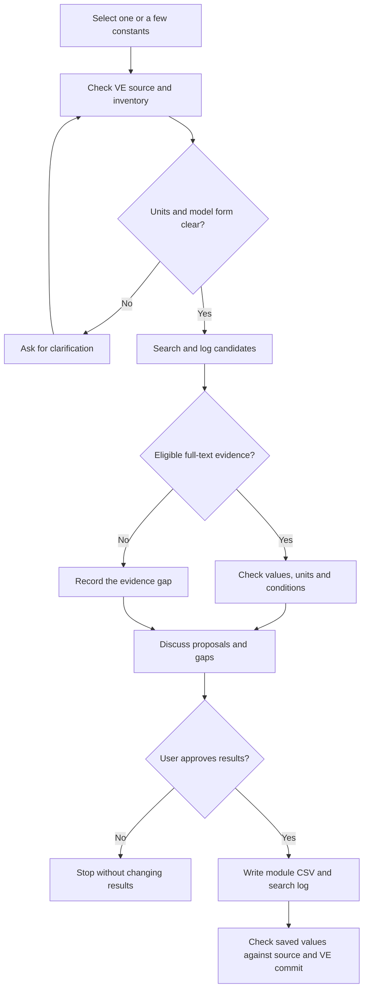

# AI-assisted parameterisation

The `ve-constant-search` skill helps find published values for Virtual Ecosystem
(VE) configuration constants in any module, one or a few at a time. It produces
**proposals for human review**, not validated parameters or automatic changes to
VE. A model default or an abstract alone is not evidence for a new value.

## Before you start

1. Open a workspace containing this repository and a sibling
   `virtual_ecosystem` repository. Use the VE version whose constants you want
   to assess; record its commit and any relevant uncommitted changes. If the
   sibling checkout is missing or unverifiable, restore it before grounding;
   an installed package alone does not establish the checkout commit.
2. Run `uv sync` from the repository root to install the Python dependencies
   declared in `pyproject.toml`, including `jedi`, `tomli-w` and `requests`.
   See [Python with uv](uv_setup.md). For the optional R documentation lookup,
   run `renv::restore()` from the repository root to install the packages in
   `renv.lock`, including `ragnar` and `DBI`. Rebuilding the documentation store
   also needs `tidyverse` from that lockfile. Local renv use is otherwise
   optional; see [R with renv](renv.md).
3. Optionally configure OpenAlex access. See the commands below. Without
   credentials, the helper still searches with OpenAlex's smaller keyless
   budget.

### Configure OpenAlex

The helper chooses the first available approach and reports it (`api_key`,
`email` or `keyless`) on stderr. It never prints the key or address.

1. `OPENALEX_API_KEY`: your free OpenAlex API key, from
   [Settings → API key](https://openalex.org/settings/api-key). It gives a
   larger daily budget. Treat it as a secret.
2. `OPENALEX_EMAIL`: your own contact address, used only when no key is set.
3. Keyless: used when neither is set.

For repo-local setup, create `.github/skills/ve-constant-search/.env` with
either or both lines:

```dotenv
OPENALEX_API_KEY=your-key
OPENALEX_EMAIL=you@example.org
```

Replace the placeholders with your own values. The file is ignored by Git. The
helper reads it relative to its own location, regardless of the working
directory. No Positron restart is needed. It does not read R `.Renviron` files.

An existing variable in the process environment takes precedence over the same
name in the `.env` file. To use the repo-local value instead, remove the
user-level variable and restart Positron, or unset it in the terminal running
the helper:

```powershell
Remove-Item Env:OPENALEX_API_KEY
```

On macOS or Linux, use `unset OPENALEX_API_KEY` instead.

Do not switch to OpenAlex MCP tools or another search integration. An API key
configured for an OpenAlex MCP server is not passed to the helper; set it as
`OPENALEX_API_KEY` as well.

### GitHub Actions-based Copilot cloud sessions

After `.github/workflows/copilot-setup-steps.yml` is merged to the default
branch, a Copilot cloud session running on GitHub Actions installs the locked
Python dependencies with the released `virtual-ecosystem` from PyPI. It checks
out the matching release tag as a sibling `virtual_ecosystem` repository and
checks that its Python source is identical to the installed package before the
agent starts. It uses the repository's `.python-version` and does not install
the optional R tools.

In repository **Settings → Secrets and variables → Agents**, add
`OPENALEX_API_KEY` as a secret, or `OPENALEX_EMAIL` as a variable. Values
previously configured in the Actions `copilot` environment are migrated to
Agents settings by GitHub. See
[GitHub's agent variables guide](https://docs.github.com/en/copilot/how-tos/copilot-on-github/customize-copilot/customize-cloud-agent/configure-secrets-and-variables).
The setup workflow does not test OpenAlex access.
Copilot's network policy must permit the OpenAlex API and any authorised
full-text hosts needed by a search.

The setup follows the `virtual-ecosystem` release locked in `uv.lock`. To move
to a newer release, run `uv lock --upgrade-package virtual-ecosystem` and
commit the lockfile. Use `uv run --no-sync`
for skill commands so they retain the prepared environment. As with local
work, compare the inventory's recorded VE commit and refresh it when needed;
the setup does not refresh it or perform a literature search. Setup-step
failures are shown in the session log, but GitHub may still start the agent.
The workflow applies to GitHub Actions sessions, not cloud sandboxes.

In an assistant that supports repository skills, ask it to use
[`ve-constant-search`](https://github.com/ImperialCollegeLondon/ve_data_science/blob/main/.github/skills/ve-constant-search/SKILL.md).
Name the constants or parameter families you want reviewed. For example:

> Use ve-constant-search to review published values for the soil microbial
> turnover constants in this workspace. Show the search and source evidence,
> units, conversions and gaps before proposing any CSV changes.

Select one or a few qualified names (`module.Class.attribute`). If you name a
module, class or family, agree on a small subset before searching. The example
above is a soil-specific request, not the default scope.

## Review the evidence

The workflow has a review step before it saves results:



The search does not change VE configuration. A failed search cannot support a
`no_evidence` result.

The assistant uses
[`ve_constant_usage.toml`](../.github/skills/ve-constant-search/assets/ve_constant_usage.toml)
to match selected constants to declarations, reference sites, functions and
VE commit. This generated inventory covers declared configuration attributes
across VE modules, including shared model and disturbance settings. It excludes
hardcoded numeric literals and external trait tables. Reference resolution is
best-effort. Review the VE declaration and reference sites directly for each
selected constant. Resolve ambiguous units or functional forms before accepting
an interpretation.

When the local VE commit changes, run the inventory dry run from this repository
root with a clean VE package source tree:

```bash
uv run --no-sync python .github/skills/ve-constant-search/scripts/refresh_constant_metadata.py
```

Review listed added, removed and changed qualified names. Only then rerun with
`--apply` to replace the TOML. The script skips a matching commit and rejects
uncommitted VE package source changes. It uses the sibling VE clone by default;
use `--ve-root` to point to another clone. Match the tool's Python environment
to the selected local VE clone before regenerating: the generator imports VE
configuration classes. Do not apply an inventory built from a different VE
installation. Check changes outside the package
that might affect imports separately. The TOML is generated model grounding,
not empirical evidence. Updating it does not rerun literature searches or
update historical reports. Do not assume a local full-text library exists.

Use only the Python helper for OpenAlex discovery and citation lookup. Do not
use `webfetch` or general web search for literature discovery or screening.
`search "DOI"` is a fuzzy search, so verify returned DOIs and do not treat a
missing match as proof that the paper is absent. `snowball --doi "DOI"` resolves
the seed for citation searches, but returns its ID and citations rather than
its full metadata. A dedicated exact DOI metadata lookup would help seed
searches; the helper does not yet provide one.
For screened candidates, `webfetch` is permitted only to open a specific
full-text article or PDF URL identified by the helper or supplied by the user;
do not use it to search for additional papers. For a PDF URL, check access and
retention rights before optionally downloading it with:

```bash
uv run --no-sync python \
  .github/skills/ve-constant-search/scripts/download_authorized_pdf.py \
  "PDF_URL" "OUTPUT.pdf" --doi "DOI"
```

Use a specific HTTPS PDF URL returned by the OpenAlex helper or supplied by the
user. Create the output directory first. Keep PDFs outside the repository unless
retention there is permitted. The tool rejects redirects and non-PDF responses,
never overwrites files, and saves a `.pdf.json` provenance record beside the
PDF. A saved PDF still needs manual full-text review. If full text is
inaccessible, record that gap instead of searching elsewhere. Before retrieving
full text, check each relevant publisher host using a bounded HTTPS request to
the specific seed or candidate URL, such as
`curl --head --max-time 15 "ARTICLE_URL"`. Record the outcome. An HTTP response
shows connectivity, not full-text access. If the host is unreachable or access
fails, ask the user for an authorised PDF and continue with other accessible
candidates. Verify access and retention rights for supplied PDFs.

### Supply private PDFs

You can use your existing filenames; no renaming or hand-written manifest is
required. Keep the PDF folder private and outside Git. When working locally,
give the agent its path as the optional `PDF_DIR`. In a cloud session, upload
the PDFs or grant folder access using the host's supported controls. The agent
must verify that it can read the supplied files: granting a local app folder
access does not automatically make that folder readable in a cloud workspace.
If necessary, upload the files into private cloud storage accessible to that
session. A new environment or Git checkout does not restore private PDF access.

The agent leaves PDFs unchanged and generates or refreshes a private
`pdf_inventory.csv` containing original filenames, checksums and citation
identities. It uses private storage you approve or session artifacts, including
when your folder is read-only. You do not need to maintain that inventory.
Citation identities come from the paper's front matter, not DOIs in its
reference list; uncertain matches are raised for your review.

PDFs, private inventories, extracted full text and private absolute paths must
not be staged, committed, pushed or published in issue/PR comments. Research
outputs can retain permissible citation metadata, findings, source locations
and brief evidence quotations after review of retention rights. Supplied PDFs
can be read without publisher connectivity, but still require full scientific
verification. Unreadable/scanned PDFs trigger a request for a readable copy or
approval for OCR, not an invented value or a claim that evidence is absent.

### Verify candidate evidence

For each candidate, expect a recorded search query and date, screened and
excluded sources, and a traceable full-text quotation with a page or table
location. Compare the original measurement's units, conditions, organism or
enzyme source, and response function with the model. Check every conversion to
model units. If a value requires re-fitting, digitising, pooling or other
reanalysis, record it as a gap rather than a verified value; ask for approval
before doing that reanalysis. Only use full text you are allowed to access and
retain; an inaccessible paper, search failure or abstract-only result cannot
verify a value. Citation counts do not establish measurement quality.

For soil microbial groups, seek separate evidence for bacteria, saprotrophic
fungi, arbuscular mycorrhiza and ectomycorrhiza; soil enzymes need separate
bacterial and fungal evidence. For other modules, check their applicable
categories and measurement conditions. Missing groups remain gaps; do not
fill them with pooled measurements. A `no_evidence` result describes the
limits of this search, not proof that no literature exists.

## Approve and retain results

Discuss proposed values, exclusions and gaps before authorising changes. The
assistant must ask before it uses proxies or changes inclusion criteria. It must
also ask before it makes a consequential scientific judgment. After your
approval, it writes results under `data/derived/llm/`, with one CSV per VE
module: `<module>_constant_literature_values.csv`. This is the default output
directory; a user may specify another project-relative directory for results
and search logs. Reusable prompts stay under `analysis/soil/llm/`. For soil,
create this CSV from the blank template for new searches. An older soil CSV exists at
[`data/derived/soil/llm/soil_constant_literature_values.csv`](../data/derived/soil/llm/soil_constant_literature_values.csv).
That file contains historical results and is not the output path for new
searches. Do not copy its rows into a new CSV without approval. Rows for other
constants must remain unchanged. The skill's
[CSV template](https://github.com/ImperialCollegeLondon/ve_data_science/blob/main/.github/skills/ve-constant-search/assets/soil_constant_literature_values.csv)
is blank; the
[field guide](../.github/skills/ve-constant-search/assets/README.md) defines its
fields. The historical soil CSV uses a different column order, so match columns
by name if you review its rows. Keep each module's new results in its own CSV.
Put each per-parameter log beside the corresponding module CSV.

Each supported value should identify its source, quotation, original units,
conversion, measurement conditions and confidence. If only a range is
supported, retain the range without inventing a point estimate. For gaps,
record why the evidence is insufficient. Keep the search and screening log
beside the resulting CSV so another reviewer can trace what was considered.
Start a new per-parameter log from the
[blank log template](../.github/skills/ve-constant-search/assets/constant_search_log.csv).
Record failed requests separately from successful zero-result searches. The
OpenAlex helper supports `search "QUERY"` and `snowball --id W...` via
`uv run --no-sync python
.github/skills/ve-constant-search/scripts/openalex_search.py` from the
repository root. It only returns candidates; it does not verify full text.
Before using any proposal in VE, verify it against the cited source and the
recorded VE commit. This workflow does not update VE configuration or
historical parameterisation reports automatically.
