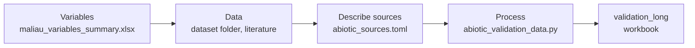

# Abiotic validation plan

For each VE abiotic variable we find observations or published values, convert
them to the VE unit and the VE monthly time step, record how close they are to
the VE grid in space and time, for comparing them with the model output for
the same cells and months.

This plan gives an overview of that process for the abiotic and abiotic simple
modules at Maliau: the variables to validate and the data they need or still
lack ([Section 3](#3-variables-and-data-needed)), the data in hand
([Section 4](#4-available-data)), how the data are processed
([Section 5](#5-processing-to-ve-units-and-monthly-values)) and the status of
each variable ([Section 6](#6-validation-tracker)).

<!-- markdownlint-disable MD013 -->

| File | What it holds |
| --- | --- |
| `data/primary/validation/maliau_variables_summary.xlsx` (globus) | VE variables with unit and validation priority (`output_variables`) and model constants (`model_constats`) |
| `data/primary/validation/dataset/` (globus) | The raw data from [SAFE](https://zenodo.org/communities/safe/about) Zenodo: `safe_abiotic/` (microclimate loggers, flux tower meteorology and eddy covariance) and `safe_soil/` (soil temperature and moisture surveys; primary forest plots only are used) |
| `data/primary/validation/abiotic/abiotic_literature_values.csv` (globus) | Published values and ranges, one row per value, with citation, DOI and `status` |
| `data/primary/validation/abiotic/abiotic_sources.toml` (globus) | Where each dataset is, its columns, units, quality limits, coordinates, citation and screening record |
| `analysis/abiotic/validation/abiotic_validation_data.py` (github) | Python script that reads, cleans and converts the data, generates `abiotic_validation_data.xlsx` and writes the tracker in Section 6 |
| `data/derived/validation/abiotic/abiotic_validation_data.xlsx` (globus) | Processed data: daily and monthly values, the long table `validation_long` and the `variable_registry` (with the data needed or lacking per variable) |

<!-- markdownlint-enable MD013 -->

## 1. Workflow

<!-- markdownlint-disable MD013 -->

<!-- markdownlint-enable MD013 -->

1. **Variables:** list the VE abiotic outputs and their priority
   ([Section 3](#3-variables-and-data-needed)).
2. **Data:** find observations and literature values and decide which to use
   ([Section 4](#4-available-data)); screening in the validation database.
3. **Describe sources:** record file, columns, units, quality limits and DOI in
   `abiotic_sources.toml`; the schema in the validation database.
4. **Process:** quality control, conversion to VE units and monthly values
   ([Section 5](#5-processing-to-ve-units-and-monthly-values)); building the
   validation database.

## 2. The VE scenario

<!-- markdownlint-disable MD013 -->

| Item | Value |
| --- | --- |
| Scenario | `maliau_2`, 10 x 10 cells of 100 m (1 km²), from `data/derived/site/maliau/maliau_grid_definition.toml` |
| Run period and time step | 2010-01 to 2020-12, monthly |
| Vertical layers | Above canopy (2 m above the canopy top, `above_canopy_height_offset`), up to 10 canopy layers (`canopy_layers`), surface layer at 0.1 m (`surface_layer_height`), topsoil at 0.25 m and subsoil at 1 m depth (`soil_layers`); abiotic simple anchors its within-canopy profiles at `measurement_height` (1.5 m) |
| Forcing | ERA5-Land monthly, the same for every cell |
| Latitude | `latitude` in the abiotic configuration sets the day length; its default (0.0, in `model_constats`) should be set to Maliau (about 4.7° N) |

<!-- markdownlint-enable MD013 -->

Times are stored in UTC and days and months are local (Asia/Kuching, UTC+8),
as in the validation database.

## 3. Variables and data needed

Variables and units are from the `output_variables` sheet of
`maliau_variables_summary.xlsx`, with their priority in the `classification`,
`validation_priority` and `spin_up_sensitive` columns. *Direct* means compared
with observations of the same quantity, *derived* through a quantity in the
second table, and *literature* with published values only. *VE output* is
how the model reports the variable each month (read from the model code). The
abiotic model builds one 24-hour day from the monthly forcing (a sine curve for
temperature, shortwave radiation spread over the daylight hours) and reports
the mean of that day; abiotic simple gives one value per month from the
forcing and leaf area index, with no daily cycle. Fluxes come only from the
abiotic model. *Data needed / lacking* is what is still missing to complete
the validation of the variable; the same text is in the tracker
([Section 6](#6-validation-tracker)) and in `DATA_NEEDED` in the script.

<!-- markdownlint-disable MD013 -->

| VE variable | VE unit | VE output | Priority | How validated | Data needed / lacking |
| --- | --- | --- | --- | --- | --- |
| air_temperature | °C | per air layer | Very High | direct | A vertical profile through the canopy in old-growth forest at Maliau (the loggers are at 1.5 m only) |
| latent_heat_flux | W m⁻² | per canopy layer, surface layer and topsoil; abiotic only | Very High | derived (above-canopy sum), SAFE flux tower eddy covariance | Eddy covariance over old-growth forest (the SAFE tower is in logged forest, 70 km away); more valid months (9 pass the quality rule) |
| net_radiation | W m⁻² | abiotic: per canopy layer, surface layer (its understorey vegetation is solved like a canopy layer) and topsoil, absorbed shortwave plus absorbed longwave minus emitted longwave; abiotic simple: canopy layers, surface and topsoil, absorbed shortwave minus emitted longwave only (no longwave absorption) | Very High | derived (above-canopy sum), SAFE flux tower | Incoming shortwave and longwave to check the ERA5-Land forcing; net radiation below the canopy and at the soil surface |
| vapour_pressure_deficit | kPa | per air layer | High | direct (from temperature and humidity) | A vertical profile, as air_temperature |
| sensible_heat_flux | W m⁻² | per canopy layer, surface layer and topsoil; abiotic only | High | derived (above-canopy sum), SAFE flux tower eddy covariance | Eddy covariance over old-growth forest (the SAFE tower is in logged forest, 70 km away) |
| canopy_temperature | °C | per canopy layer; abiotic simple copies air temperature | High | - | Leaf or canopy surface temperature (thermal camera, infrared thermometer or leaf thermocouples) in old-growth forest |
| soil_temperature | °C | per soil layer | High | direct (primary forest soil plots at 10-12 cm: Car_Bel and Car_Ser at Maliau, Car_D1 and Car_D2 at Danum; SAFE flux tower at 5, 10 and 20 cm) | Soil temperature at 0.25-1 m to match the VE soil layers, and continuous records; old-growth spot readings at 10-12 cm are in hand (Car_Bel, Car_Ser at Maliau) |
| soil_moisture | mm | top soil layer; a hydrology output that the abiotic model reads (soil heat capacity and conductivity) | Very High | input check (primary forest soil plots, 0-12 cm; θ × 250 mm) | Continuous soil moisture in old-growth forest at Maliau (the surveys are spot visits), and at 0.25-1 m to match the VE soil layers |
| aerodynamic_resistance_canopy | s m⁻¹ | per canopy layer; abiotic only | High | derived above the canopy; literature | In hand but not yet derived: wind speed and friction velocity (u.) in `SAFE_EC_byYear.xlsx` give r = u / u.² above the canopy; within-canopy values from literature |
| relative_humidity | % | per air layer | High | direct | A check of the unlabelled loggers that read above 100 %; a vertical profile, as air_temperature |
| vapour_pressure | kPa | per air layer | Medium | direct (from temperature and humidity) | A vertical profile, as air_temperature |
| wind_speed | m s⁻¹ | one profile per month, no daily cycle | Medium | direct above the canopy (SAFE flux tower, 52 m) | Wind speed at several heights within and below the canopy; only the 52 m value above the canopy is in hand |
| ground_heat_flux | W m⁻² | at the soil surface; abiotic only | Medium | literature | Soil heat flux plates (about 5-8 cm deep) in old-growth forest; none in hand |
| diurnal_temperature_range | °C | per layer; abiotic: maximum − minimum of the modelled day; abiotic simple: the forcing value copied to every layer | Medium | direct (monthly mean of daily maximum − minimum) | In hand but not yet mapped: daily maximum and minimum from the loggers and the flux tower |
| absorbed_longwave_radiation, longwave_emission | W m⁻² | per layer; abiotic only | Medium | literature | Upward and downward longwave radiation above and below the canopy (four-component radiometer); the tower measures net radiation only |
| vapour_pressure_deficit_ref, vapour_pressure_ref | kPa | from the forcing, for every month at the start | Medium, Low | direct (SAFE flux tower, above canopy at 50 m); checks the forcing | None: flux tower values at 50 m in hand |
| atmospheric_pressure, atmospheric_co2 | kPa, ppm | forcing value copied to every layer | Low | input check (SAFE flux tower pressure and CO2) | Pressure: none (flux tower barometer in hand). CO2: in hand but not yet read (`co2_mole_fraction` in `SAFE_EC_byYear.xlsx`) |

<!-- markdownlint-enable MD013 -->

`condensation`, `density_air`, `latent_heat_vapourisation` and
`specific_heat_air` need no field data: they follow standard physical formulas
and are checked by unit tests.

*Derived variables* combine VE outputs, or observations, so that they match
each other. They are candidates for
`data/derived/validation/derived_variables.toml` (step 5 of the validation
database).

<!-- markdownlint-disable MD013 -->

| Derived variable | Formula | Unit |
| --- | --- | --- |
| vapour_pressure (observed) | $e_a = e_s(T)\,RH / 100$, $e_s(T) = 0.6112 \exp(17.62\,T / (T + 243.12))$, the Magnus equation the VE uses (pyrealm `calc_vp_sat`, default coefficients of Sonntag 1990) | kPa |
| vapour_pressure_deficit (observed) | $VPD = e_s(T) - e_a$ | kPa |
| latent_heat_flux from evapotranspiration | $LE = ET \cdot \lambda$ / seconds per period (as `calculate_latent_heat_flux` in the VE), with $\lambda = 1.91846 \times 10^6\,(T_K / (T_K - 33.91))^2$ J kg⁻¹ (Henderson-Sellers 1984, as the VE; about 2.44 MJ kg⁻¹ at 25 °C); the evapotranspiration values of the [hydrology plan](hydrology_validation_plan.md) also check LE | W m⁻² |
| energy balance closure | $G = R_n + LE + H$ with the VE signs (see the sign convention below the table: $R_n$ positive when the surface gains energy, $LE$ and $H$ negative from the surface to the air, $G$ positive into the soil); in the VE the topsoil $G$ is this residual | W m⁻² |
| diurnal_temperature_range (observed) | monthly mean of daily maximum − daily minimum air temperature | °C |
| above-canopy net_radiation, latent_heat_flux, sensible_heat_flux | sum of the VE profile over the canopy layers, surface layer and topsoil, compared with the flux tower; the VE stores LE and H as negative from the surface to the air, so the tower LE and H change sign (`obs_in_ve_unit`) | W m⁻² |

<!-- markdownlint-enable MD013 -->

*Sign convention of the energy balance.* The plan uses the VE signs for each
term of the energy balance:

* **$R_n$ (net radiation)** is positive when the surface gains energy, that is,
  it absorbs more radiation from the sun and sky than it emits.
* **$LE$ (latent heat flux)** and **$H$ (sensible heat flux)** are negative
  when heat leaves the surface (soil or leaves) and goes into the air, and
  positive when heat goes from the air to the surface.
* **$G$ (ground heat flux)** is positive when heat goes down into the soil.

With these signs the balance is $G = R_n + LE + H$: the soil receives the
radiation energy the surface gains ($R_n$), less the energy used to evaporate
water ($LE$) and warm the air ($H$). The VE computes the topsoil $G$ this way,
as the residual. The SAFE flux tower reports $LE$ and $H$ as positive from the
surface to the air, so `obs_in_ve_unit` holds them with the VE sign.

*Inputs and constants* the same data can check: the ERA5-Land forcing (air
temperature, relative humidity, pressure and wind against the flux tower above
the canopy); `surface_albedo` and `leaf_albedo`; the soil constants marked as
placeholders in the code (`soil_porosity`, `soil_thermal_conductivity_dry`,
`soil_thermal_conductivity_saturated`) through soil temperature at 5, 10 and
20 cm; and the leaf area index gradients in `AbioticSimpleBounds` (from
Hardwick et al. 2015) through the loggers. Values are in the `model_constats`
sheet.

*Model inputs* that the comparison also needs, beyond the validation data:
leaf area index and canopy height for the `maliau_2` cells (they set the VE
layers and drive the abiotic simple gradients), `latitude` set to Maliau, and
the logger and sensor heights to pick the matching VE layer.

## 4. Available data

One row per dataset, as recorded in `abiotic_sources.toml`: each source there
has a screening record (`record_id`, `doi`, decision and reason) and its
metadata, in the format of the validation database. *Zenodo* is the dataset
record; *DOI* is the paper or other repository describing the same data.
Citations and DOIs come from
`readme.txt` in the dataset folder (`data/primary/validation/dataset/`); the
full references are in [Section 8](#8-references). Values, sites and periods are
in the workbook (`sources`, `sites` sheets) and in the tracker.

<!-- markdownlint-disable MD013 -->

| Dataset (file name) | Folder | Citation | Zenodo | DOI (paper or other repository) | VE variable | Screening |
| --- | --- | --- | --- | --- | --- | --- |
| `Microclimate1319.csv` | `safe_abiotic/` | Hardwick et al. (2024) | [10.5281/zenodo.12751374](https://doi.org/10.5281/zenodo.12751374) | none | air_temperature, relative_humidity, vapour_pressure, vapour_pressure_deficit | proceed |
| `SAFE_FluxTower_MetData_2012-2017 .xlsx` | `safe_abiotic/` | Riutta et al. (2020) | [10.5281/zenodo.3888375](https://doi.org/10.5281/zenodo.3888375) | none | net_radiation, air_temperature and relative_humidity above the canopy, atmospheric_pressure, soil_temperature (also soil moisture and rainfall for hydrology) | proceed |
| `SAFE_EC_byYear.xlsx` | `safe_abiotic/` | Mills et al. (2022) | [10.5281/zenodo.7307447](https://doi.org/10.5281/zenodo.7307447) | none | latent_heat_flux, sensible_heat_flux, wind_speed, vapour_pressure_deficit above the canopy (also evapotranspiration for hydrology) | proceed |
| `SAFE_SoilRespiration_Data_SAFEdatabase_update_2021-01-11.xlsx` | `safe_soil/` | Riutta et al. (2021) | [10.5281/zenodo.4542881](https://doi.org/10.5281/zenodo.4542881) | none | soil_temperature (10 cm), soil_moisture (0-12 cm); old-growth plots and total-respiration collars only | proceed |
| `Carbon_corrected_slopes.xlsx` | `safe_soil/` | Orme et al. (2019) | [10.5281/zenodo.3247592](https://doi.org/10.5281/zenodo.3247592) | none | soil_temperature (12 cm), soil_moisture (0-12 cm); Belian plot at Maliau, total collars only | proceed |
| `Termite_monitoring_maliau.xlsx` | `safe_soil/` | Ashton et al. (2019) | [10.5281/zenodo.3265746](https://doi.org/10.5281/zenodo.3265746) | [10.5285/1e9993ae-add7-497a-b54b-745b0fc6a7ca](https://doi.org/10.5285/1e9993ae-add7-497a-b54b-745b0fc6a7ca) (EIDC) | soil_moisture; control plots at Maliau only | proceed |
| `abiotic_literature_values.csv` | `data/primary/validation/abiotic/` | per row | per row | per row (`doi`) | air_temperature, vapour_pressure_deficit, latent_heat_flux, net_radiation, sensible_heat_flux, soil_temperature | all rows `to_extract` or `to_find` |

<!-- markdownlint-enable MD013 -->

The other `safe_soil/` files (`BALI_Nottingham_Girdling_Data_2021_rev .xlsx`,
`1_HJ_river_water_riparian.xlsx`, `3_GHG_jdrewer.xlsx`,
`Lab_experiment_Melissa_corrected.xlsx`, `SAFE_Dataset.xlsx`) are screened out
(`exclude` in `abiotic_sources.toml`): they hold no primary forest plots, or no
field dates.

**Plot types and which are comparable to `maliau_2`.** The `maliau_2` grid
is old-growth (primary) forest at Maliau, so only primary forest plots are
comparable to it. The workbook gives every site a `habitat` and a
`comparable_to_maliau_2` column (in `sites` and `validation_long`):

<!-- markdownlint-disable MD013 -->

| Plot code | Habitat | Comparable to `maliau_2` |
| --- | --- | --- |
| OG1-OG3 (Maliau) | old-growth (primary) forest | yes |
| Car_Bel, Car_Ser (Maliau); termite control plots CC, DC, GC, KC (Maliau) | old-growth (primary) forest | yes |
| Car_D1, Car_D2 (Danum Valley) | old-growth (primary) forest, 94 km away | yes (regional) |
| VJR (SAFE) | Virgin Jungle Reserve: near-primary forest (resembles primary forest, not fully primary) | yes (regional) |
| A-F (SAFE) | salvage-logged forest | no |
| LFE (SAFE) | twice-logged forest | no |
| LF1-LF3 (SAFE) | logged forest | no |
| RP (SAFE) | riparian plots | no |
| OP1-OP3 (SAFE) | oil palm | no |
| SAFE flux tower | logged forest | no (the only flux data; regional check) |

<!-- markdownlint-enable MD013 -->

Literature candidates: Hardwick et al. (2015) and Jucker et al. (2018) for
air temperature and VPD by habitat at SAFE and Maliau; Kumagai et al. (2005)
and Kume et al. (2011) for the energy balance at Lambir, as a second check on
the SAFE flux tower.

### 4.1 Microclimate loggers (`Microclimate1319.csv`)

<!-- markdownlint-disable MD013 -->

| Item | Details |
| --- | --- |
| Loggers | Lascar, iButton and unlabelled loggers; hourly air temperature (°C) and relative humidity (%), 2013-2019 |
| Columns | `Plot`, `time` (UTC), `Temp`, `RH`, `DewTemp`, `LoggerType`, `LoggerID` |
| Plots | Old-growth forest at Maliau (OG1-OG3, comparable to `maliau_2`); at SAFE: salvage-logged forest (A-F), twice-logged forest (LFE), logged forest (LF1-LF3), Virgin Jungle Reserve (VJR, near-primary), riparian (RP) and oil palm (OP1-OP3); see the plot type table above |
| Location | Coordinates from `data/primary/site/gazetteer.geojson`; the seven OG2 plots are inside the `maliau_2` grid, OG1 and OG3 within 1.4 km of it, the SAFE plots 53-81 km away (oil palm and riparian 53-73 km, forest 63-81 km) |
| Logger height | 1 m above ground (Zenodo record 12751374) |
| Caveat | RH from the unlabelled loggers often exceeds 100 %; check whether they should be kept for humidity and VPD |

<!-- markdownlint-enable MD013 -->

### 4.2 SAFE flux tower

Both files come from the same tower (SAFE Project dataset 113) and are read in
local time (UTC+8).

<!-- markdownlint-disable MD013 -->

| Item | `SAFE_FluxTower_MetData_2012-2017 .xlsx` | `SAFE_EC_byYear.xlsx` |
| --- | --- | --- |
| Location | Flux tower in the SAFE landscape (4.7173 N, 117.6032 E), about 70 km from the `maliau_2` grid (regional); canopy about 25 m high | Same tower |
| Period and step | 2012-03 to 2017-12, 30 min (60 min below the canopy until 2012-11-02) | 2012-08 to 2018-11, 30 min; no 2016 sheet |
| Sheets | `data_above canopy` (50 m): air temperature, RH, PAR, net radiation, rainfall, pressure; `data_below canopy`: PAR at 1 m, soil water content and soil temperature at 5, 10 and 20 cm | `Raw_data_2012_2013` to `Raw_data_2018`: EddyPro output at 52 m (LE, H, CO2 and H2O fluxes with quality flags, ET, air temperature, RH, VPD, wind speed, friction velocity); `Daily_fluxes`: daily NEE, ecosystem respiration and GPP |
| Caveats | Above-canopy power gap 2014-02-17 to 2014-06-17; rain gauge has false zeros and some false high values; the 10 cm soil water sensor failed 2015-05-26 and read higher after its replacement on 2015-09-10 | Same 2014 power gap; quality flags run from 0 (best) to 5 (worst) (Göckede et al. 2006), threshold to agree; `-9999` means missing; some time stamps repeat in 2017 and 2018 |
| Not used for abiotic | PAR, logger battery and box temperature | CO2 fluxes, NEE, GPP and respiration (candidates for the plant validation) |

<!-- markdownlint-enable MD013 -->

### 4.3 Soil plots in primary forest (`safe_soil/`)

<!-- markdownlint-disable MD013 -->

| Item | Details |
| --- | --- |
| Plots | Car_Bel (0.1 km from the grid) and Car_Ser (1.1 km) at Maliau, Car_D1 and Car_D2 at Danum Valley (94 km); termite control plots CC, DC, GC and KC at Maliau (0.1-0.5 km) |
| Measurements | Spot visits with handheld probes: soil temperature at 10 cm (Riutta) or 12 cm (Orme); volumetric soil moisture over 0-12 cm (Hydrosense or 12 cm probe; termite plots: Delta-T HH2, depth not stated) |
| Periods | Riutta: about monthly visits, 2012-01 to 2018-07 (Maliau) and 2015-03 to 2018-03 (Danum); Orme: four days in 2019-02; Ashton: 2016-03 (El Niño drought) and 2016-10 |
| Kept | Old-growth plots and total-respiration collars (Riutta); total collars, subplots averaged to Car_Bel (Orme); control plots (Ashton). Logged forest, oil palm, trenched and termite suppression plots are dropped |
| Caveats | Spot readings, not continuous records; the probes sample the upper 10-12 cm of the 0-25 cm VE top soil layer; the termite plots read about 2 % soil moisture in the 2016-03 drought, to check |

<!-- markdownlint-enable MD013 -->

## 5. Processing to VE units and monthly values

The script `abiotic_validation_data.py` does every step below; each
quality-control step is logged in the workbook's `qc_log` sheet; the settings
(gaps, completeness, quality flag) are in the script's settings section.
Files are under the dataset folder (`data/primary/validation/dataset/`)
unless the path is given in full.

<!-- markdownlint-disable MD013 -->

| Data | Files processed | Steps to a monthly value | Conversion to the VE unit |
| --- | --- | --- | --- |
| Air temperature (loggers) | `safe_abiotic/Microclimate1319.csv` | Remove embedded header rows; values outside 10-45 °C set missing; mean per plot and local hour; fill gaps up to 3 hours; daily mean, maximum and minimum from days with at least 20 hours; monthly mean from months with at least 20 complete days | °C, no conversion |
| Relative humidity (loggers) | `safe_abiotic/Microclimate1319.csv` | Values from 100 % to 130 % capped at 100 %; then as air temperature | %, no conversion |
| Vapour pressure and VPD | `safe_abiotic/Microclimate1319.csv` | Calculated hourly from temperature and RH (Section 3), then as air temperature | kPa, no conversion |
| Flux tower meteorology | `safe_abiotic/SAFE_FluxTower_MetData_2012-2017 .xlsx` (sheets `data_above canopy`, `data_below canopy`) | Values outside limits set missing (air temperature 10-45 °C, pressure 900-1100 mbar, net radiation, soil temperature 15-40 °C); half-hours to hourly means; gaps up to 3 hours filled; daily and monthly means with the logger rules, per variable; vapour pressure and VPD above the canopy from temperature and RH | Net radiation × −1 (the file counts energy to the atmosphere as positive), W m⁻²; pressure mbar / 10 = kPa; soil temperature at 5, 10 and 20 cm, °C |
| Eddy covariance | `safe_abiotic/SAFE_EC_byYear.xlsx` (sheets `Raw_data_2012_2013` to `Raw_data_2018`) | `-9999` set missing and repeated time stamps dropped; LE and H kept when their quality flag is at most 3 (`flux_qc_max`, to agree) and within −200 to 1000 W m⁻²; LE from 2012-12 to 2013-02 dropped (midday LE near 0 W m⁻² while H is normal: the water vapour signal failed); monthly value = mean of the month's mean diurnal course, only when every hour of the day has at least 2 valid half-hours | LE, H W m⁻² and wind speed m s⁻¹, no conversion |
| Soil temperature and soil moisture (primary forest plots) | `safe_soil/SAFE_SoilRespiration_Data_SAFEdatabase_update_2021-01-11.xlsx`, `safe_soil/Carbon_corrected_slopes.xlsx`, `safe_soil/Termite_monitoring_maliau.xlsx` | Keep primary forest rows (`[sources.keep]`); soil temperature outside 10-45 °C and soil moisture outside 0-100 % set missing; monthly value = mean of all readings per plot and month (`visit_mean`) | Soil temperature °C, no conversion; soil moisture % / 100 = θ (m³ m⁻³), VE value θ × 250 mm |
| Literature | `data/primary/validation/abiotic/abiotic_literature_values.csv` | Only `extracted` rows; a range becomes two rows | Annual values against the mean of monthly VE values; latent heat flux from evapotranspiration as in Section 3 |

<!-- markdownlint-enable MD013 -->

Checks of the flux tower values (2026-10-13): VPD calculated from the 50 m
temperature and RH matches the eddy covariance VPD (median 0.36 kPa for both);
LE matches the ET column × 2.45 MJ kg⁻¹; the energy balance closure
(LE + H) / Rn with the tower signs, or −(LE + H) / Rn with the VE signs, is
0.55-0.82 per month, usual for tropical forest towers; the
net radiation in the file is negative at midday, which confirms the sign
reversal. The eddy covariance air pressure is about 100.7 kPa against 97.4 kPa
from the barometer, so pressure comes from the barometer only.

Every row is then classed by its distance to the grid and its period:

<!-- markdownlint-disable MD013 -->

| Match | Classes |
| --- | --- |
| Spatial | inside the maliau_2 grid (match); within 100 km of it (partial); further away (no match) |
| Temporal | in run (match); in run but needs daily output, such as mean daily maxima, or partly in run (partial); outside run (no match) |

<!-- markdownlint-enable MD013 -->

The result is the `validation_long` sheet in
`data/derived/validation/abiotic/abiotic_validation_data.xlsx`: one row per
observation in the columns of the validation database (location, time window,
original and converted value), plus the value in VE terms (`ve_variable`, `ve_unit`,
`obs_in_ve_unit`, the observed value in the VE unit, not model output), where
to read the VE value (`ve_compare_at`: the grid mean for every abiotic
variable) and the match classes.

## 6. Validation tracker

<!-- tracker:start -->
<!-- Generated by abiotic_validation_data.py; do not edit this block. -->

Every VE value is predicted for 2010-01 to 2020-12 on the maliau_2 grid
(maliau_2: 10 x 10 cells of 100 m) at monthly time steps.
Data files are under the dataset folder (`data/primary/validation/dataset/`);
the literature values are in `abiotic_literature_values.csv`. Distances are
from the sites to the edge of the grid; the match classes are explained in
[Section 5](#5-processing-to-ve-units-and-monthly-values). Citations, every
site, sensor heights and the row counts are in the `variable_registry` sheet of
the workbook. *Data needed / lacking* is what is still missing to complete
the validation of each variable (`DATA_NEEDED` in the script).

<!-- markdownlint-disable MD013 -->

Status counts (per variable): observed 13, no data yet 11.

| VE variable | modules | VE unit | priority | data | sites (distance to grid) | spatial match | period | temporal match | status | data needed / lacking |
| --- | --- | --- | --- | --- | --- | --- | --- | --- | --- | --- |
| absorbed_longwave_radiation | abiotic | W m⁻² | Medium | | | | | | no data yet | Upward and downward longwave radiation above and below the canopy (four-component radiometer); the tower measures net radiation only |
| aerodynamic_resistance_canopy | abiotic | s m⁻¹ | High | | | | | | no data yet | In hand but not yet derived: wind speed and friction velocity (u.) in SAFE_EC_byYear.xlsx give r = u / u.^2 above the canopy; within-canopy values from literature |
| air_temperature | abiotic, abiotic_simple | °C | Very High | `safe_abiotic/SAFE_FluxTower_MetData_2012-2017 .xlsx`; `safe_abiotic/Microclimate1319.csv`; `abiotic_literature_values.csv` (to extract) | 155 sites, 0.0-81.4 km | inside grid; regional | 2012-04 to 2019-12 | in run; in run, needs daily | observed | A vertical profile through the canopy in old-growth forest at Maliau (the loggers are at 1 m only) |
| atmospheric_co2 | abiotic, abiotic_simple | ppm | Low | | | | | | no data yet | In hand but not yet read: co2_mole_fraction (ppm) in SAFE_EC_byYear.xlsx; a forcing check only |
| atmospheric_pressure | abiotic, abiotic_simple | kPa | Low | `safe_abiotic/SAFE_FluxTower_MetData_2012-2017 .xlsx` | 1 site, 70.4 km | regional | 2012-04 to 2017-12 | in run | observed | None for a forcing check (flux tower barometer in hand); a barometer at Maliau's elevation would be better |
| canopy_temperature | abiotic, abiotic_simple | °C | High | | | | | | no data yet | Leaf or canopy surface temperature (thermal camera, infrared thermometer or leaf thermocouples) in old-growth forest |
| condensation | abiotic | mm | Low | | | | | | no data yet | None: follows from physical formulas, checked by unit tests |
| density_air | abiotic | kg m⁻³ | Low | | | | | | no data yet | None: standard formula, checked by unit tests |
| diurnal_temperature_range | abiotic, abiotic_simple | °C | Medium | | | | | | no data yet | In hand but not yet mapped: daily maximum and minimum from the loggers and the flux tower |
| ground_heat_flux | abiotic | W m⁻² | Medium | | | | | | no data yet | Soil heat flux plates (about 5-8 cm deep) in old-growth forest; none in hand |
| latent_heat_flux | abiotic | W m⁻² | Very High | `safe_abiotic/SAFE_EC_byYear.xlsx`; `abiotic_literature_values.csv` (to extract) | 1 site, 70.4 km | regional | 2013-10 to 2017-04 | in run | observed | Eddy covariance over old-growth forest (the SAFE tower is in logged forest, 70 km away); more valid months (9 pass the quality rule) |
| latent_heat_vapourisation | abiotic | kJ kg⁻¹ | Low | | | | | | no data yet | None: standard formula, checked by unit tests |
| longwave_emission | abiotic | W m⁻² | Medium | | | | | | no data yet | Upward longwave radiation (radiometer) or canopy surface temperature; none in hand |
| net_radiation | abiotic, abiotic_simple | W m⁻² | Very High | `safe_abiotic/SAFE_FluxTower_MetData_2012-2017 .xlsx`; `abiotic_literature_values.csv` (to extract) | 1 site, 70.4 km | regional | 2012-04 to 2017-12 | in run | observed | Incoming shortwave and longwave to check the ERA5-Land forcing; net radiation below the canopy and at the soil surface |
| relative_humidity | abiotic, abiotic_simple | % | High | `safe_abiotic/SAFE_FluxTower_MetData_2012-2017 .xlsx`; `safe_abiotic/Microclimate1319.csv` | 135 sites, 0.0-81.0 km | inside grid; regional | 2012-04 to 2019-12 | in run | observed | A check of the unlabelled loggers that read above 100 %; a vertical profile, as air_temperature |
| sensible_heat_flux | abiotic | W m⁻² | High | `safe_abiotic/SAFE_EC_byYear.xlsx`; `abiotic_literature_values.csv` (to extract) | 1 site, 70.4 km | regional | 2012-08 to 2017-08 | in run | observed | Eddy covariance over old-growth forest (the SAFE tower is in logged forest, 70 km away) |
| soil_moisture | hydrology (abiotic input) | mm | Very High | `safe_soil/Carbon_corrected_slopes.xlsx`; `safe_soil/SAFE_SoilRespiration_Data_SAFEdatabase_update_2021-01-11.xlsx`; `safe_soil/Termite_monitoring_maliau.xlsx` | 8 sites, 0.1-94.3 km | regional | 2012-01 to 2019-02 | in run | observed | Continuous soil moisture in old-growth forest at Maliau (the surveys are spot visits), and at 0.25-1 m to match the VE soil layers |
| soil_temperature | abiotic, abiotic_simple | °C | High | `safe_soil/Carbon_corrected_slopes.xlsx`; `safe_abiotic/SAFE_FluxTower_MetData_2012-2017 .xlsx`; `safe_soil/SAFE_SoilRespiration_Data_SAFEdatabase_update_2021-01-11.xlsx`; `abiotic_literature_values.csv` (no source yet) | 5 sites, 0.1-94.3 km | regional | 2012-02 to 2019-02 | in run | observed | Soil temperature at 0.25-1 m to match the VE soil layers, and continuous records; old-growth spot readings at 10-12 cm are in hand (Car_Bel, Car_Ser at Maliau) |
| specific_heat_air | abiotic | J kg⁻¹ K⁻¹ | Low | | | | | | no data yet | None: standard formula, checked by unit tests |
| vapour_pressure | abiotic, abiotic_simple | kPa | Medium | `safe_abiotic/Microclimate1319.csv` | 134 sites, 0.0-81.0 km | inside grid; regional | 2013-05 to 2019-12 | in run | observed | A vertical profile, as air_temperature |
| vapour_pressure_deficit | abiotic, abiotic_simple | kPa | High | `safe_abiotic/Microclimate1319.csv`; `abiotic_literature_values.csv` (to extract) | 134 sites, 0.0-81.0 km | inside grid; regional | 2013-05 to 2019-12 | in run; in run, needs daily | observed | A vertical profile, as air_temperature |
| vapour_pressure_deficit_ref | abiotic, abiotic_simple | kPa | Medium | `safe_abiotic/SAFE_FluxTower_MetData_2012-2017 .xlsx` | 1 site, 70.4 km | regional | 2012-04 to 2017-12 | in run | observed | None: flux tower values at 50 m in hand; this variable comes from the ERA5-Land forcing, so it checks the forcing |
| vapour_pressure_ref | abiotic, abiotic_simple | kPa | Low | `safe_abiotic/SAFE_FluxTower_MetData_2012-2017 .xlsx` | 1 site, 70.4 km | regional | 2012-04 to 2017-12 | in run | observed | None: flux tower values at 50 m in hand; this variable comes from the ERA5-Land forcing, so it checks the forcing |
| wind_speed | abiotic, abiotic_simple | m s⁻¹ | Medium | `safe_abiotic/SAFE_EC_byYear.xlsx` | 1 site, 70.4 km | regional | 2012-08 to 2017-08 | in run | observed | Wind speed at several heights within and below the canopy; only the 52 m value above the canopy is in hand |

<!-- markdownlint-enable MD013 -->

<!-- tracker:end -->

## 7. Next steps

1. Choose the VE layer to compare with the loggers (1 m above ground).
2. Extract the `to_extract` literature values.
3. Agree the eddy covariance quality flag threshold (`flux_qc_max`, now 3).
   Few months pass the diurnal-course rule: 9 for latent heat flux, 23 for
   sensible heat flux and 26 for wind speed.
4. Collect or derive the data in the *data needed / lacking* column. Three
   gaps can be closed with data already in hand: diurnal_temperature_range
   (logger and tower daily maxima and minima), atmospheric_co2
   (`co2_mole_fraction`) and aerodynamic_resistance_canopy above the canopy
   (wind speed and friction velocity in `SAFE_EC_byYear.xlsx`).
5. Check the termite control plots' soil moisture of about 2 % in the 2016-03
   drought.

Points to agree on before comparing:

* **Where on the grid:** every cell gets the same ERA5-Land forcing, so
  differences between cells come only from the land surface. Proposed: the
  grid mean against the mean of the Maliau old-growth loggers as the main
  target, the cells holding the OG2 plots as a check, and the spread across
  cells against the spread across plots as a test of spatial variation.
* **Which layer:** the loggers are 1-1.5 m above the ground, and the VE has no
  layer at 1 m: the surface layer is at 0.1 m and the lowest canopy layer
  depends on the canopy. Proposed: the surface layer, with the lowest canopy
  layer as a check; not the reference height 2 m above the canopy.
* **Which model:** compare abiotic and abiotic simple in the same way?
* The logger period (2013-2019) and the flux tower period (2012-2018) are
  inside the run (2010-2020); the SAFE plots and the flux tower are regional
  checks only.
* **Monthly means of one modelled day:** the VE value is the mean of one
  24-hour day built from the monthly forcing, so compare it with the mean of
  the month's mean diurnal course (as the script does for the flux tower),
  not with single days.
* **Flux tower height:** the tower measures 25-27 m above the canopy, higher
  than the VE reference height (2 m above the canopy), so above-canopy air
  temperature, humidity and wind are a range check only.

Possible model issues found while reading the code (inferred from the code,
not yet tested; to raise with the VE developers before reading the results):

* **Day length:** the daily cycle uses
  12 + 4 cos((month − 1) π / 6) cos(latitude) hours, which at Maliau gives
  about 16 hours in January and 8 hours in July instead of about 12 hours all
  year.
* **Shortwave radiation in the modelled day:** fixed in the current model code
  (the hourly weights are now multiplied by 24, so the day's mean equals the
  monthly mean).
* **Diurnal temperature range:** the forcing range is used as the amplitude of
  the temperature sine curve, so the modelled day spans twice that range.
* **abiotic simple net radiation** has no incoming longwave term, and its
  longwave emission is calculated from the temperature in °C, not kelvin
  (`calculate_longwave_emission` expects kelvin; the abiotic model adds
  273.15), so the emission is close to 0 W m⁻² and net radiation is close to
  the absorbed shortwave.

## 8. References

Dataset citations follow `readme.txt` in the dataset folder. Published values
in `abiotic_literature_values.csv` carry their own citation and DOI in each
row.

Hardwick, S., Nilus, R., & Ewers, R. (2024). Forest microclimate data from 2nd
order sites (Version v2) [Dataset]. Zenodo.
<https://doi.org/10.5281/zenodo.12751374>

Ashton, L., Griffiths, H., Parr, C., Evans, T., Eggleton, P., & Vairappan, C.
(2019). Termite abundance and ecosystem processes in Maliau Basin, 2015-2016
[HMTF] [Dataset]. Zenodo. <https://doi.org/10.5281/zenodo.3265746>

Hardwick, S. R. et al. (2015). The relationship between leaf area index and
microclimate in tropical forest and oil palm plantation: forest disturbance
drives changes in microclimate. *Agricultural and Forest Meteorology*, 201,
187-195. <https://doi.org/10.1016/j.agrformet.2014.11.010>

Henderson-Sellers, B. (1984). A new formula for latent heat of vaporization of
water as a function of temperature. *Quarterly Journal of the Royal
Meteorological Society*, 110, 1186-1190.
<https://doi.org/10.1002/qj.49711046626>

Jucker, T. et al. (2018). Canopy structure and topography jointly constrain the
microclimate of human-modified tropical landscapes. *Global Change Biology*, 24,
5243-5258. <https://doi.org/10.1111/gcb.14415>

Kumagai, T. et al. (2005). Annual water balance and seasonality of
evapotranspiration in a Bornean tropical rainforest. *Agricultural and Forest
Meteorology*, 128, 81-92. <https://doi.org/10.1016/j.agrformet.2004.08.006>

Kume, T. et al. (2011). Ten-year evapotranspiration estimates in a Bornean
tropical rainforest. *Agricultural and Forest Meteorology*, 151, 1183-1192.
<https://doi.org/10.1016/j.agrformet.2011.04.005>

Mills, M., Riutta, T., Malhi, Y., Ewers, R. M., & Majalap, N. (2022). Eddy
covariance SAFE Flux Tower [Dataset]. Zenodo.
<https://doi.org/10.5281/zenodo.7307447>

Orme, C. D. L., Riutta, T., Fraser, A., et al. (2019). Daily cycles in soil
carbon flux [Dataset]. Zenodo. <https://doi.org/10.5281/zenodo.3247592>

Riutta, T., Ewers, R. M., Malhi, Y., Majalap, N., & Khoon, K. L. (2021). Total
and partitioned soil respiration and below-ground carbon budget in SAFE
intensive carbon plots [Dataset]. Zenodo.
<https://doi.org/10.5281/zenodo.4542881>

Riutta, T., Malhi, Y., Ewers, R. M., & Majalap, N. (2020). Microclimate at SAFE
Flux Tower [Dataset]. Zenodo. <https://doi.org/10.5281/zenodo.3888375>

Sonntag, D. (1990). Important new values of the physical constants of 1986,
vapour pressure formulations based on the ITS-90, and psychrometer formulae.
*Zeitschrift für Meteorologie*, 40(5), 340-344.
