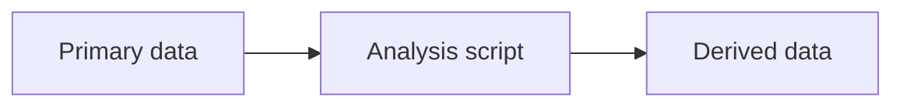

# Documenting your work

<!-- markdownlint-disable MD046 -->
<!-- The admonition syntax within mkdocs confuses markdownlint, because it thinks the
indented content of the admonition is code. -->

This page explains how to document your module on this site: what goes on its landing
page, how to fill it in and how to get it published.

These pages complement the
[Virtual Ecosystem documentation](https://virtual-ecosystem.readthedocs.io/en/latest/).
That site explains the model. Pages here explain how this repository parameterises,
runs and tests the model for our sites, and link to the VE documentation wherever the
model itself needs explaining.

## How module documentation is organised

Each module's documentation has two layers:

* **A module landing page** on this site, made from the
  [module landing page template][landing]. It is a site map for the module: it gives
  an overview, shows how the pipeline fits together, and links to every script and
  notebook with a brief description of what it does and how it is used.
* **The scripts and notebooks themselves**, which describe how they work in their
  metadata headers and comments. Start new files from the [script templates][scripts].

Detailed methods belong in the scripts and notebooks, not on the landing page.

[landing]: https://github.com/ImperialCollegeLondon/ve_data_science/blob/main/templates/docs/module_landing_template.md
[scripts]: https://github.com/ImperialCollegeLondon/ve_data_science/tree/main/templates

Each module has one landing page, at `docs/modules/<module>/index.md`. `<module>` is
the module's folder name in `analysis/`: `soil` (soil and litter), `abiotic` (abiotic
and hydrology), `animal` or `plant`. Any other pages for your module, such as a
validation plan, go in the same folder and sit under your module in the site menu.

Information about the study sites goes on the [Study sites](../background/study_sites.md)
page, not on module pages.

## The landing page sections

| Section | What goes in it |
| --- | --- |
| 1. Module overview | The general approach of the module, with links to the VE documentation |
| 2. Input data | Formats, special considerations, a pipeline figure, and the files that prepare inputs and parameters |
| 3. Output data | The outputs you work with, special considerations, and the files that process them |
| 4. Calibration | The files and tools used for calibration or sensitivity analysis |
| 5. Validation | The files and tools used for validation |
| 6. Other | Any testing or tools that do not fit the sections above |

Sections 2 to 6 each list files in a table with three columns:

* **File**: the path, linked to the file on GitHub.
* **What it does**: one sentence on its purpose.
* **How it is used**: when it is run and how it connects to other files. Say if it is
  part of a pipeline or used together with another file, for example "Run after
  `model_safe.R`; its output is read by `input_data_maliau_2.R`".

List the files in the order they are run.

## Steps

Each module's landing page already exists, made from the template, so you only need
to fill it in:

1. Create an issue for the work, and a branch named after it, as described in
   [Git and GitHub](../github_overview.md).
2. Open your module's page in `docs/modules/<module>/index.md`.
3. Fill in each section. The comments explain what to write; delete them as you go.
   When the page is complete, delete the "Draft" note at the top.
4. Preview the site on your computer:

    ```sh
    uvx --with mkdocs-material mkdocs serve
    ```

    Open <http://127.0.0.1:8000> and click every link on your page.

5. Commit, push and open a pull request. Ask someone who works on the module to
   review it.

### Adding another page

To add another page for your module, such as a validation plan, put it in the same
folder as the landing page. Then:

1. Add it to the `nav:` section of `mkdocs.yml`, under your module's heading in
   Modules. A page that is not listed there does not appear in the site menu. For
   example:

    ```yaml
      - Modules:
          - Animals:
              - Overview: modules/animal/index.md
              - Validation plan: modules/animal/validation_plan.md
    ```

2. Link to it from your module's landing page and from the
   [home page](../index.md).

To start a landing page for a new module, copy
[`module_landing_template.md`][landing] to `docs/modules/<module>/index.md` and add
it to the menu in the same way.

The site is published automatically when the pull request is merged into `main`.

## Writing rules

The repository checks every Markdown file when you commit. Most problems come from
these rules:

* Keep lines to 88 characters or fewer. Tables are exempt.
* Use spaces, not tabs. Text inside a note box must be indented by exactly four
  spaces.
* Use one `#` heading per page, on the first line.
* Pages with note boxes (`!!! note`) need the `markdownlint-disable MD046` comment
  at the top, as on this page.

Some style points help readers:

* Link to the VE documentation instead of explaining the model.
* Link to scripts and notebooks on GitHub rather than copying code into the page.
* Use a table when you are listing several scripts, inputs or outputs.
* Keep each page focused. If a section grows long, move the detail into the script
  or notebook it describes and link to it.

## Diagrams

The site draws diagrams written in [Mermaid](https://mermaid.js.org/). Write them in a
code block marked `mermaid`:

````markdown

````

The template includes an example pipeline figure you can edit.

## VE documentation to link from each module page

| Module page | Theory | Implementation |
| --- | --- | --- |
| Soil and litter | [Soil summary](https://virtual-ecosystem.readthedocs.io/en/latest/virtual_ecosystem/theory/soil/summary.html), [litter decay](https://virtual-ecosystem.readthedocs.io/en/latest/virtual_ecosystem/theory/soil/litter_theory.html) | [Soil model](https://virtual-ecosystem.readthedocs.io/en/latest/virtual_ecosystem/implementation/soil_implementation.html), [litter model](https://virtual-ecosystem.readthedocs.io/en/latest/virtual_ecosystem/implementation/litter_implementation.html) |
| Abiotic and hydrology | [Abiotic theory](https://virtual-ecosystem.readthedocs.io/en/latest/virtual_ecosystem/theory/abiotic_theory.html), [hydrology theory](https://virtual-ecosystem.readthedocs.io/en/latest/virtual_ecosystem/theory/hydrology_theory.html) | [Abiotic model](https://virtual-ecosystem.readthedocs.io/en/latest/virtual_ecosystem/implementation/abiotic_implementation.html), [abiotic simple model](https://virtual-ecosystem.readthedocs.io/en/latest/virtual_ecosystem/implementation/abiotic_simple_implementation.html), [hydrology model](https://virtual-ecosystem.readthedocs.io/en/latest/virtual_ecosystem/implementation/hydrology_implementation.html) |
| Animals | [Animal theory](https://virtual-ecosystem.readthedocs.io/en/latest/virtual_ecosystem/theory/animals/animal_theory.html) | [Animal model](https://virtual-ecosystem.readthedocs.io/en/latest/virtual_ecosystem/implementation/animal_implementation.html) |
| Plants | [Plant theory](https://virtual-ecosystem.readthedocs.io/en/latest/virtual_ecosystem/theory/plants/plant_theory.html) | [Plants model](https://virtual-ecosystem.readthedocs.io/en/latest/virtual_ecosystem/implementation/plants_implementation.html) |

## Checklist before opening a pull request

* [ ] All template comments and `[placeholders]` are removed
* [ ] The "Draft" note is removed, if the page is complete
* [ ] Any new page is in the `nav:` section of `mkdocs.yml` and linked from the home
  page
* [ ] Every link works in the local preview
* [ ] The commit checks pass
