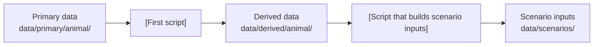

# Animals

<!-- markdownlint-disable MD046 -->
<!-- The admonition syntax within mkdocs confuses markdownlint, because it thinks the
indented content of the admonition is code. -->

!!! note "Draft"

    This page has not been filled in yet. It will describe how this repository
    parameterises, runs and tests the animals module, and link to the scripts and
    notebooks involved.

<!--
HOW TO FILL IN THIS PAGE

This page was created from templates/docs/module_landing_template.md. Replace
every [bracketed] placeholder, and delete these comments as you fill each section in.
When the page is complete, delete the "Draft" note at the top of the page.

The purpose of your module landing page is to create a "site map" for your
documentation, scripts and notebooks. It explains how everything fits together and
links to the files that hold the details. The scripts and notebooks themselves
describe how they work internally, in their metadata headers and comments, so this
page only needs a brief description of each file and how it is used. Each section 
below has a table where you can provide a link and brief description of these files. 

The page has six sections:

1. Module overview: the general approach of the module, with links to the VE docs.
2. Input data: formats, special considerations, the pipeline and the files that
   prepare the inputs.
3. Output data: the outputs you work with and the files that process them.
4. Calibration: the files and tools used to calibrate the module.
5. Validation: the files and tools used to validate the module.
6. Other: any testing or tools that do not fit the sections above.

Not needed:

1. Information on the sites or site-specific considerations. Please leave this for
   the Study sites page (docs/background/study_sites.md).
2. Any substantial repeats of the VE docs. Just include a link.
3. Detailed information about your methods. Please put this in your script and
   notebook comments, and link to the files from here.

If a section does not apply to your module yet, keep the heading and write one line
saying so, for example "No calibration has been done for this module yet."

FILE TABLES

Sections 2 to 6 each list files in a table. For each file, give:

- File: the path, linked to the file on GitHub. Link to a folder if several files
  do one job together.
- What it does: one sentence on its purpose.
- How it is used: when it is run and how it connects to other files. Say if it is
  part of a pipeline or used together with another file, for example "Run after
  model_safe.R; its output is read by input_data_maliau_2.R", or "Sourced by all
  scripts in this folder". Name any shared function from tools/ that it relies on.

List the files in the order they are run.
-->

## Module overview

<!--
Give a short overview of how this repository has interpreted and worked with the VE
for your module. Key questions can include:

- Which VE models does this module cover (for example soil and litter)?
- What is the general approach of the module?
- What is the current state of the work, and what is planned?

The links to the VE theory and implementation pages for this module are already
listed below. Link to them rather than explaining the model.
-->

[Two or three sentences describing how this repository parameterises and tests the
module.]

For how the model itself works, see the VE documentation:

* [Animal theory](https://virtual-ecosystem.readthedocs.io/en/latest/virtual_ecosystem/theory/animals/animal_theory.html)
* [Animal model implementation](https://virtual-ecosystem.readthedocs.io/en/latest/virtual_ecosystem/implementation/animal_implementation.html)

## Input data

<!--
Give a brief overview of the input data formats (link to the VE docs where
appropriate) and any special considerations about source or format. For example: is
the data spatially explicit? Continuous or categorical? Gridded or per plot?

Then give an overview of your pipeline. A figure is a good option: the flowchart
below renders as a diagram on the website. Edit the boxes to match your files, or
delete it if a figure does not help.
-->

[Brief overview of the input data, its formats and any special considerations.]

| File | What it does | How it is used |
| --- | --- | --- |
| [`analysis/animal/[folder]/[file]`](https://github.com/ImperialCollegeLondon/ve_data_science/tree/main/analysis/animal) | [One sentence] | [When it runs; what it reads from and feeds into] |
| [`analysis/animal/[folder]/[file]`](https://github.com/ImperialCollegeLondon/ve_data_science/tree/main/analysis/animal) | [One sentence] | [When it runs; what it reads from and feeds into] |

### Input parameters

<!--
Optional. Describe any input parameters that need specific pre-processing, and list
the files that produce them. Delete this subsection if it does not apply.
-->

[Brief description of the parameters and how they are derived.]

| File | What it does | How it is used |
| --- | --- | --- |
| [`path/to/file`](https://github.com/ImperialCollegeLondon/ve_data_science/tree/main) | [One sentence] | [When it runs; what it reads from and feeds into] |

## Output data

<!--
Give a brief description of the module outputs you work with and any special
considerations, such as variables that must be converted or aggregated before they
can be compared with observations. Then list the notebooks and scripts that process
the outputs.
-->

[Brief description of the outputs and any special considerations.]

| File | What it does | How it is used |
| --- | --- | --- |
| [`path/to/file`](https://github.com/ImperialCollegeLondon/ve_data_science/tree/main) | [One sentence] | [When it runs; what it reads from and feeds into] |

## Calibration

<!--
Give a short overview of any calibration or sensitivity analysis for this module,
then list the notebooks, tools and other documentation used.
-->

[Brief overview of the calibration work.]

| File | What it does | How it is used |
| --- | --- | --- |
| [`path/to/file`](https://github.com/ImperialCollegeLondon/ve_data_science/tree/main) | [One sentence] | [When it runs; what it reads from and feeds into] |

## Validation

<!--
Give a short overview of how the module outputs are validated, then list the
notebooks, tools and other documentation used.
-->

[Brief overview of the validation work.]

| File | What it does | How it is used |
| --- | --- | --- |
| [`path/to/file`](https://github.com/ImperialCollegeLondon/ve_data_science/tree/main) | [One sentence] | [When it runs; what it reads from and feeds into] |

## Other

<!--
Describe any special testing or tools that do not fit the sections above, using the
same table. Delete this section if there are none.
-->

[Brief description of other tools or testing.]

| File | What it does | How it is used |
| --- | --- | --- |
| [`path/to/file`](https://github.com/ImperialCollegeLondon/ve_data_science/tree/main) | [One sentence] | [When it runs; what it reads from and feeds into] |
