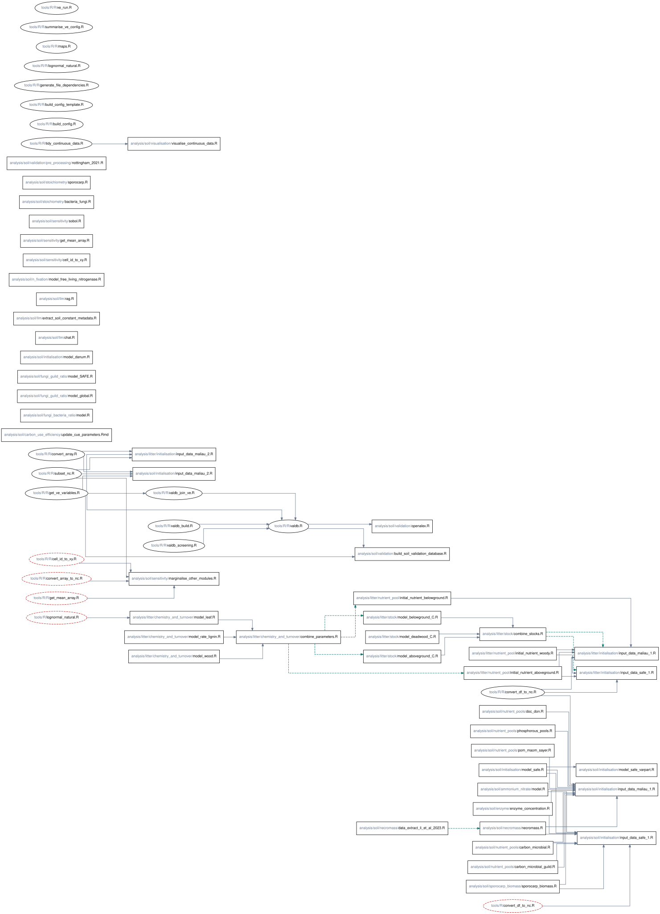

# Soil, litter, and shared-tools dependencies

This page maps tracked R and R Markdown code under `analysis/soil/`,
`analysis/litter/`, and `tools/`. Scenario and source data are not shown because
synchronisation to this repository is inconsistent.

## Explicit code dependencies

The Graphviz diagram below maps explicit `source()` and `box::use()`
relationships under the listed analysis and tools directories, excluding unit
tests. It also joins scripts that write and read an identical static CSV, YAML,
TOML, NetCDF, or Parquet path. Artefact files are not nodes. Each node labels
one scanned script or document. Directory paths are grey; filenames are black.
Open [the SVG directly](file_dependencies.svg) for interactive links, browser
zoom, and search.



The diagram is generated and rendered by
`tools/R/R/generate_file_dependencies.R`. Source it from R at the repository
root:

```r
source("tools/R/R/generate_file_dependencies.R")
build_file_dependency_graph()
render_file_dependency_graph()
```

`render_file_dependency_graph()` uses `DiagrammeR` and `DiagrammeRsvg` to
create `file_dependencies.svg` from the DOT file.

Solid arrows point from a required script to the script that uses it. Dashed
green arrows point from a script that writes a static artefact path to one that
reads it. Rectangles are analysis scripts; ellipses are scripts under `tools/`.
Calls in comments, Zarr, and dynamically constructed paths are excluded.

Dashed red nodes are paths referenced by code but absent from the scanned tree
(sometimes due to unmerged working branch). They expose known path
inconsistencies rather than silently resolving them.

There are a few lone nodes that may be removed / merged / refactored.

## Data dependencies

Data files are intentionally omitted from the tree. Input data are distributed
outside Git when they are too large or unavailable for repository storage.

Litter workflows depend on primary measurements and derived decay, stock, and
nutrient-pool products. Soil workflows depend on SAFE campaign observations,
spatial covariates, microbial and nutrient measurements, and published
stoichiometry or necromass values. Scenario compilers write soil and litter
NetCDF inputs. Validation combines source observations, validation schemas, and
Virtual Ecosystem outputs into Parquet data. See [the module overview](index.md)
for Maliau metadata and input-distribution details.
