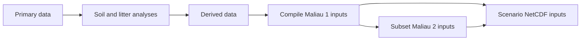

# Soil and litter

## Module overview

Here we prepares initial soil and litter states for Virtual Ecosystem
scenarios, principally by assembling analysed data into model-ready NetCDF
files. It also contains work to inspect outputs, build a validation database,
and sample initial-state ranges for sensitivity analysis.

For how the model itself works, see the VE documentation:

* [Soil summary](https://virtual-ecosystem.readthedocs.io/en/latest/virtual_ecosystem/theory/soil/summary.html)
* [Theory of litter decay](https://virtual-ecosystem.readthedocs.io/en/latest/virtual_ecosystem/theory/soil/litter_theory.html)
* [Soil model implementation](https://virtual-ecosystem.readthedocs.io/en/latest/virtual_ecosystem/implementation/soil_implementation.html)
* [Litter model implementation](https://virtual-ecosystem.readthedocs.io/en/latest/virtual_ecosystem/implementation/litter_implementation.html)

## Input data

Soil and litter initial states are spatial NetCDF inputs on the scenario grid.
The Maliau inputs include soil properties, carbon, nitrogen and phosphorus
pools, microbial and enzyme pools, litter pools, and lignin proportions.
Variable-level sources, units, and assumptions for the Maliau inputs are
recorded in
[`soil_litter_metadata.toml`](https://github.com/ImperialCollegeLondon/ve_data_science/blob/main/data/scenarios/maliau/soil_litter_metadata.toml).
Input data files are shared through Globus rather than stored in the repository.

| File | What it does | How it is used |
| --- | --- | --- |
| [`analysis/soil/initialisation/input_data_maliau_1.R`](https://github.com/ImperialCollegeLondon/ve_data_science/blob/main/analysis/soil/initialisation/input_data_maliau_1.R) | Compiles analysed soil variables into `soil_maliau.nc` for `maliau_1`. | Run after analyses that estimate soil variables; it reads grid metadata and writes the full-grid scenario input. |
| [`analysis/litter/initialisation/input_data_maliau_1.R`](https://github.com/ImperialCollegeLondon/ve_data_science/blob/main/analysis/litter/initialisation/input_data_maliau_1.R) | Compiles analysed litter variables into `litter_maliau.nc` for `maliau_1`. | Run after litter stock and nutrient analyses; it reads grid metadata and writes the full-grid scenario input. |
| [`analysis/soil/initialisation/input_data_maliau_2.R`](https://github.com/ImperialCollegeLondon/ve_data_science/blob/main/analysis/soil/initialisation/input_data_maliau_2.R) | Subsets the `maliau_1` soil input to the `maliau_2` grid. | Run after the `maliau_1` soil compilation; it writes the `maliau_2` soil input. |
| [`analysis/litter/initialisation/input_data_maliau_2.R`](https://github.com/ImperialCollegeLondon/ve_data_science/blob/main/analysis/litter/initialisation/input_data_maliau_2.R) | Subsets the `maliau_1` litter input to the `maliau_2` grid. | Run after the `maliau_1` litter compilation; it writes the `maliau_2` litter input. |
| [`data/scenarios/maliau/soil_litter_metadata.toml`](https://github.com/ImperialCollegeLondon/ve_data_science/blob/main/data/scenarios/maliau/soil_litter_metadata.toml) | Records provenance and units for Maliau soil and litter initial-state variables. | Read by the Maliau input-compilation scripts to obtain variable names and units; use it to trace a variable to its analysis script. |

## Output data

Virtual Ecosystem outputs for `maliau_2` are stored as a Zarr dataset. The
validation workflow joins selected outputs to observations after harmonising
those observations into the repository validation database. A separate script
demonstrates visualisation of continuous soil outputs and initial states.

| File | What it does | How it is used |
| --- | --- | --- |
| [`analysis/soil/validation/build_soil_validation_database.R`](https://github.com/ImperialCollegeLondon/ve_data_science/blob/main/analysis/soil/validation/build_soil_validation_database.R) | Builds the soil validation database and joins it to `maliau_2` model outputs. | Run after validation source schemas and data are available; it reads `out/model_data.zarr` and writes a Parquet dataset partitioned by source dataset. |
| [`analysis/soil/visualisation/visualise_continuous_data.R`](https://github.com/ImperialCollegeLondon/ve_data_science/blob/main/analysis/soil/visualisation/visualise_continuous_data.R) | Demonstrates plots of selected continuous soil outputs and initial states. | Run against Maliau output NetCDF files; it uses `tidy_continuous_data()` to prepare variables for time-series and spatial plots. |

## Calibration

No calibration workflow has been completed for the soil and litter module. The
available script creates Sobol samples across observed Maliau initial-state
ranges, which is preparatory sensitivity work rather than calibration.

| File | What it does | How it is used |
| --- | --- | --- |
| [`analysis/soil/sensitivity/sobol.R`](https://github.com/ImperialCollegeLondon/ve_data_science/blob/main/analysis/soil/sensitivity/sobol.R) | Reads required initial-state variables and generates first-order Sobol sample matrices scaled to Maliau input ranges. | Run with Maliau soil and litter input NetCDF files available; its sampled matrix can support later sensitivity experiments. |

## Validation

Validation harmonises observations into a common database, then joins model
values from the matching spatial and temporal context. The current soil workflow
targets the `maliau_2` scenario and remains work in progress. Validation is
fully documented in
[the validation database documentation](../../validation_database.md), including
a workflow flowchart.

| File | What it does | How it is used |
| --- | --- | --- |
| [`analysis/soil/validation/build_soil_validation_database.R`](https://github.com/ImperialCollegeLondon/ve_data_science/blob/main/analysis/soil/validation/build_soil_validation_database.R) | Builds the soil validation database and adds Virtual Ecosystem output values. | Run after source datasets have been screened and described by validation schemas; it writes the combined Parquet dataset for downstream validation. |
