# VE abiotic: findings for every microclimate variable

## Environment and data provenance

**uv environment (pinned VE).** The run and this analysis use the `dev-pinned`
dependency group in `pyproject.toml`:

| Item | Value |
| --- | --- |
| Install | `uv sync --group dev-pinned` |
| Virtual Ecosystem | `0.2.3`, git commit `3dd40851e4bdd81a9535afa73d70b1b4e49ddf52` |
| Run | `data/scenarios/maliau/maliau_2/out/abiotic/test_001` |
| Analysis | `notebook/abiotic/abiotic_report.ipynb` (reads `model_data.zarr`, does not rerun the model) |

**Data used: `maliau_2` site**

```toml
[Scenario.maliau_2]
# Site definition file for maliau_2
# Grid: 10 x 10 cells, resolution = 100 m
# Temporal: 2010-2020 (11 years)

epsg_code = 32650
ll_x = 495559.3
ll_y = 524298.8
ur_x = 496559.3
ur_y = 525298.8
```

Forcing is ERA5 (`era5_maliau_10x10_2010_2020.nc`). The layer structure has one
above-canopy layer, ten canopy layers, a 0.1 m surface layer and soil layers at
-0.25 m and -1.0 m. Only two canopy layers are occupied: a top layer at 38.6 m in every
cell and a second layer at 4.7-12.7 m in 88 cells. Total leaf area index is 5.7.

**Static mode.** The run starts from
`data/scenarios/maliau/maliau_2/config/static_abiotic_configuration_001.toml`. Only the
abiotic module is updated through time; all other modules are run in static mode, so
their outputs (shortwave absorption, leaf area index, transpiration, evaporation, soil
moisture, soil aerodynamic resistance) stay at their January 2010 values and the
results reflect the abiotic module alone.

| Module | `static` |
| --- | --- |
| `abiotic` | `false` (module under test) |
| `hydrology` | `true` |
| `plants` | `true` |
| `animal` | `true` |
| `litter` | `true` |
| `soil` | `true` |

The compiled configuration saved with the run gives its output path as `out\test_003`;
the log and `readme.txt` match `test_001`, so the folder was probably renamed after the
run.

## Summary

The run completes, and the variables taken directly from the ERA5 forcing (pressure,
CO₂) are correct. The temperature, humidity and energy fluxes are not realistic. Five
problems explain most of what is seen in the variables below:

1. **Heat cannot leave the canopy air.** The air in each canopy layer exchanges heat
   only with its own leaves; it does not mix with the layers above and below or with
   the air above the forest, and each month starts from the end of the last. The top
   canopy layer heats to about 40 °C and stays there.
2. **The daily temperature range is doubled.** The simulated range above the canopy is
   exactly twice the ERA5 range, so nights are too cold and become supersaturated,
   which removes water vapour from the air.
3. **Soil evaporative cooling is 730 times too small.** The energy used by soil
   evaporation is spread over a month instead of an hour, a unit error.
4. **Soil heat is not conserved.** Heat that flows into the subsoil is not lost by the
   topsoil, so heat is created and both layers warm by about 6 °C.
5. **The canopy receives the wrong amount of solar heat.** Total absorbed sunlight is
   treated as visible light (PAR) only, so half of it is assumed to be used by
   photosynthesis and part is then added back; the top layer is heated with 80 % of
   the sunlight it absorbs, where nearly all of it should become heat.

The table covers all 22 abiotic output variables in `maliau_variables_summary.xlsx`
(sheet `output_variables`).

| Variable | Status | Main issue |
| --- | --- | --- |
| air_temperature | Critical | Top canopy layer 39.5 °C, 17 °C above ERA5 |
| canopy_temperature | Critical | Top-layer leaves 37.7 °C as a 24-hour mean |
| soil_temperature | Problem | Topsoil 28.8 °C and subsoil 28.3 °C, about 6 °C above the air |
| diurnal_temperature_range | Problem | Above canopy exactly 2 times ERA5 (14.1 against 7.0 °C) |
| relative_humidity | Problem | 32 % in the top canopy layer; 83 % above canopy against 88 % in ERA5 |
| vapour_pressure | Problem | Above canopy 2.28 kPa against 2.45 kPa in the reference |
| vapour_pressure_deficit | Problem | 4.9 kPa in the top canopy layer, 15 times the reference |
| vapour_pressure_ref | OK | 2.45 kPa, matches ERA5; saved metadata gives the wrong unit |
| vapour_pressure_deficit_ref | OK | 0.32 kPa, matches ERA5; saved metadata gives the wrong unit |
| condensation | OK | Effectively zero (7.5e-5 mm per year) |
| wind_speed | OK (with note) | 0.47 m s⁻¹ above canopy; 0.1 m s⁻¹ floor in every layer below the top one |
| aerodynamic_resistance_canopy | OK | 48-81 s m⁻¹, higher when wind is lower |
| atmospheric_pressure | OK | 93.3-94.1 kPa, equal to the reference |
| atmospheric_co2 | OK | 400 ppm, equal to the reference |
| absorbed_longwave_radiation | Problem | Soil absorbs 445 W m⁻² from the hot canopy, more than the sky's 409 W m⁻² |
| longwave_emission | Problem | Top canopy layer emits 518 W m⁻² |
| net_radiation | Problem | 47.5 W m⁻² in total; hot leaves emit most of what they absorb |
| sensible_heat_flux | Problem | 2.1 W m⁻² from the top canopy layer, near zero after mid-2010 |
| latent_heat_flux | Problem | 32 W m⁻² from the canopy (about 105 expected); topsoil 730 times too small |
| ground_heat_flux | OK (with note) | 7.4 W m⁻² in 2010, then near zero |
| density_air | OK | 1.02-1.14 kg m⁻³, follows temperature |
| specific_heat_air | OK | 1 015-1 070 J kg⁻¹ K⁻¹, follows temperature |
| latent_heat_vapourisation | OK | 2 401-2 470 kJ kg⁻¹, follows temperature |

## How to read the variable figures

Each figure has three parts:

- **Left:** the mean over 2010-2020 in each grid cell.
- **Top right:** domain-mean monthly forcing: ERA5 air temperature for temperature and
  humidity, downward shortwave for radiation and fluxes, reference wind speed for
  resistance.
- **Bottom right:** the variable through time for every cell (light blue), the domain
  mean (dark blue) and, where one exists, the matching reference input (orange).

Layers are named by role: *above canopy* (40.6 m), *top canopy layer* (38.6 m),
*second canopy layer*, *surface layer* (0.1 m), *topsoil* (0-0.25 m) and *subsoil*
(0.25-1 m). Negative sensible and latent heat fluxes mean heat leaving the surface.
Values are means over 2010-2020 unless marked 2012-2020; those leave out the first two
years, while the model warms up from its initial state.

## Whole-domain problems

### Vertical profiles

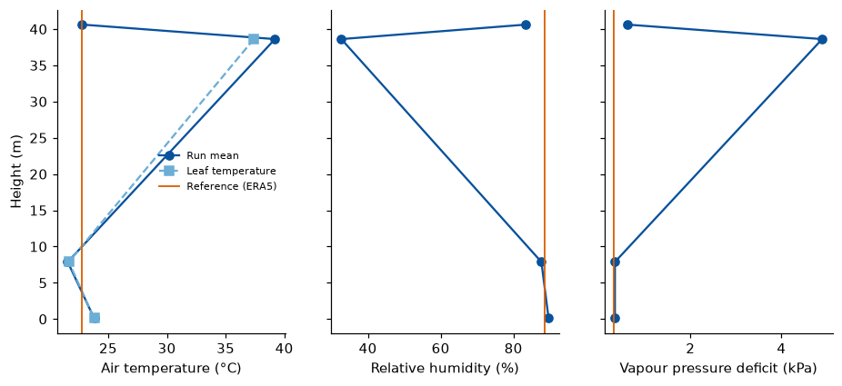

*Run means by layer. The top canopy layer is 16 °C warmer, 51 percentage points drier
and has 15 times the vapour pressure deficit of the air above it; the second canopy
layer and the surface layer are close to the reference.*

### Temperature drift

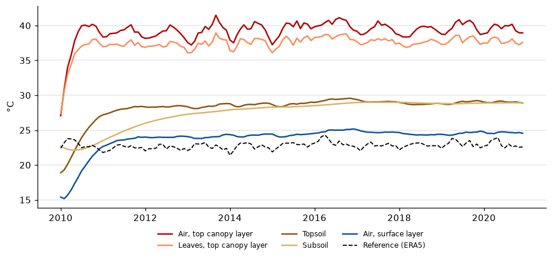

*Domain means. The top canopy layer warms from 27 °C to 40 °C between January and July
2010, the topsoil from 18.9 °C to 27 °C by the end of 2010, and the subsoil until about
2016. None of them returns towards the ERA5 temperature.*

- **Possible cause:** the model mixes water vapour between layers and with the air
  above the canopy, but not heat. Heat released by the leaves stays in the layer, and
  because each month starts from the previous month's state it accumulates. The
  starting profile (surface layer 14.9 °C, topsoil 19.1 °C, 100 % humidity) is also far
  from the forcing, so 2010 is not representative.

### Energy budget

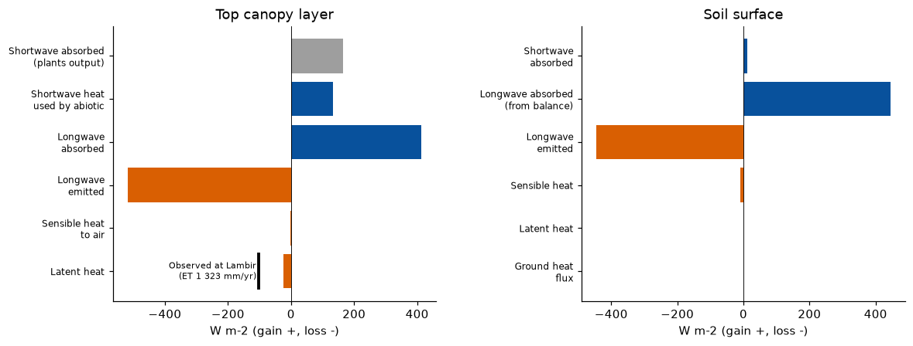

*Run means. The top canopy layer absorbs 166 W m⁻² of shortwave but is heated with
132 W m⁻²; latent heat removes 23 W m⁻², so the leaves warm until longwave emission
(518 W m⁻²) balances the budget. At the soil surface, longwave from the hot canopy
(445 W m⁻²) exceeds the sky's downward longwave (409 W m⁻²).*

- **Possible cause:** the shortwave absorbed by the layers is total sunlight (it sums to
  exactly the downward shortwave, 181.0 W m⁻² in January 2010), but the abiotic module
  treats it as visible light (PAR) only. It assumes 50 % of it is stored by
  photosynthesis, where only a few percent is, and adds an extra near-infrared share. The
  evaporation that sets latent heat comes from the plants and hydrology modules
  (413 mm per year), does not respond to temperature or VPD, and is about a third of
  observed values.

### Unit checks

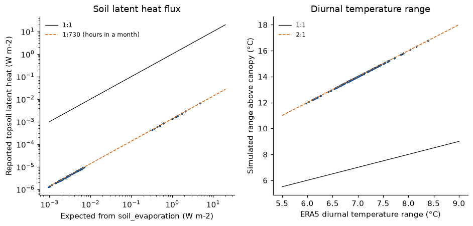

*Left: topsoil latent heat against the value implied by soil evaporation; every point
lies on the 1:730 line. Right: diurnal temperature range above the canopy against the
ERA5 input; every point lies on the 2:1 line.*

- **Possible cause:** each hour's soil evaporation is converted to an energy flux as if
  it had taken the whole month (30.4 days) to evaporate, instead of one hour
  (30.4375 × 24 = 730.5). The daily temperature cycle swings by the full daily range
  above and below the monthly mean, instead of half the range each way.

## Variables

### air_temperature

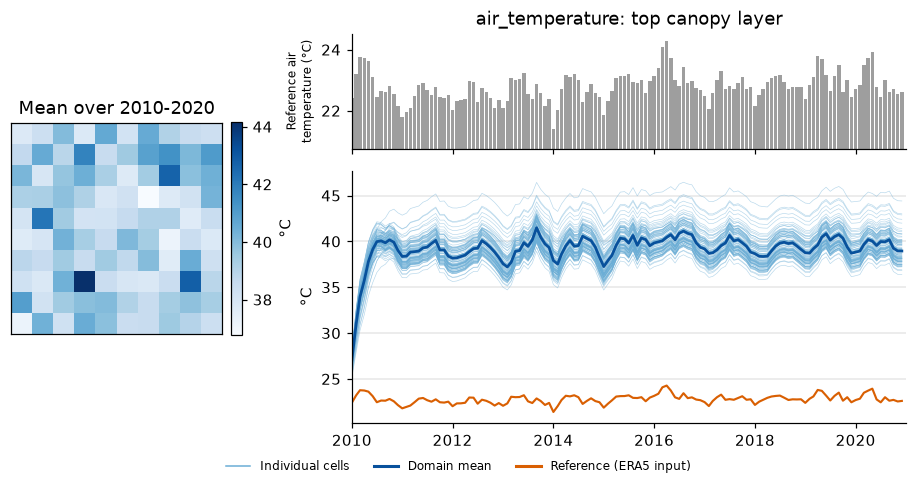

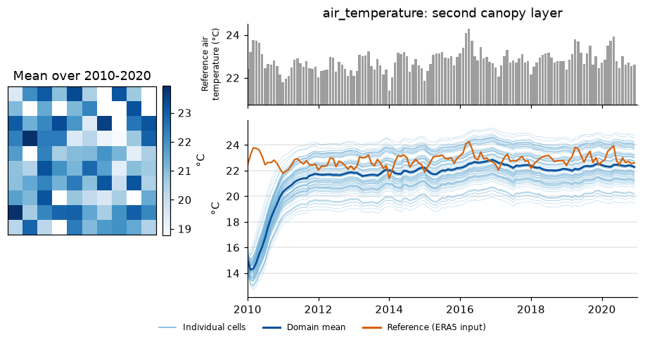

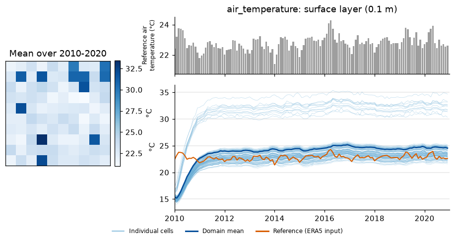

- **What it shows:** above the canopy equal to ERA5 (22.8 °C). In 2012-2020 the top
  canopy layer averages 39.5 °C (up to 46.5 °C as a monthly mean), the second canopy
  layer 22.1 °C and the surface layer 24.4 °C; uniform in time, with cells differing by a
  few degrees.
- **Problem:** the top canopy layer is 17 °C warmer than the air above it, and the
  surface layer is 1.6 °C warmer than ERA5 where forest floors are normally cooler.
- **Evidence:** understory near-ground temperatures are on average 1.6 °C cooler than
  open air across the tropics, and average 23.9 ± 1.6 °C in Borneo [1]. Higher leaf
  area index gives cooler, more humid air below the canopy in Sabah [2].
- **Possible cause:** canopy air is never mixed or ventilated (see *Temperature
  drift*). The surface layer warms because it absorbs longwave from the hot canopy; in
  the 12 cells without a second canopy layer it reaches 32.2 °C.

### canopy_temperature

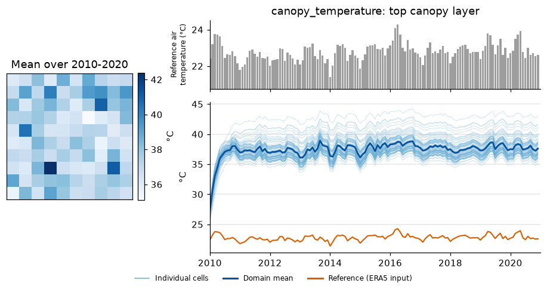

- **What it shows:** top-layer leaves 37.7 °C on average (up to 44.2 °C as a monthly
  mean), 1.8 °C cooler than the air around them; second-layer and surface leaves within
  0.1 °C of their air.
- **Problem:** a 24-hour mean of 37.7 °C is above the observed midday peak of upper
  canopy leaves.
- **Evidence:** pantropical upper-canopy leaf temperatures peak at about 34 °C at midday
  in dry periods and rarely exceed 40 °C [3].
- **Possible cause:** the leaves follow the unventilated air, and with latent heat
  limited by the evapotranspiration input only longwave emission can balance their
  energy budget.

### soil_temperature

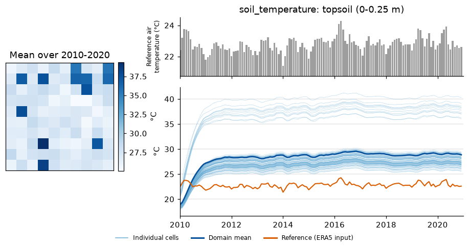

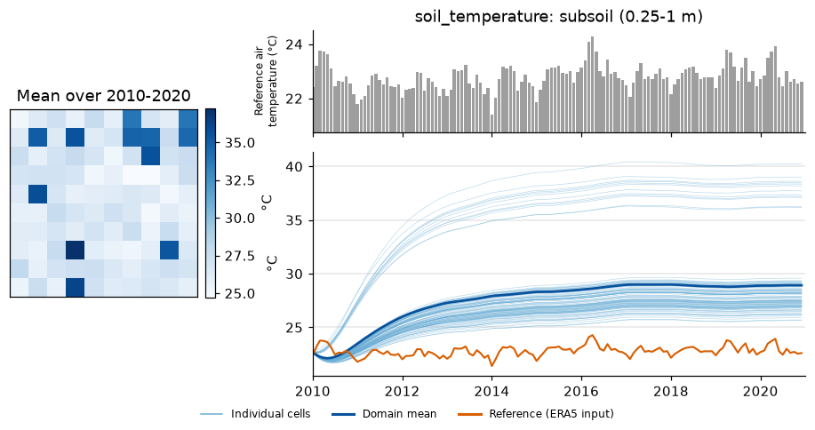

- **What it shows:** topsoil rises from 18.9 °C to 28.8 °C by 2012, subsoil from
  22.7 °C to 28.3-28.9 °C by 2016. Daily range 0.65 °C in the topsoil and 0.07 °C in the
  subsoil. Twelve cells reach 36-40 °C.
- **Problem:** both layers are about 6 °C warmer than the forest-floor air; soil at 1 m
  should be close to the mean annual air temperature, 22.8 °C (inferred; no Maliau
  soil temperature record was checked).
- **Possible cause:** heat conducted from the topsoil into the subsoil is added to the
  subsoil but not removed from the topsoil, so energy is created, and no heat can leave
  through the base of the soil. The soil also absorbs longwave from the hot canopy; the
  12 hottest cells have no second canopy layer, so their soil sees only the hot top
  layer.

### diurnal_temperature_range

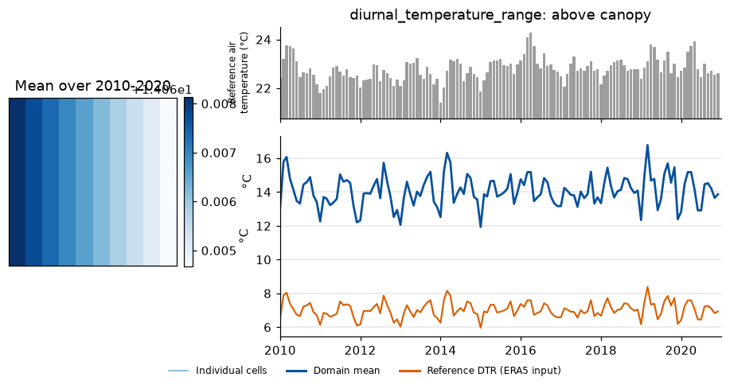

- **What it shows:** 14.1 °C above the canopy against 7.0 °C in ERA5, exactly 2.0 times
  in every cell and month; 9.5 °C in the top canopy layer, 1.5 °C in the surface layer
  and 0.65 °C in the topsoil.
- **Problem:** the above-canopy range is doubled.
- **Assessment:** the surface layer range is realistic.
- **Evidence:** daily temperature ranges inside tropical forests are 1.5-5 °C, against
  3-7.5 °C in the open [1].
- **Possible cause:** the daily cycle uses the whole range as the sine amplitude (see
  *Unit checks*).

### relative_humidity

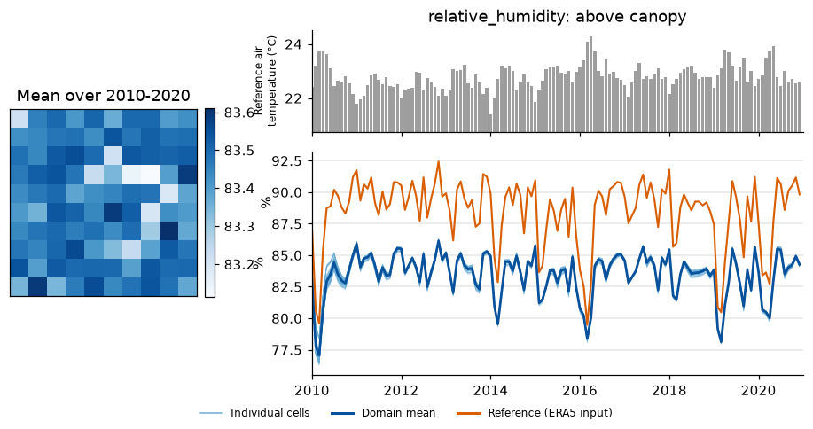

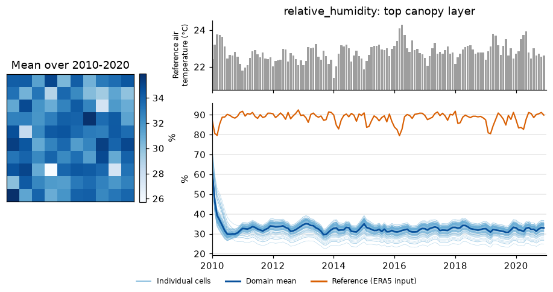

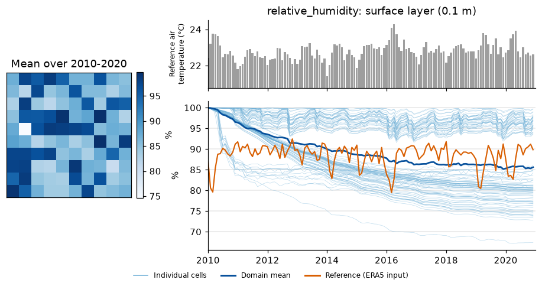

- **What it shows:** above the canopy 83.4 % against 88.5 % in ERA5; top canopy layer
  32.7 %; second canopy layer 87.7 % and surface layer 89.7 %, sometimes at the 99.999 %
  cap.
- **Problem:** the top canopy layer is far drier than a closed forest canopy, and the
  air above the canopy is 5 percentage points drier than its forcing.
- **Evidence:** intact Bornean forest keeps the air below the canopy humid; drying
  follows disturbance and lower leaf area index [2].
- **Possible cause:** the top layer is dry because it is 17 °C too warm. Above the
  canopy, the doubled daily range makes nights supersaturated, and clipping them at
  100 % removes water vapour. The humidity at which air is taken to be saturated is also
  calculated incorrectly; this is negligible at 22 °C but 21 % too low at 39 °C.

### vapour_pressure

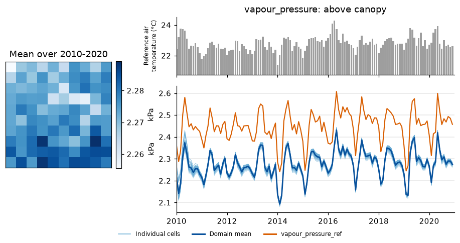

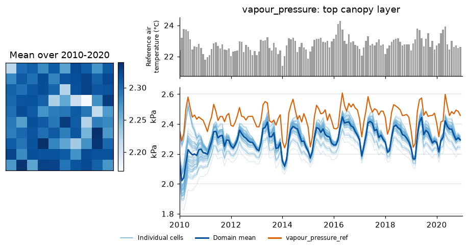

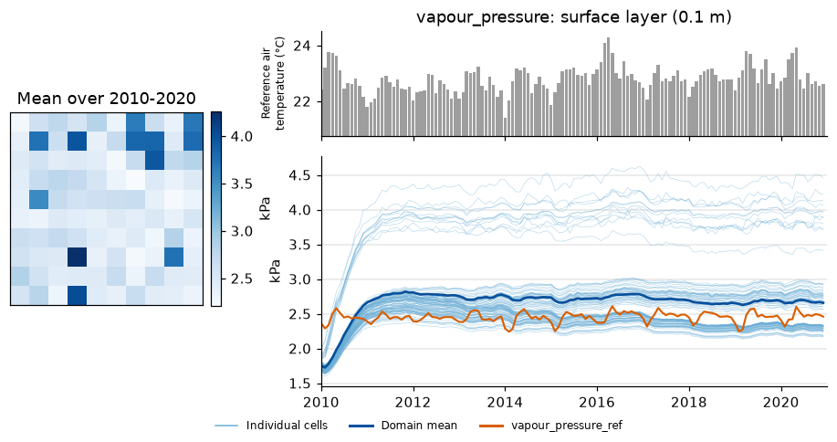

- **What it shows:** 2.28 kPa above the canopy, 2.30 kPa in the top canopy layer,
  2.25 kPa in the second layer and 2.66 kPa in the surface layer (up to 4.62 kPa),
  against 2.45 kPa in the reference. Above the canopy it follows the reference month by
  month, 0.1-0.2 kPa lower.
- **Problem:** above the canopy it should equal the reference that forces it.
- **Possible cause:** the night-time clipping caused by the doubled daily range. The
  higher surface-layer value comes from canopy evaporation added to a 0.1 m layer of air.

### vapour_pressure_deficit

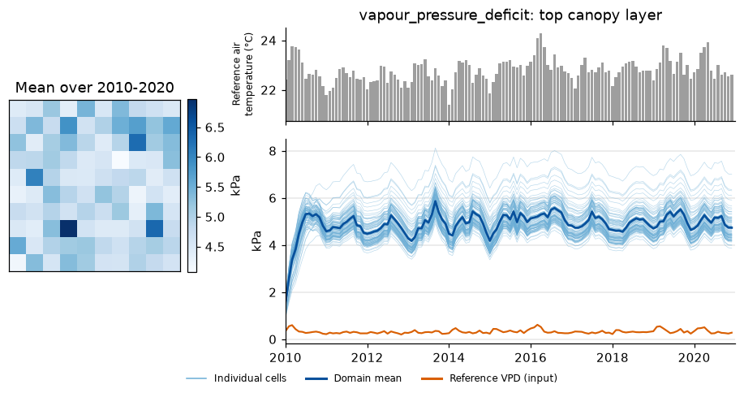

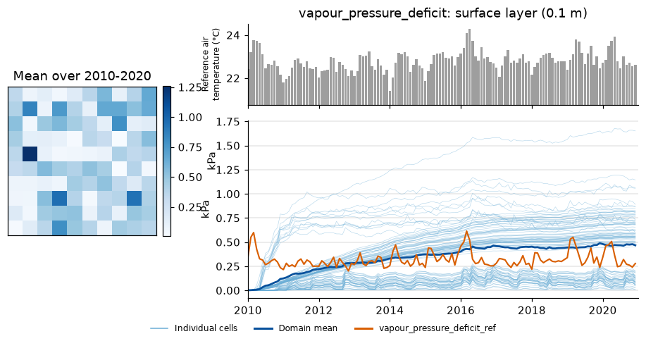

- **What it shows:** 4.9 kPa in the top canopy layer (above 3 kPa in 98 % of
  cell-months), 0.61 kPa above the canopy and 0.34 kPa in the second canopy and surface
  layers, against 0.32 kPa in the reference.
- **Problem:** 5 kPa in the canopy would close stomata, but the evapotranspiration input
  cannot respond; above the canopy VPD is twice the reference.
- **Possible cause:** the hot top canopy layer and the doubled daily range.

### vapour_pressure_ref

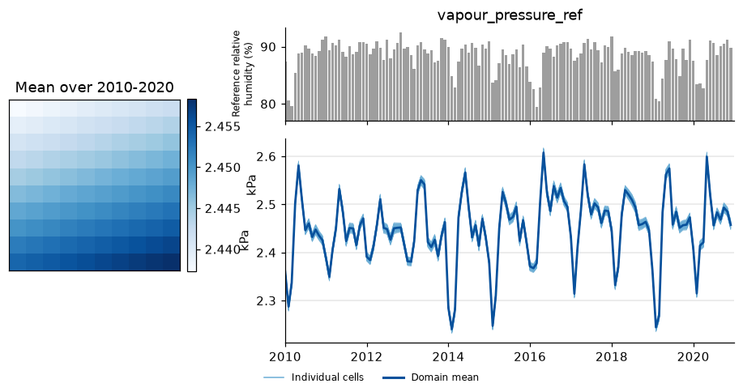

- **What it shows:** 2.23-2.62 kPa (mean 2.45 kPa), following ERA5 temperature and
  humidity.
- **Assessment:** correct; recalculating it from ERA5 reproduces every value to within
  1e-7 kPa. It is calculated once at the start of the run and stored with the initial
  data rather than with the other outputs.
- **Problem:** the output file labels it as relative humidity in %, although the values
  are vapour pressure in kPa.

### vapour_pressure_deficit_ref

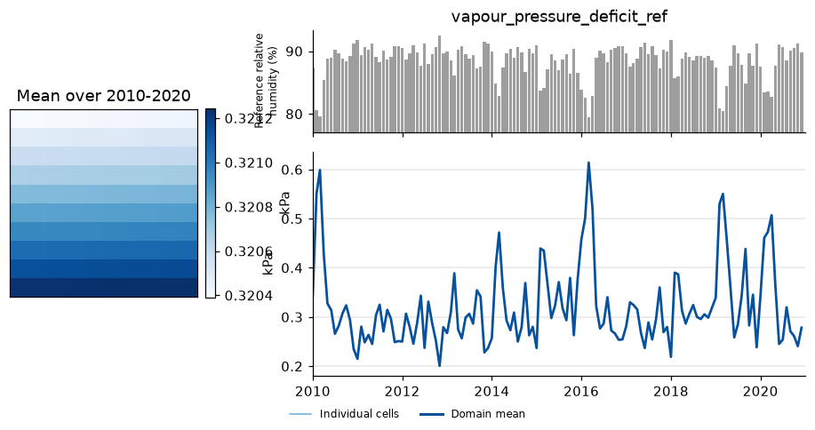

- **What it shows:** 0.20-0.62 kPa (mean 0.32 kPa), highest in February-April 2010, 2016
  and 2019.
- **Assessment:** correct (recalculated to within 1e-7 kPa from ERA5); same metadata
  problem as *vapour_pressure_ref*.

### condensation

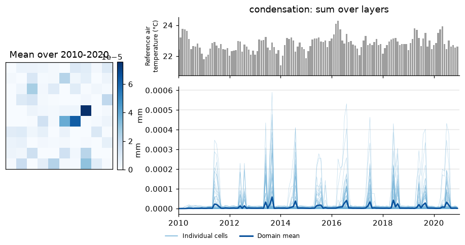

- **What it shows:** 7.5e-5 mm per year in total, at most 6e-4 mm in one cell and month,
  only in the second canopy and surface layers and mostly in mid-year.
- **Assessment:** effectively zero, as expected while the lower layers are rarely
  saturated after mixing. Moisture removed by clipping the above-canopy forcing is not
  counted as condensation.

### wind_speed

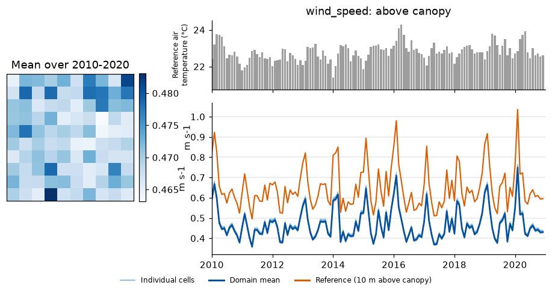

- **What it shows:** 0.47 m s⁻¹ above the canopy (the reference is 0.65 m s⁻¹ at 10 m
  above the canopy) and 0.40 m s⁻¹ in the top canopy layer; exactly 0.1 m s⁻¹ in every
  layer below.
- **Assessment:** plausible above the canopy.
- **Problem:** below the top layer the wind is always at the 0.1 m s⁻¹ minimum, so it
  carries no information.

### aerodynamic_resistance_canopy

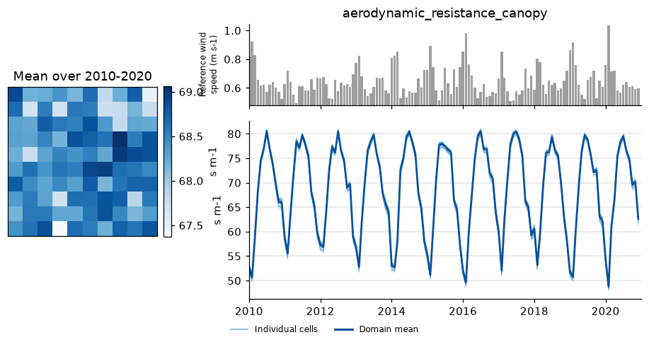

- **What it shows:** 48-81 s m⁻¹ (mean 68), higher when the reference wind is lower.
- **Assessment:** plausible; it averages the daytime value from the wind profile with the
  fixed night-time value of 100 s m⁻¹.

### atmospheric_pressure

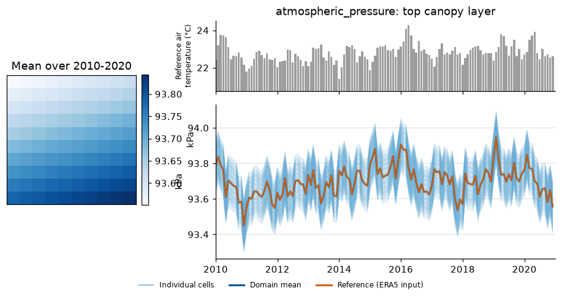

- **What it shows:** 93.3-94.1 kPa, equal to the reference in every layer and month.
- **Assessment:** correct copy of the reference.

### atmospheric_co2

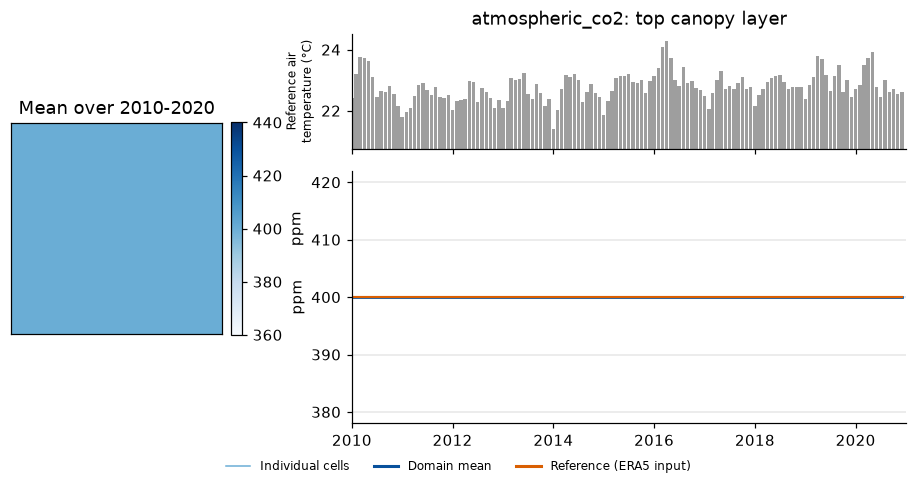

- **What it shows:** 400 ppm everywhere, equal to the constant reference input.
- **Assessment:** correct copy of the reference; the input has no trend or seasonality.

### absorbed_longwave_radiation

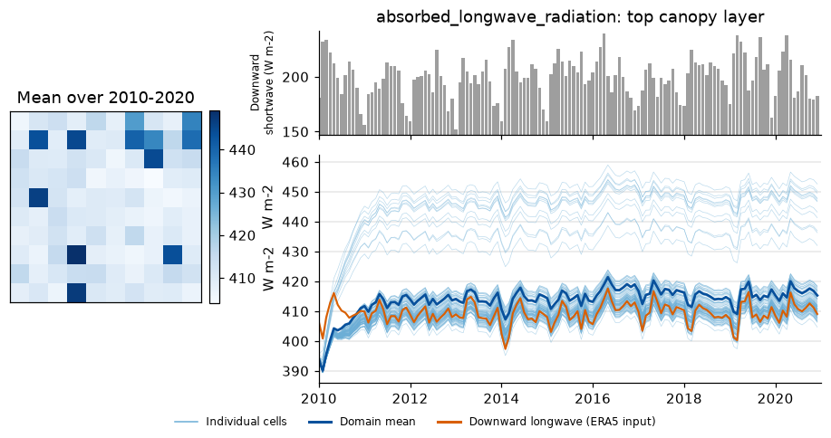

- **What it shows:** 414 W m⁻² in the top canopy layer, 433 in the surface layer and,
  from the soil energy balance, 445 at the topsoil, against 409 W m⁻² of downward
  longwave from the sky.
- **Problem:** the soil and lower layers absorb longwave emitted by the hot top layer,
  which spreads the canopy heating downwards. In the 12 cells with no second canopy
  layer, that layer is saved as 0 instead of empty (1 584 values), which lowers its mean
  from 425 to 375 W m⁻²; the topsoil value is not saved at all.
- **Possible cause:** a consequence of the hot canopy.

### longwave_emission

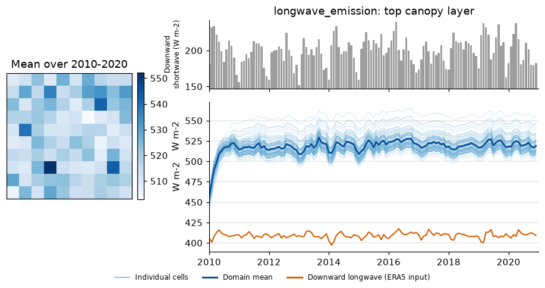

- **What it shows:** 518 W m⁻² from the top canopy layer (up to 565), 420 from the
  second layer, 432 from the surface layer and 445 from the topsoil.
- **Problem:** leaves at 37.7 °C emit about 100 W m⁻² more than leaves at air
  temperature would.
- **Possible cause:** a consequence of the hot canopy.

### net_radiation

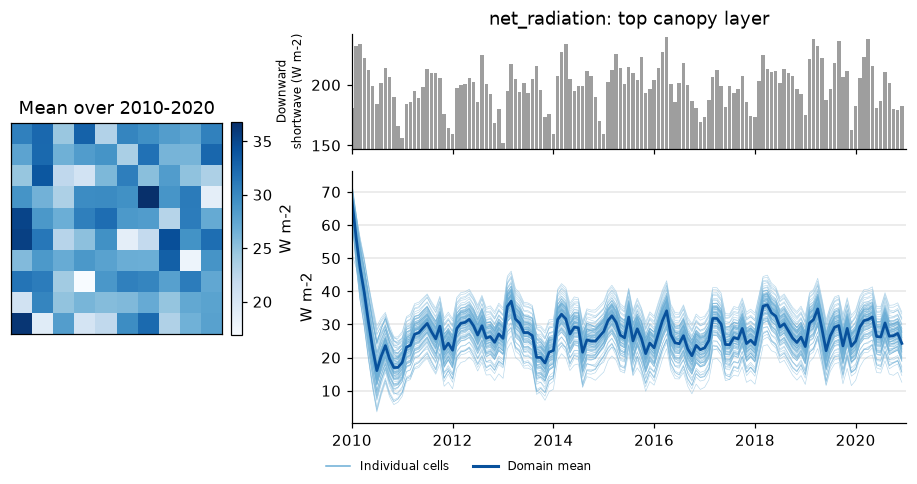

- **What it shows:** 27.7 W m⁻² in the top canopy layer, 9.2 in the second layer, 1.2 in
  the surface layer and 10.5 at the topsoil, 47.5 W m⁻² in total.
- **Problem:** observed latent heat over Bornean forest is 103-120 W m⁻², so net
  radiation must be at least that large (inferred from the energy balance).
- **Evidence:** evapotranspiration of 1 323 and 1 545 mm per year at Lambir [4], [5].
- **Possible cause:** the hot top layer emits most of the energy it absorbs, and the
  shortwave input is reduced by the PAR error.

### sensible_heat_flux

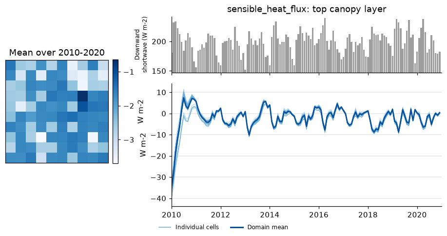

- **What it shows:** −35 W m⁻² from the top canopy layer in January 2010, then near zero
  (mean −2.1 W m⁻²); −0.6 W m⁻² from the second layer and −9.9 W m⁻² from the topsoil.
- **Problem:** the leaves cannot lose heat as sensible heat because the air around them
  heats up with them; only the first month behaves as expected.
- **Possible cause:** heat cannot leave the canopy air (see *Temperature drift*). The soil
  flux is small because the daytime soil resistance from the hydrology module is
  5 000 s m⁻¹ in 88 % of cells.

### latent_heat_flux

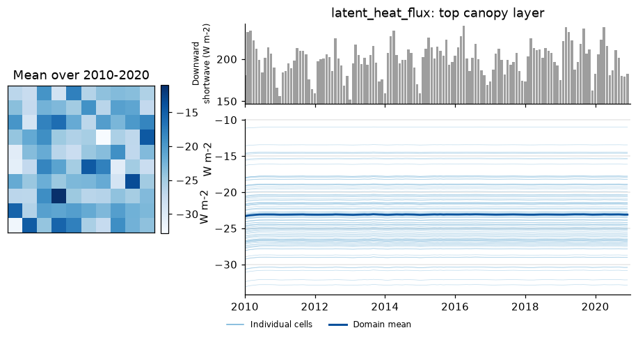

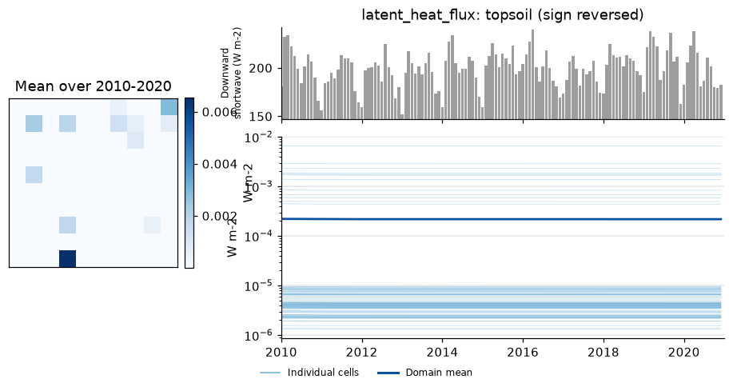

- **What it shows:** −23.1 W m⁻² from the top canopy layer and −32.2 W m⁻² from all
  layers, constant through the run; −0.0002 W m⁻² from the topsoil (shown with the sign
  reversed on a log scale).
- **Problem:** canopy latent heat is about a third of observed values, and topsoil latent
  heat is 730 times smaller than its own input implies (0.16 W m⁻²).
- **Evidence:** evapotranspiration of 1 323 mm per year [4] and 1 545 mm per year [5] at
  Lambir corresponds to about 103 and 120 W m⁻².
- **Possible cause:** the evapotranspiration input (413 mm per year, of which
  transpiration is 3 mm) from the static plants and hydrology modules; for the topsoil,
  the unit error in soil evaporative cooling (see *Unit checks*).

### ground_heat_flux

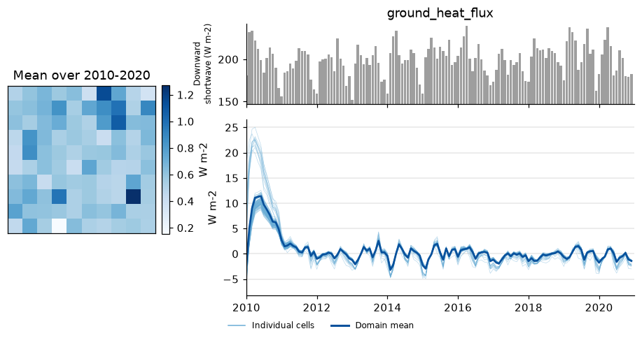

- **What it shows:** 7.4 W m⁻² in 2010 while the soil warms up, then −0.6 to 1.2 W m⁻²
  per year.
- **Assessment:** a near-zero annual mean is expected; the flux is calculated correctly,
  but the soil layers do not conserve it (see *soil_temperature*).

### density_air

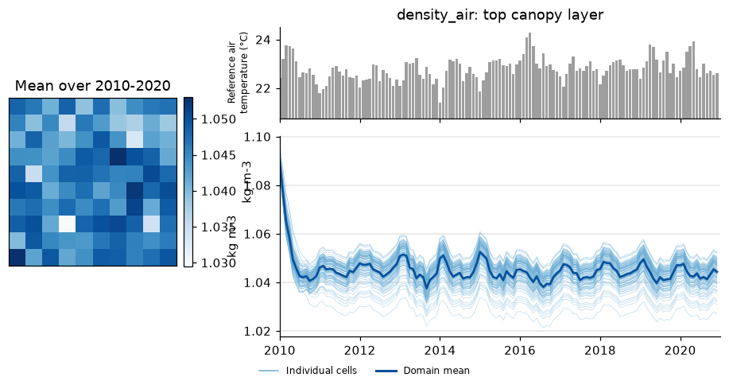

- **What it shows:** 1.02-1.14 kg m⁻³; 1.045 in the top canopy layer and 1.10 above it.
- **Assessment:** correct for the simulated temperature and pressure; the low top-layer
  value follows its high temperature.

### specific_heat_air

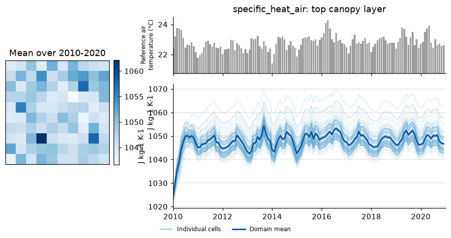

- **What it shows:** 1 015-1 070 J kg⁻¹ K⁻¹; 1 048 in the top canopy layer and about
  1 020 elsewhere.
- **Assessment:** correct for the simulated temperature; the top-layer value is high
  only because that layer is too hot.

### latent_heat_vapourisation

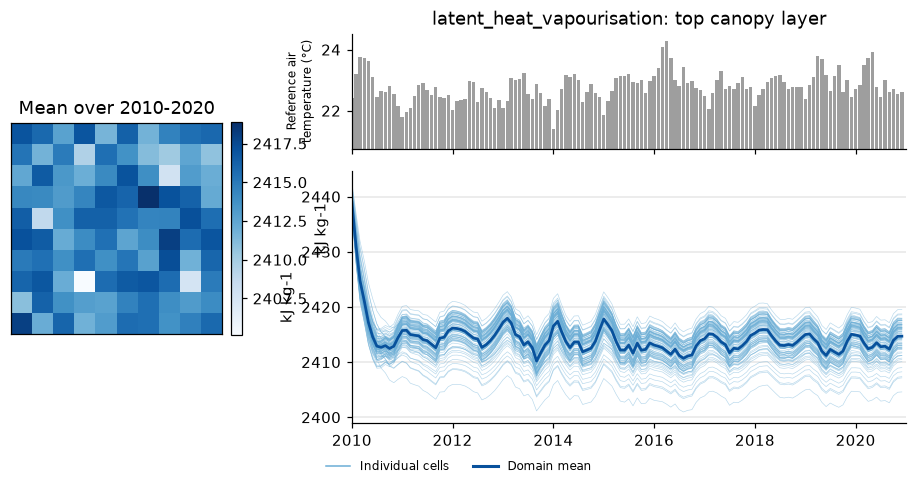

- **What it shows:** 2 401-2 470 kJ kg⁻¹; 2 414 in the top canopy layer and 2 445-2 450
  elsewhere.
- **Assessment:** correct for the simulated temperature.

## Comparison with Bornean lowland forest

| Quantity | This run (2012-2020) | Observed | Source |
| --- | --- | --- | --- |
| Understory air temperature (°C) | 24.4 (surface layer) | 23.9 ± 1.6, Borneo | [1] |
| Near-ground air against open air | 1.6 °C warmer | 1.6 °C cooler on average | [1] |
| Upper canopy leaf temperature (°C) | 37.7 as a 24-hour mean | midday peak about 34 | [3] |
| Daily temperature range near the ground (°C) | 1.5 | 1.5-5 inside forest; 3-7.5 in the open | [1] |
| Latent heat (W m⁻²) | 32 | about 103-120 (evapotranspiration 1 323-1 545 mm per year) | [4], [5] |
| Top canopy relative humidity (%) | 32 | humid below an intact canopy | [2] |

## Supporting evidence from the literature

The published values come from Borneo (Lambir in Sarawak, Sabah) or from pantropical
syntheses. They differ from this run in scale and method, so they show the expected
order of magnitude, not calibration targets.

| # | Study | Site and method | Values used here | Supports |
| --- | --- | --- | --- | --- |
| [1] | Ismaeel et al. (2024) | Pantropical understory temperature loggers combined with satellite data | Understory 1.6 °C cooler than open air; daily range 1.5-5 °C inside forest, 3-7.5 °C outside; Borneo mean 23.9 ± 1.6 °C | Canopy and surface air too warm; above-canopy range doubled |
| [2] | Hardwick et al. (2015) | Primary forest, logged forest and oil palm, Sabah; air temperature and humidity at 1.5 m against leaf area index | Higher leaf area index gives cooler, more humid air; logged forest up to 2.5 °C warmer than primary | A dense canopy should not produce hot, dry air |
| [3] | Doughty et al. (2023) | Pantropical upper-canopy leaf temperatures | Midday peak about 34 °C; rarely above 40 °C | Canopy temperature far too high |
| [4] | Kume et al. (2011) | Lambir Hills, Sarawak; big-leaf model checked against eddy covariance, 2000-2009 | Evapotranspiration 1 323 mm per year | Latent heat and net radiation too low |
| [5] | Kumagai et al. (2005) | Lambir Hills, Sarawak; annual water balance | Evapotranspiration 1 545 mm per year | Latent heat and net radiation too low |

**How the values were checked.** Values for [1] were taken from the full text, for [2]
and [3] from the abstracts, and for [4] and [5] from the hydrology report
(`flow_report_001`). Latent heat was calculated here as evapotranspiration × 2.45 MJ
kg⁻¹ divided by the seconds in a year.

### References

1. Ismaeel, A. et al. (2024). Patterns of tropical forest understory temperatures.
   *Nature Communications*, 15, 549. <https://doi.org/10.1038/s41467-024-44734-0>
2. Hardwick, S. R. et al. (2015). The relationship between leaf area index and
   microclimate in tropical forest and oil palm plantation: forest disturbance drives
   changes in microclimate. *Agricultural and Forest Meteorology*, 201, 187-195.
   <https://www.ncbi.nlm.nih.gov/pmc/articles/PMC5268355/>
3. Doughty, C. E. et al. (2023). Tropical forests are approaching critical temperature
   thresholds. *Nature*, 621, 105-111. <https://doi.org/10.1038/s41586-023-06391-z>
4. Kume, T. et al. (2011). Ten-year evapotranspiration estimates in a Bornean tropical
   rainforest. *Agricultural and Forest Meteorology*, 151, 1183-1192.
   <https://www.sciencedirect.com/science/article/abs/pii/S0168192311001183>
5. Kumagai, T. et al. (2005). Annual water balance and seasonality of
   evapotranspiration in a Bornean tropical rainforest. *Agricultural and Forest
   Meteorology*, 128, 81-92.
   <https://www.sciencedirect.com/science/article/abs/pii/S0168192304001935>

## Issues to resolve, in order of importance

1. **Heat exchange between the canopy and the atmosphere.**
   - *What should happen:* air inside a forest canopy is constantly stirred by wind and
     turbulence, so heat released by warm leaves is carried up and out of the canopy and
     canopy air stays within a degree or two of the air above the forest.
   - *Why the run gives these results:* in the model, canopy air exchanges heat only
     with its own leaves. It is not mixed with the layers above and below or with the
     air above the forest, although water vapour is, and each month starts from the
     state at the end of the previous month. The top canopy layer absorbs most of the
     sunlight; its leaves warm the air around them, the warmer air warms the leaves, and
     the only way out is longwave emission. The top layer therefore climbs from 27 °C in
     January 2010 to about 40 °C by July and stays there (Fig 2). The same problem
     explains the dry air (32 % humidity), the high VPD (4.9 kPa), the near-zero
     sensible heat flux, the high longwave emission (518 W m⁻²) and, through longwave
     reaching the ground, part of the soil warming.
2. **Daily temperature cycle.**
   - *What should happen:* ERA5 gives the daily temperature range, the gap between the
     day's maximum and minimum (7.0 °C on average here). A daily cycle with that range
     swings half of it above and half below the monthly mean (± 3.5 °C).
   - *Why the run gives these results:* the model swings by the whole range above and
     below the mean (± 7 °C), so the simulated range above the canopy is exactly twice
     the ERA5 range in every cell and month (Fig 4, right). Nights become about 3.5 °C
     too cold. The amount of water vapour is kept constant through the day, so at night
     the cold air would hold more than 100 % humidity; it is capped at 100 %, which
     removes water vapour. That is why above-canopy humidity is 83 % instead of 88 % and
     vapour pressure 2.28 instead of 2.45 kPa.
3. **Soil evaporative cooling.**
   - *What should happen:* evaporating 1 mm of water takes about 2.45 MJ per square
     metre. To express this as a flux in W m⁻² (joules per second), the energy is
     divided by the time over which the water evaporated.
   - *Why the run gives these results:* the soil evaporation is first split into hourly
     amounts, but the energy is then divided by the length of a month instead of an
     hour. The flux is 30.4375 × 24 = 730.5 times too small, and every point in Fig 4
     (left) lies on the 1:730 line. The canopy uses the correct hour, so only the soil
     is affected.
4. **Soil heat conservation.**
   - *What should happen:* heat flows down through soil from warm to cold, and whatever
     leaves the topsoil arrives in the subsoil, so energy is conserved. Soil at about 1 m
     depth stays close to the mean annual air temperature, so the base of the soil
     should either exchange heat with deeper soil at that temperature or pass no heat.
   - *Why the run gives these results:* heat that flows into the subsoil is added to
     the subsoil but not taken from the topsoil, so heat is created every hour. The
     subsoil warms from 22.7 °C to about 28.9 °C by 2016 and the topsoil settles near
     28.8 °C, about 6 °C above the air at the forest floor (Fig 2). Longwave from the hot
     canopy adds to this, most strongly in the 12 cells with no second canopy layer,
     where the topsoil reaches 36-40 °C.
5. **Solar heating of the canopy.**
   - *What should happen:* sunlight absorbed by leaves either heats them or is stored by
     photosynthesis, which takes only a few percent of the energy, so almost all
     absorbed sunlight becomes heat.
   - *Why the run gives these results:* the sunlight absorbed by each layer is total
     sunlight (in January 2010 it sums to exactly the downward shortwave,
     181.0 W m⁻²), but the abiotic module treats it as visible light (PAR) only. It
     assumes half is stored by photosynthesis and then adds back a near-infrared share.
     The top canopy layer absorbs 166 W m⁻² but is heated with 132 W m⁻², 80 % of what
     it absorbs (Fig 3). This makes the canopy cooler than it should be, so it partly
     hides item 1. It should be resolved after item 1: it adds about 30 W m⁻² of heat
     to the top canopy layer, which would make the canopy even hotter while heat cannot
     escape.
6. **Smaller points.**
   - The saturation humidity used for condensation is too low at high temperatures.
  
   - A canopy layer that does not exist in a cell gets 0 W m⁻² instead of being empty (NaN). 
     In this run, 12 cells have no second canopy layer; their zeros lower that layer's mean from 
     425 to 375 W m⁻². Fill missing layers with NaN, as the other outputs do.
    
   - The reference vapour pressure and VPD are labelled as relative humidity in % 
     in `AbioticModel._setup` (`abiotic_model.py`,lines 205-211)
  
   - The latitude is set to 0° `[abiotic] latitude = 0.0` instead of about 4.7° N, 
     which affects day length.

   - The starting profile comes from the simple abiotic model: surface air 14.9 °C, 
     topsoil 19.1 °C and 100 % humidity. The full model then takes months (air) to years (soil)
     to move away from it, so 2010-2011 are not representative. Either leave the first years out 
     of the analysis (the report quotes 2012-2020 for this reason), run a spin-up year first, or
    start from the ERA5 temperature and humidity.

7. **Inputs from other modules affecting the results.**
   - *Evaporation and transpiration:* 413 mm per year, of which only 3 mm is
     transpiration, against 1 323-1 545 mm observed [4], [5]. This limits canopy latent
     heat to about a third of observed values, so evaporation cannot cool the leaves.
   - *Soil aerodynamic resistance:* 5 000 s m⁻¹ in 88 % of cells, which almost stops
     the soil losing heat to the air during the day.
   - Both come from the plants and hydrology modules and stay at their January 2010
     values while those modules are static, so they limit the abiotic results until
     they are corrected there.

Once these are addressed, this report can be rerun on the corrected model and every
variable compared with the values above.
