# VE hydrology: test_001 against test_002

This report compares the hydrology of two `maliau_2` runs: `test_001`, made before the water-balance fixes (reported in `flow_report_001`), and `test_002`, made after the identified issues were addressed in [PR #1935](https://github.com/ImperialCollegeLondon/virtual_ecosystem/pull/1935) and [PR #1919](https://github.com/ImperialCollegeLondon/virtual_ecosystem/pull/1919). The diagnostic report for `test_001` informed these changes, and `test_002` was run afterwards to assess their effects on model behaviour. For each variable the report describes what test_002 shows, the problem that remains and its possible cause, with a remark where calibration is needed, and ends with the calibration points. Figures and numbers come from `notebook/hydrology/flow_report/hydrological_flow_comparison_002.ipynb`, which reads both runs' `model_data.zarr` stores, and from `data/derived/validation/hydrology/hydrology_validation_test_002.xlsx`, which places the test_002 values next to the observed stream and soil moisture data.

## Environment and data provenance

| Item | test_001 | test_002 |
| --- | --- | --- |
| Virtual Ecosystem (logfile.log) | `0.2.1` | `0.2.3` |
| VE commit (run readme) | `22689f01`  | `3dd40851` (following [PR #1935](https://github.com/ImperialCollegeLondon/virtual_ecosystem/pull/1935) and [PR #1919](https://github.com/ImperialCollegeLondon/virtual_ecosystem/pull/1919)) |
| Base configuration | `static_hydro_configuration_001` | `static_hydro_configuration_002` |
| Input data folder | `data/sensitivity/hydrology/data` | `data/scenarios/maliau/maliau_2/data` |
| Grid origin (`xoff`, `yoff`) | 496 400, 524 100 | 495 559.3, 524 298.8 |
| Elevation range | 212-432 m | 255-533 m |
| Drainage sinks (cells draining in) | 18 (79), 10 (19) | 23 (54), 9 (25), 51 (10), 4 (7) |
| Static modules | `abiotic_simple`, `plants`, `animal`, `litter`, `soil` | `abiotic`, `plants`, `animal`, `litter`, `soil` |
| Dynamic module | `hydrology` | `hydrology` |
| Timing | 2010-01 to 2020-12, 132 monthly steps of 30 daily steps | same as test_001 |

**Hydrology parameters that changed**

| Parameter | test_001 | test_002 |
| --- | --- | --- |
| `saturated_hydraulic_conductivity` (m s⁻¹) | 3.5e-5, all layers | 3.5e-5 topsoil, 3.5e-7 subsoil |
| `van_genuchten_nonlinearity_parameter` | 1.598 | 2.0 |
| Snow parameters, water-balance tolerances | not present | added (no snow falls at this site) |

All other hydrology settings are identical (initial soil moisture 0.5, initial
groundwater 90 % of the 500 mm capacity, `max_percolation_rate_uzlz` 2.7 mm per
day, `groundwater_loss` 1 mm per day, reservoir constants 20 days,
`bypass_flow_coefficient` 1.0, `stormflow_coefficient` 0.05,
`air_entry_potential_inverse` 0.042 m⁻¹).

**The two runs do not cover the same ground.** test_002 uses the grid shifted
about 841 m west and 199 m north that `flow_report_001` noted for the
`hydrology_morris_001` runs. Its elevation field, and therefore its drainage
network, differ: it has four sinks instead of two. Rainfall on the two grids
differs by less than 0.5 % per year, and the abiotic module (static in both) is
the full rather than the simple one. Domain-mean local fluxes are therefore
comparable, but maps and routed values (anything `_routed_plus_local`, total
runoff and discharge) are not like-for-like.

## Summary

The three defects that dominated test_001 are fixed, and test_002 conserves
water: the model checks closure every day and every month to a relative tolerance
of 1e-6 and stops if it fails, and test_002 ran to the end. From 2011, outputs
equal rainfall within 2 % in every year.

- Water is no longer created in the groundwater stores (baseflow in 2010 is
  995 mm instead of 12 603 mm; neither store goes negative).
- Water drains through the soil (about 945 mm per year leaves the topsoil instead
  of 0.004 mm; surface runoff falls from 84 % to 1.3 % of rainfall).
- River discharge matches total runoff instead of being 30 times too small.

The water is now accounted for, but it takes the wrong paths. Three problems
explain most of what remains in the flow variables below:

1. **Too little water returns to the atmosphere.** Evapotranspiration is 366 mm
   per year because transpiration is 3 mm per year. Rainfall minus streamflow is
   797-1 110 mm per year in the PF and VJR catchments, and evapotranspiration at
   Lambir is 1 323-1 545 mm per year. The rest goes to runoff.
2. **Most water bypasses the soil.** Bypass flow takes 53 % of rainfall straight to
   groundwater and carries 94 % of groundwater recharge, so the soil matrix plays
   little part in what reaches the streams.
3. **Groundwater parameters, not recharge, set the slow flows.** The lower store is
   fed at most 2.7 mm per day and loses a fixed 1 mm per day, so baseflow from it
   sits near a ceiling of about 620 mm per year and 13 % of rainfall leaves the site
   as `groundwater_loss` regardless of conditions.

| Flow variable | test_001 | test_002 status | Main remaining issue |
| --- | --- | --- | --- |
| precipitation_surface (throughfall) | OK, 87 % of rainfall | OK | Interception 13 %, slightly above 11 % observed |
| surface_runoff | Problem, 84 % of rainfall | Fixed | 1.3 % of rainfall, below 4.6 % observed |
| bypass_flow | Problem, small and declining | Problem | 53 % of rainfall, 94 % of recharge |
| vertical_flow | Problem, about 1e-5 mm per day | Fixed | Set by tuned Ksat and van Genuchten n |
| subsurface_stormflow | Problem, drains once then stops | Fixed | Largest local term, 31 % of rainfall |
| subsurface_flow | Problem, 2 589 mm in 2010 then about 2 | Fixed | Fed mainly by bypass flow |
| baseflow | Critical, 12 603 mm in 2010, zero from 2014 | Fixed | Held near a ceiling by percolation and loss |
| groundwater_loss | Removed even from an empty store | Fixed | Fixed 360 mm per year (13 % of rainfall) |
| surface_runoff_routed_plus_local | OK, sinks counted twice | Fixed | None |
| subsurface_runoff_routed_plus_local | Problem, created baseflow | Fixed | 98 % of runoff is subsurface |
| total_runoff | Problem, falls from 130 924 mm | Fixed | Runoff ratio high because evapotranspiration is low |
| river_discharge_rate | Problem, 30 times too small | Fixed | Weak month-to-month match with observed streams |

## How water moves through the model

The sections below follow the water from rainfall to the outlets:

1. **Canopy:** rainfall, interception and throughfall (`precipitation_surface`).
2. **Land surface:** `surface_runoff`, `bypass_flow` to groundwater, and infiltration.
3. **Soil:** topsoil and subsoil moisture, `vertical_flow` between them and to
   groundwater, and lateral `subsurface_stormflow`.
4. **Groundwater:** upper store (`subsurface_flow`), lower store (`baseflow`) and
   `groundwater_loss`.
5. **Routing and outlets:** routed surface and subsurface runoff, `total_runoff`
   and `river_discharge_rate` at the sinks, compared with the gauged streams.

The whole-domain water balance comes first, because it shows how the water is
shared between these paths.

## How to read the flow-variable figures

Flow-variable figures have three parts:

- **Top:** the mean over 2010-2020 in each cell for test_001 (left) and test_002
  (right); orange crosses are the drainage sinks. The two maps cover different
  ground (see above) and have their own colour scales.
- **Middle:** domain-mean monthly rainfall (ERA5, test_002 grid).
- **Bottom:** domain mean (solid) and main sink (dashed) for test_001 (grey) and
  test_002 (blue).

Routed variables, discharge and vertical flow use a log scale.

## Water balance

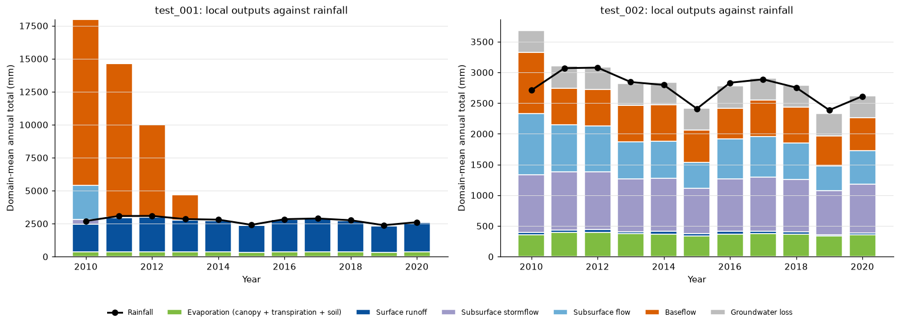

*Annual local outputs (bars) against rainfall (line); note the different y-axes.
test_001 outputs are 6.7, 4.7 and 3.2 times rainfall in 2010-2012. test_002
outputs are 1.36 times rainfall in 2010 and 0.98-1.01 times from 2011.*

| Domain-mean, mm per year (2011-2020 mean) | test_001 | test_002 |
| --- | --- | --- |
| Rainfall | 2 773 | 2 767 |
| Canopy evaporation | 355 | 359 |
| Transpiration | 3.2 | 3.2 |
| Soil evaporation | 0.06 | 5.3 |
| Surface runoff | 2 359 | 37 |
| Subsurface stormflow | 3.6 | 844 |
| Subsurface flow | 3.0 | 600 |
| Baseflow | 2 052 (all in 2011-2013) | 561 |
| Groundwater loss | not reported | 360 |
| Outputs / rainfall | 0.98-4.74 | 0.98-1.01 |

- **What it shows:** inputs now equal outputs plus the change in storage (test_001
  created water). Evapotranspiration is 13 % of rainfall and local runoff 77 %.
  2010 outputs are 36 % above rainfall.
- **Problem:** the partition is wrong: in the PF and VJR catchments rainfall minus
  streamflow is 23-38 % of rainfall, against 13 % here. The 2010 excess is the
  initial stores draining, not created water.
- **Possible cause:** transpiration passed from the (static) plants module is
  3 mm per year (see *Comparison with Bornean lowland forest*). The run starts with
  450 mm in each groundwater store, far above the 30 mm or so where they settle.
  *Calibration:* check the transpiration units first (calibration point 1); start
  the stores near their settled level or leave 2010 out (point 7).

## 1. Canopy

Rain is first intercepted by the canopy; what is not evaporated reaches the ground as throughfall.

### precipitation_surface (throughfall)

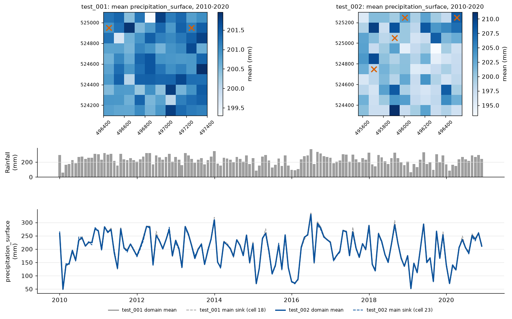

- **What it shows:** 2 060-2 694 mm per year, 86-88 % of rainfall, in both runs;
  interception loss is about 359 mm per year (13 %).
- **Problem:** none; realistic. Interception loss was 11 % of rainfall in unlogged
  forest in Central Kalimantan [1] and 209 mm per year at Lambir [4].

## 2. Land surface

Throughfall either runs off the surface, bypasses the soil through preferential paths to groundwater, or infiltrates the topsoil.

### surface_runoff

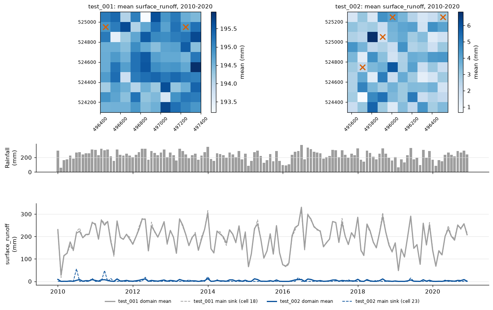

- **What it shows:** test_002 averages 36 mm per year (1.3 % of rainfall, 25-51 mm
  per year); 87 % of cell-months have none. It occurs in wet months (correlation
  with rainfall 0.82, no lag). test_001 was 84 % of rainfall.
- **Problem:** slightly low. Overland flow was 4.6 % of rainfall on an undisturbed
  plot at Danum Valley [3]; reviews find overland flow uncommon under undisturbed
  forest [2], so the value is of the right order.
- **Possible cause:** the topsoil drains quickly (topsoil Ksat 12.6 cm per hour,
  5-57 times the Danum field range), and the daily drainage capacity is added to
  infiltration before runoff is calculated, so rain rarely exceeds what the
  topsoil can take in a day. *Calibration:* lowering the topsoil Ksat towards the
  field range should raise surface runoff (point 5).

### bypass_flow

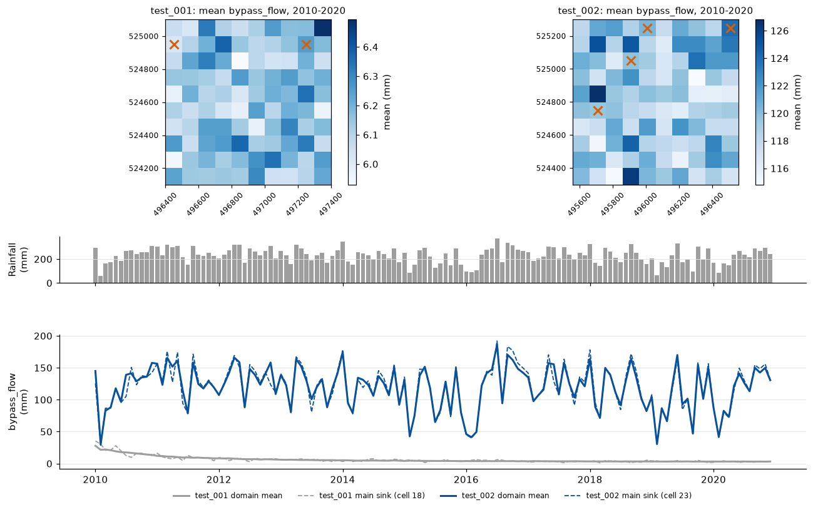

- **What it shows:** 1 225-1 605 mm per year, 53 % of rainfall and 61 % of
  throughfall, following rainfall exactly (correlation 1.00). In test_001 it was
  39-223 mm per year and unrelated to rainfall.
- **Problem:** it carries 94 % of groundwater recharge (1 470 mm per year against
  89 mm of drainage from the subsoil), so most water reaches the streams without
  passing through the soil matrix.
- **Possible cause:** the share of infiltrating water that bypasses the soil is
  (topsoil moisture / saturation) raised to `bypass_flow_coefficient`. The topsoil
  is at about 63 % of saturation and the coefficient is 1.0, so about 63 %
  bypasses; the bypass is also worked out before the topsoil's daily drainage
  capacity is added to infiltration. *Calibration:* raise
  `bypass_flow_coefficient` so bypass is a minor share of recharge (0.63³ = 0.25),
  checked against the baseflow index (point 2).

## 3. Soil

Water in the topsoil drains to the subsoil; the subsoil loses water laterally as stormflow and drains slowly to groundwater.

### Soil moisture

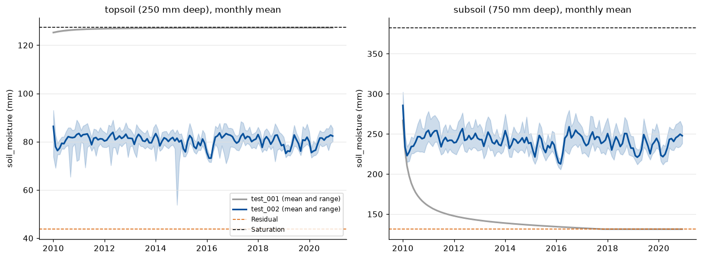

*test_001: topsoil pinned at saturation, subsoil drains to residual and stays
there. test_002: topsoil 54-93 mm (saturation 127.5 mm), subsoil 206-302 mm
(saturation 382.5 mm), both varying with rainfall.*

- **What it shows:** neither layer reaches saturation or residual in any monthly
  mean, and the topsoil is wetter in wet months and drier in dry months. The
  topsoil averages 80 mm (volumetric 0.32).
- **Problem:** the topsoil is wetter and steadier than measured. Probe readings
  (0-12 cm) at the Maliau and Danum old-growth plots (Car_Bel, Car_Ser, Car_D1,
  Car_D2 and the termite-experiment plots) average 25-69 mm per plot (volumetric
  0.10-0.28) once scaled to the 250 mm layer; the probe depth is shallower than the
  model layer, so the comparison is indicative. The matric potential is also
  extreme: its median in the topsoil is -475 kPa, and in 9 cell-months it falls to
  -1.9e14 kPa because the topsoil reaches residual moisture on some days.
- **Possible cause:** the retention and drainage parameters (Ksat, van Genuchten n,
  `air_entry_potential_inverse` 0.042 m⁻¹) were tuned for vertical flow, not fitted
  to measured retention; the units of `air_entry_potential_inverse` are worth
  checking (inferred, not checked against the source). The matric potential has no
  lower bound. *Calibration:* fit the retention parameters to the plot soil
  moisture (point 6), after Ksat (point 5).

### vertical_flow

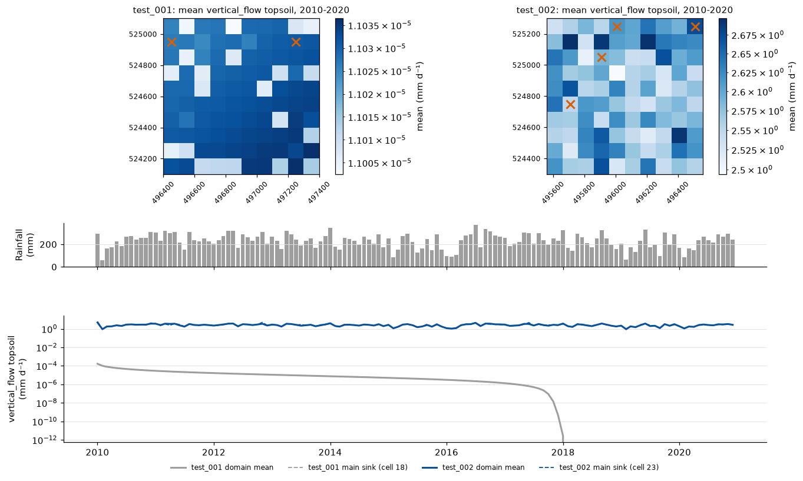

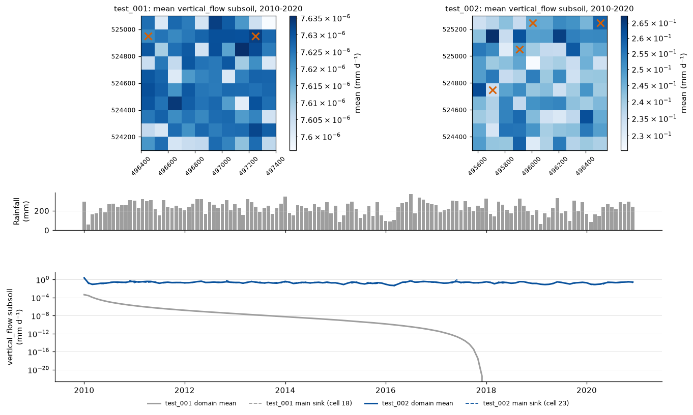

- **What it shows:** out of the topsoil, 2.6 mm per day on average (0.33-7.2;
  about 945 mm per year), following rainfall closely (correlation 0.98). Out of
  the subsoil into groundwater, 0.24 mm per day on average (0.03-3.5; about
  89 mm per year), lagging rainfall by about a month (correlation 0.69 at a
  one-month lag). test_001 was about 1e-5 mm per day and stopped in 2018.
- **Problem:** its size is set by parameters chosen to make water move, not by
  data. The topsoil Ksat (12.6 cm per hour) is 5-57 times the 0.22-2.54 cm per hour
  measured at Danum Valley [3], the subsoil Ksat (0.126 cm per hour) is below it,
  and van Genuchten n was raised from 1.598 to 2.0 to increase vertical flow.
- **Possible cause:** the low subsoil conductivity holds water in the subsoil,
  which then leaves laterally as stormflow rather than draining to groundwater.
  *Calibration:* set Ksat for both layers and n from measured values (point 5).

### subsurface_stormflow

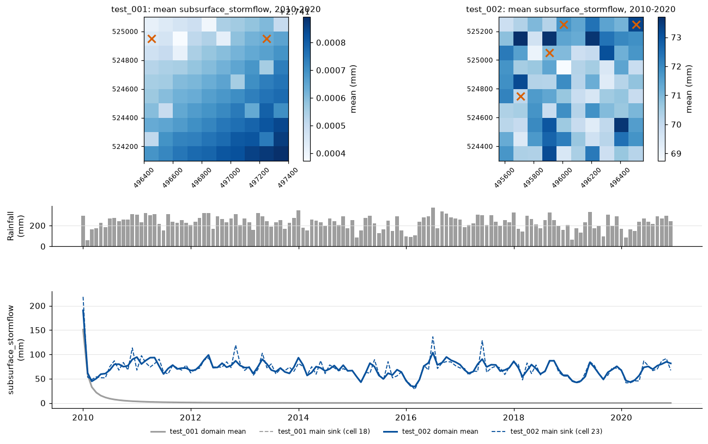

- **What it shows:** 718-946 mm per year (about 31 % of rainfall), every cell and
  every year, peaking a month after wet months (correlation 0.74 at a one-month
  lag). test_001 drained the initial subsoil water once and stopped.
- **Problem:** it is the largest local runoff term and almost all of the model's
  quickflow (quickflow 963 mm per year, of which surface runoff is 37 mm). Total
  quickflow matches VJR but is 40 % below PF.
- **Possible cause:** the subsoil drains to groundwater slowly (low subsoil Ksat)
  and `stormflow_coefficient` (0.05 per day) takes much of the rest laterally; how
  water is split between stormflow and groundwater depends on these two values and
  on bypass flow. *Calibration:* fit `stormflow_coefficient` to observed quickflow
  and storm-event runoff coefficients (point 4), after bypass flow.

## 4. Groundwater

Bypass flow and subsoil drainage recharge the upper store, which releases subsurface flow and percolates to the lower store; the lower store releases baseflow and loses water to deep groundwater.

### Groundwater stores

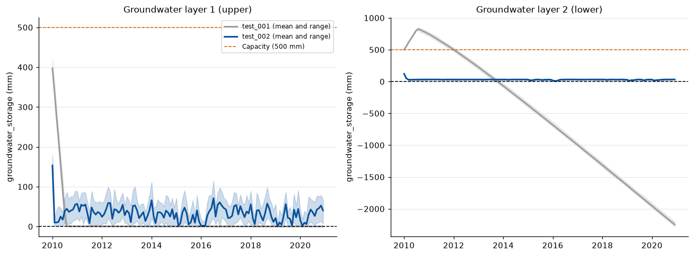

*test_001: the upper store empties in six months, the lower store rises to
850 mm, then falls linearly to -2 248 mm. test_002: both stores drain within the
first month and then stay between 0 and 180 mm (upper) and 0.6 and 122 mm
(lower), rising and falling with rainfall.*

- **What it shows:** no store goes negative (65 % of test_001 lower-store values
  were negative; none in test_002). The upper store fills in wet months and
  empties in some cells in dry months; the lower store settles at about 29 mm.
- **Problem:** the lower store hardly varies. Its level is close to the 34 mm at
  which baseflow plus the 1 mm per day loss balance the 2.7 mm per day maximum
  percolation (20 days x (2.7 - 1.0) mm per day), so it behaves as a fixed outflow
  rather than a store.
- **Possible cause:** `max_percolation_rate_uzlz` and `groundwater_loss` are of the
  same order as the recharge, so they, not the recharge, decide the lower store's
  level. *Calibration:* fit both to observed baseflow and its dry-season recession
  (point 3).

### subsurface_flow

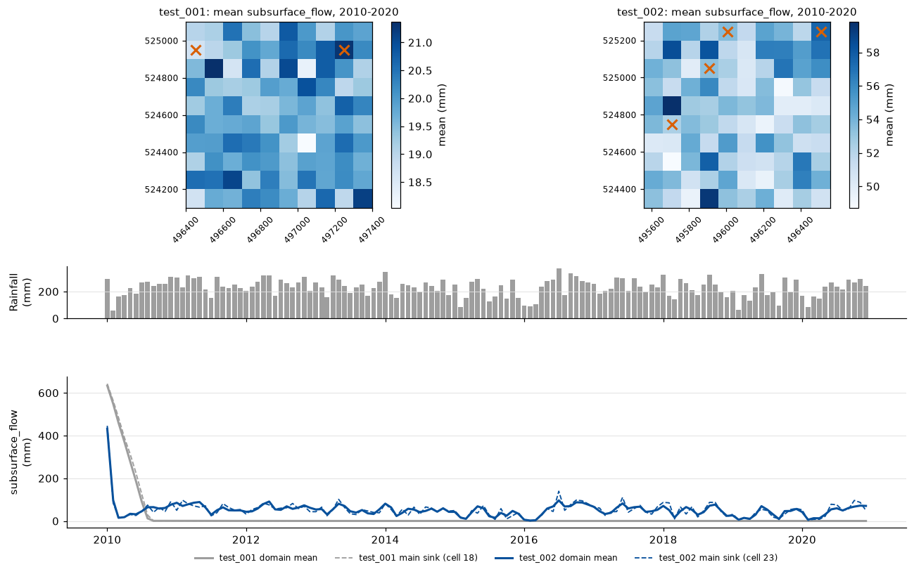

- **What it shows:** 999 mm in 2010 (initial store draining), then 401-765 mm per
  year, lagging rainfall by about a month (correlation 0.72 at a one-month lag).
  test_001 was 2 589 mm in 2010 and about 2 mm per year afterwards.
- **Problem:** it is fed almost entirely by bypass flow, so its size reflects the
  bypass partition rather than drainage through the soil.
- **Possible cause:** see *bypass_flow*. *Calibration:* follows from
  `bypass_flow_coefficient` (point 2).

### baseflow

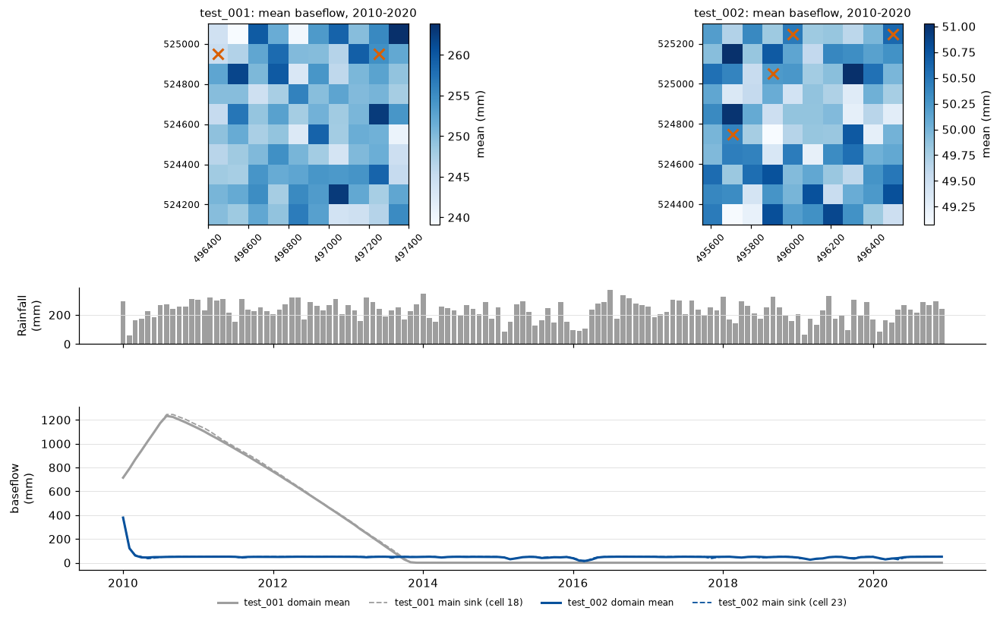

- **What it shows:** 995 mm in 2010 (initial store draining), then 490-601 mm per
  year (about 20 % of rainfall), lowest in the dry years 2015, 2016 and 2019 and
  lagging rainfall by one to two months (correlation 0.52 and 0.51). No cell is
  ever zero. test_001 was 12 603 mm in 2010 and zero from 2014.
- **Problem:** the lower store's outflow sits near a ceiling, so it barely responds
  to recharge, and slow flow overall is too large a share of runoff. With both
  stores counted as baseflow, the baseflow index is 0.58 against 0.43 at PF and VJR
  (Lyne-Hollick) [7] and 0.42-0.68 by Hewlett-Hibbert separation [6]; baseflow is
  1 312-1 335 mm per year against 1 175 (PF) and 715 (VJR).
- **Possible cause:** the lower store is fed at most 2.7 mm per day
  (`max_percolation_rate_uzlz`) and loses 1 mm per day to `groundwater_loss`, so its
  outflow cannot exceed about 1.7 mm per day (about 620 mm per year); the large
  bypass flow keeps the upper store's outflow high. *Calibration:* fit the
  percolation rate and loss to observed baseflow (point 3), after bypass flow.

### groundwater_loss

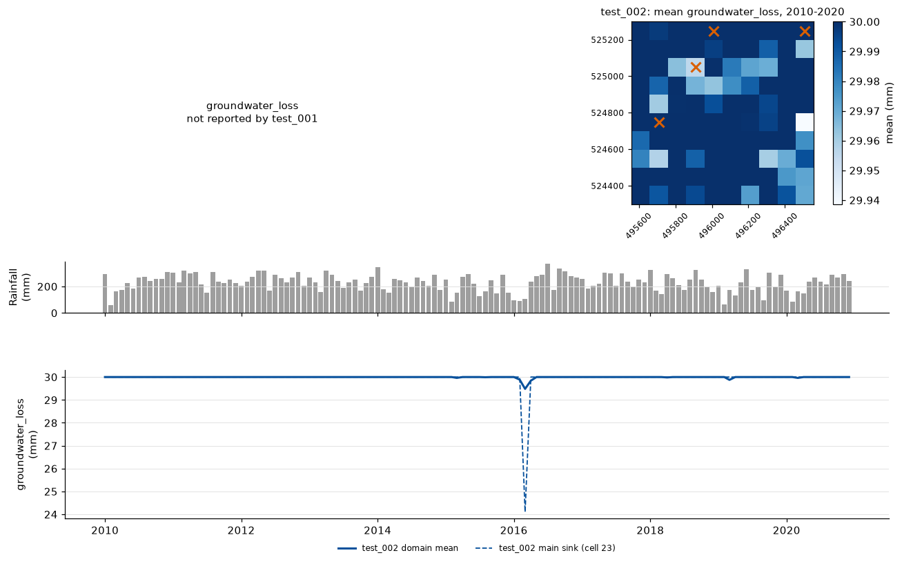

- **What it shows:** 360 mm per year (1 mm per day x 30 days x 12 steps) in almost
  every cell and year, slightly less in a few cells in dry months when the lower
  store is nearly empty. It never exceeds the water in the store (test_001 removed
  it even from an empty store).
- **Problem:** it removes 13 % of rainfall from the site every year as a fixed
  amount, set by a parameter rather than by a process.
- **Possible cause:** the 1 mm per day default has not been checked against
  measured deep drainage or inter-catchment groundwater flow for this site.
  *Calibration:* calibrate with the percolation rate (point 3).

## 5. Routing and outlets

Surface and subsurface runoff are routed downslope to the sinks, where total runoff is converted to river discharge and can be compared with gauged streams.

### Drainage network and outlets

- **What it shows:** routed runoff is reproduced exactly with each cell counted
  once (largest relative difference 4e-16), the sink shares add up to 1.000, and
  outlet runoff over the grid equals local runoff.
- **Problem:** none; fixed (in test_001 each sink counted its own runoff twice and
  the shares added up to 1.020).

### surface_runoff_routed_plus_local

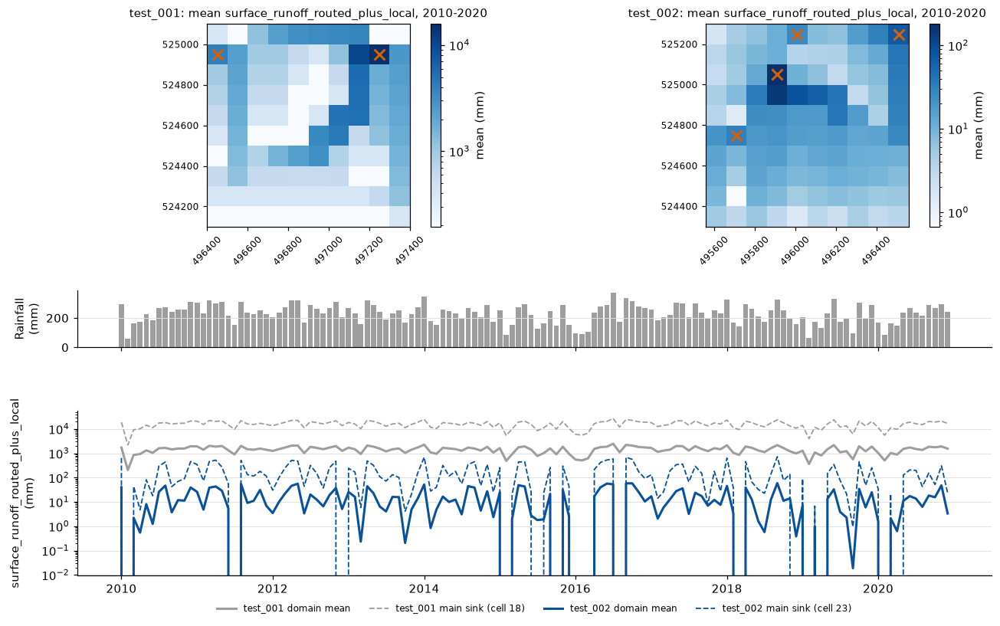

- **What it shows:** test_002 averages 180 mm per month at the main sink
  (cell 23, 54 cells draining in); 65 % of cell-months are zero because local
  surface runoff is now rare. The four sinks receive 58, 24, 10 and 8 % of the
  site's surface runoff, which adds up to 100 %.
- **Problem:** none; routing conserves water and sinks are no longer counted
  twice.

### subsurface_runoff_routed_plus_local

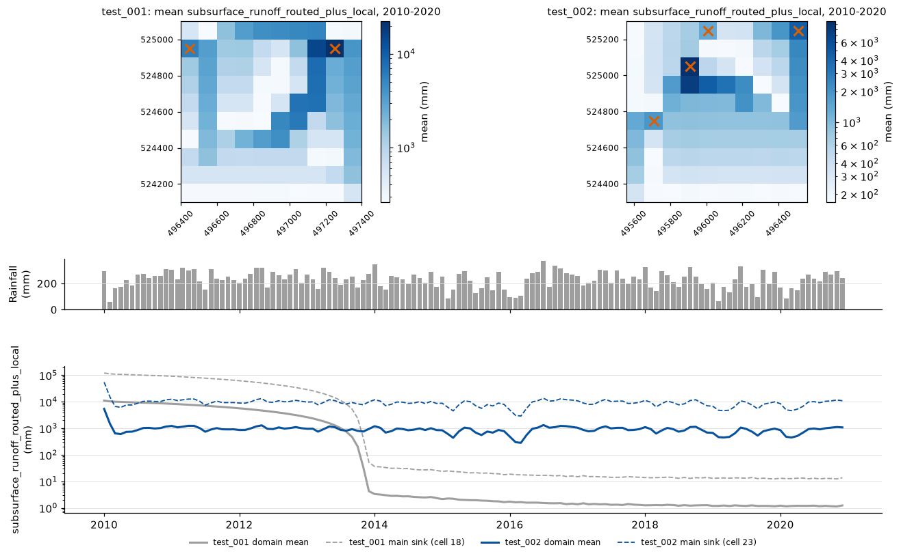

- **What it shows:** domain mean 8 662-12 427 mm per year from 2011 (sums of
  upstream depths), steady through the run and lagging rainfall. In test_001 it
  fell from 115 142 mm in 2010 to about 14 mm per year as created baseflow ran out.
- **Problem:** it carries 98 % of the site's runoff (stormflow, subsurface flow and
  baseflow).
- **Possible cause:** surface runoff is low and bypass and stormflow are large (see
  above). *Calibration:* follows from points 2, 4 and 5.

### total_runoff

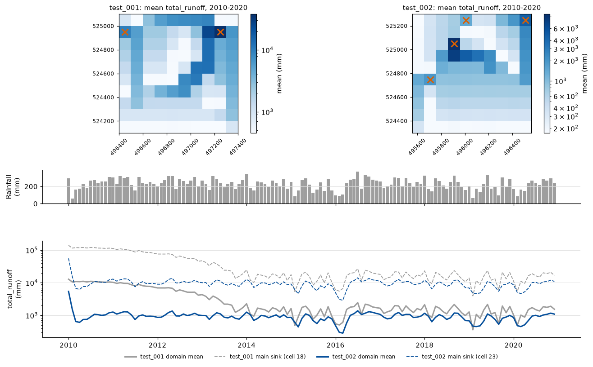

- **What it shows:** domain mean 8 788-12 687 mm per year from 2011 with no trend;
  at the outlets it equals local runoff of 2 126 mm per year over the grid (77 %
  of rainfall). Routed values are sums of upstream cell depths; outlet totals
  divided by the number of cells draining in give a depth that can be compared
  with rainfall and gauged runoff.
- **Problem:** the runoff ratio (0.74-0.75 over the stream records) lies between
  PF (0.77) and VJR (0.62), but only because evapotranspiration is far too low;
  rainfall minus runoff is 797 mm per year at PF and 1 110 mm per year at VJR [7],
  and evapotranspiration at Lambir is 1 323-1 545 mm per year [4], [5].
- **Possible cause:** transpiration of 3 mm per year. *Calibration:* with realistic
  transpiration the runoff ratio will fall, so recheck it against PF and VJR after
  point 1.

### river_discharge_rate

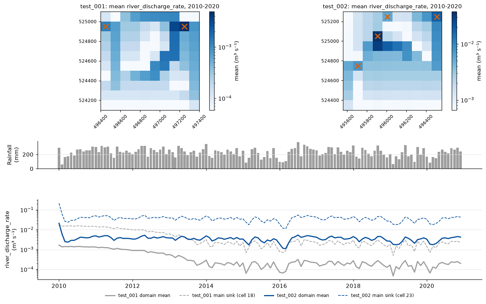

- **What it shows:** 0.038 m³ s⁻¹ at the main sink and 0.068 m³ s⁻¹ for the four
  sinks together (test_001: 0.0061 m³ s⁻¹ at its two sinks, 30 times too small).
  Specific discharge averages 0.072 m³ s⁻¹ km⁻² against 0.087 (PF) and 0.053 (VJR).
- **Problem:** the month-to-month match is weak (r = 0.39 at PF, 0.53 at VJR).
- **Possible cause:** ERA5 rainfall differs from the gauge rainfall month to month
  (r = 0.39 at PF), and the gauged catchments are far from the grid; the monthly
  timing is limited by the forcing as much as by the model. *Calibration:* not a
  parameter issue; needs gauge-corrected rainfall before monthly discharge is used
  as a target.

### Discharge conversion

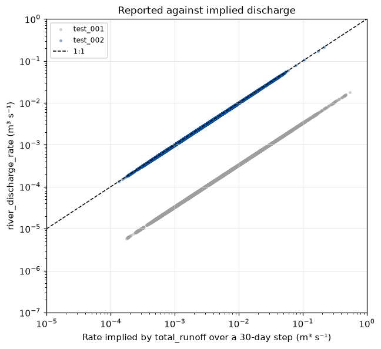

*Reported discharge against the rate implied by total runoff over a 30-day step.
test_001 points lie 30 times below 1:1; test_002 points lie on it (ratio 1.000 in
every cell and month).*

- **What it shows:** the four test_002 sinks together discharge 0.068 m³ s⁻¹ on
  average, which matches the 2 126 mm per year of local runoff generated over the
  1 km² grid.
- **Problem:** none; fixed (test_001 was 30 times too small).

### Comparison with observed streams (PF and VJR)

The validation file compares each sink with the two gauged forest catchments of
Nainar et al. (2018) [7]: PF (primary forest, Danum Valley, 1.7 km²) and VJR
(old-growth forest, SAFE, 3.1 km²). Model values are depths over each sink's
catchment; the ranges cover the four sinks over the PF and VJR record months (the
sinks differ by less than 3 %). Model baseflow is the outflow of both groundwater
stores; observed baseflow is from a Lyne-Hollick filter.

| Mean annual, over the stream record | PF observed | VJR observed | test_002 (sinks) |
| --- | --- | --- | --- |
| Rainfall (mm) | 3 529 (Danum station) | 2 920 (stream gauge) | 3 041-3 045 (ERA5) |
| Total runoff (mm) | 2 740 | 1 680 | 2 271-2 310 |
| Baseflow (mm) | 1 175 | 715 | 1 312-1 335 |
| Quickflow (mm) | 1 565 | 966 | 952-975 |
| Baseflow index | 0.43 | 0.43 | 0.58 |
| Runoff ratio | 0.77 | 0.62 | 0.74-0.75 |
| Rainfall minus runoff, or evapotranspiration (mm) | 797 | 1 110 | 388-390 |

- **What it shows:** total runoff and runoff ratio fall between the two
  catchments. Monthly total runoff correlates with the observed series at r = 0.37
  (PF, 10 months) and 0.53 (VJR, 13 months).
- **Problem:** the runoff is right for the wrong reason: evapotranspiration is a
  third to a half of rainfall minus runoff in either catchment. The baseflow index
  is above both catchments, and quickflow matches VJR but is 40 % below PF.
- **Possible cause:** low transpiration (see *Water balance*), and a split between
  slow and quick flow set by bypass flow and the groundwater parameters. ERA5
  rainfall is 14 % below the PF gauge over its record and correlates with it at
  only r = 0.39 (0.83 at VJR), which limits the monthly match. The gauged
  catchments are 64-94 km from the grid and three to six times larger than the
  largest sink catchment (0.55 km²), so they show the expected magnitude and
  partition rather than a monthly target. *Calibration:* use the annual partition
  (runoff ratio, baseflow index, quickflow) as targets (points 1-4), not individual
  months.

## Comparison with Bornean lowland forest

| Quantity | test_001 | test_002 | Observed | Source |
| --- | --- | --- | --- | --- |
| Rainfall (mm per year) | 2 767 | 2 761 | 2 870, Danum Valley; about 2 740, near Lambir | [6], [5] |
| Canopy interception | 13 %, 355 mm per year | 13 %, 358 mm per year | 11 %, Central Kalimantan; 209 mm per year, Lambir | [1], [4] |
| Transpiration (mm per year) | 3 | 3 | 1 114-1 193, Lambir | [4], [5] |
| Evapotranspiration (mm per year) | 358 | 366 | 1 323-1 545, Lambir; rainfall minus runoff 797 (PF), 1 110 (VJR) | [4], [5], [7] |
| Surface runoff | 84 % of rainfall | 1.3 % of rainfall | 4.6 %, undisturbed plot, Danum Valley | [3] |
| Runoff ratio | not comparable (created water) | 0.74-0.75 | 0.77 (PF), 0.62 (VJR) | [7] |
| Baseflow (mm per year) | 12 603 in 2010; 0 from 2014 | 490-601 (lower store); 1 312-1 335 (both stores, stream record months) | 1 175 (PF), 715 (VJR); 753-1 877 over the 2011-2013 study | [7], [6] |
| Baseflow share of runoff | about 71 % in 2010; 0 from 2014 | 27 % (lower store); 58 % (both stores) | 43 % (PF, VJR, Lyne-Hollick); 42-68 % (Hewlett-Hibbert) | [7], [6] |
| Saturated conductivity (cm per hour) | 12.6, all layers | 12.6 topsoil, 0.126 subsoil | 0.22-2.54, undisturbed plot, Danum Valley | [3] |

The published values for [1]-[6] are the ones used in `flow_report_001`; they
were not re-read for this report. The PF and VJR values [7] come from the cleaned
stream gauge records in `hydrology_validation_data.xlsx`.

### References

1. Asdak, C., Jarvis, P. G. and van Gardingen, P. (1998). *Hydrology and Earth
   System Sciences*, 2, 211-220. <https://hess.copernicus.org/articles/2/211/1998/>
2. Bruijnzeel, L. A. (2004). *Agriculture, Ecosystems and Environment*, 104,
   185-228. <https://doi.org/10.1016/j.agee.2004.01.015>
3. Cleophas, F., Musta, B., How, P. M. and Bidin, K. (2017). *Transactions on
   Science and Technology*, 4(4), 449-459.
   <https://tost.unise.org/pdfs/vol4/no4/4x4x449x459.pdf>
4. Kume, T. et al. (2011). *Agricultural and Forest Meteorology*, 151, 1183-1192.
   <https://www.sciencedirect.com/science/article/abs/pii/S0168192311001183>
5. Kumagai, T. et al. (2005). *Agricultural and Forest Meteorology*, 128, 81-92.
   <https://www.sciencedirect.com/science/article/abs/pii/S0168192304001935>
6. Nainar, A. et al. (2022). *Water*, 14, 3791.
   <https://doi.org/10.3390/w14223791>
7. Nainar, A., Tanaka, N., Bidin, K., Annammala, K. V., Ewers, R. M., Reynolds,
   G. and Walsh, R. P. D. (2018). Hydrological dynamics of tropical streams on a
   gradient of land-use disturbance and recovery: a multi-catchment experiment.
   *Journal of Hydrology*, 566, 581-594.
   <https://doi.org/10.1016/j.jhydrol.2018.09.022>

## Status of the test_001 issues

| test_001 issue | Status in test_002 | Behaviour in test_002 |
| --- | --- | --- |
| Transpiration 3 mm per year | Not fixed | Unchanged (plants module static) |
| Surface runoff 84 % of rainfall | Fixed | 1.3 % of rainfall |
| Vertical flow almost zero; topsoil saturated, subsoil at residual | Fixed | Topsoil drains about 945 mm per year |
| Water lost when soil layers reach their limits | Fixed | Water balance closes every day and month |
| Water created in the groundwater stores; lower store negative | Fixed | Stores stay between 0 and 180 mm |
| Sinks count their own runoff twice | Fixed | Sink shares add up to 100 % |
| River discharge 30 times too small | Fixed | Matches total runoff |

## Calibration or coding?

The remaining issues are mostly calibration. No water-accounting errors remain:
the water balance closes every day, routing conserves water exactly and discharge
matches runoff. Three issues, however, look like code or model-structure problems
and should be settled before calibrating, because calibrated parameters would
otherwise compensate for them.

**Code or structure (check first)**

1. **Transpiration of 3 mm per year.** The largest error in the water balance. It
   is most likely a units or interface issue between the plants and hydrology
   modules rather than a parameter: the hydrology module divides the value it
   receives from the (static) plants module by the number of days in the month.
   The cause has not been confirmed.
2. **Order of the bypass calculation.** Bypass flow is worked out before the
   topsoil's daily drainage capacity is added to infiltration, so even with a
   calibrated coefficient it takes a share of water that would otherwise
   infiltrate. This is a design choice worth reviewing.
3. **No lower bound on matric potential.** It reaches -1.9e14 kPa when the topsoil
   reaches residual moisture. It does not affect the fluxes, but it makes the
   output unusable for comparison with tensiometer data.

**Calibration (parameter values)**

- `bypass_flow_coefficient` (1.0), which sends 53 % of rainfall to groundwater.
- `max_percolation_rate_uzlz` and `groundwater_loss`, which set baseflow and the
  360 mm per year loss.
- `stormflow_coefficient`, saturated hydraulic conductivity (topsoil and subsoil),
  van Genuchten n and the soil retention parameters, which were set to make water
  move rather than fitted to data.
- The initial groundwater state, which causes the 2010 spin-up excess.

**Neither: the rainfall forcing**

- ERA5 rainfall is 14 % below the Danum gauge and matches its monthly pattern
  poorly (r = 0.39), which limits how well monthly runoff can match observations
  whatever the model does.

The suggested order is: check the transpiration units, then decide on the bypass
order and a lower bound for matric potential, then calibrate.

## Calibration points

The water balance closes, so the remaining problems are about how water is split
between paths. The points below are in the order they should be addressed,
because the earlier ones change the water available to the later ones.

| # | What to calibrate | Current value | Target (evidence) | Affects |
| --- | --- | --- | --- | --- |
| 1 | Transpiration from the plants module (check units before calibrating) | 3 mm per year | 1 114-1 193 mm per year [4], [5]; evapotranspiration 797-1 110 mm per year as rainfall minus runoff [7] | Evapotranspiration, runoff ratio, every runoff term |
| 2 | `bypass_flow_coefficient` | 1.0 (63 % of infiltration bypasses) | Bypass a minor share of recharge; baseflow index 0.42-0.68 [6], 0.43 [7] | bypass_flow, subsurface_flow, baseflow |
| 3 | `max_percolation_rate_uzlz` and `groundwater_loss` | 2.7 and 1.0 mm per day (lower store fixed near 30 mm; 360 mm per year lost) | Baseflow 715-1 175 mm per year at VJR and PF [7]; recession of observed baseflow in dry months | baseflow, groundwater_loss, groundwater_storage |
| 4 | `stormflow_coefficient` | 0.05 per day (stormflow 31 % of rainfall) | Quickflow 966 (VJR) to 1 565 (PF) mm per year [7]; storm-event runoff coefficients in the validation file | subsurface_stormflow, quickflow |
| 5 | `saturated_hydraulic_conductivity` (topsoil, subsoil) and `van_genuchten_nonlinearity_parameter` | 3.5e-5 and 3.5e-7 m s⁻¹; n = 2.0 (tuned) | 6.1e-7 to 7.1e-6 m s⁻¹ (0.22-2.54 cm per hour) [3]; surface runoff about 4.6 % of rainfall [3] | vertical_flow, surface_runoff, soil_moisture |
| 6 | Soil retention: `air_entry_potential_inverse`, residual and saturated water content | 0.042 m⁻¹; 0.175 and 0.51 | Topsoil volumetric moisture 0.10-0.28 in old-growth plots (validation file); check the unit of the air-entry parameter | soil_moisture, matric_potential |
| 7 | Initial state: `initial_groundwater_saturation`, `initial_soil_moisture` | 0.9 of 500 mm per store; 0.5 | Start near the stores' settled level (about 30 mm), or leave 2010 out | 2010 outputs (36 % above rainfall) |

Two further points are not parameters but limit how far calibration can go:

- **Rainfall forcing.** ERA5 is 14 % below the Danum station over the PF record
  and matches its monthly pattern poorly (r = 0.39); calibrating monthly runoff
  against PF needs gauge-corrected forcing or a comparison over longer periods.
- **Comparison grid.** Rerun test_002 on the test_001 grid (or test_001 on the new
  grid) so that maps and routed values can be compared cell by cell, and add a
  lower bound to the matric potential (for example -1 500 kPa) so that it can be
  compared with tensiometer data [Newbery and Lingenfelder (2022), listed in the
  validation file as still to extract].
